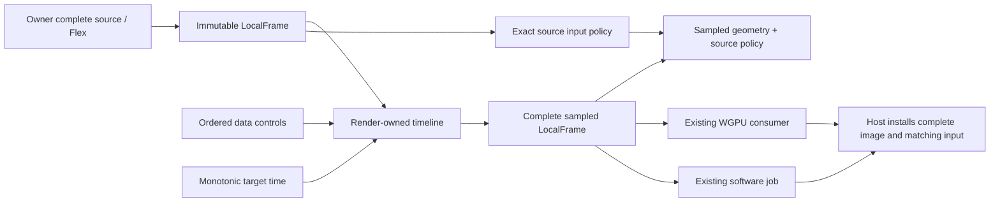

# ADR: Sample render-owned controllers over existing immutable LocalFrames

Status: experimental Rust API, 2026-11-19. Full RFC remains active.

## Context and requirements

The source graph, typed style/tokens and persistent Flex publish complete owned
scenes, but FrameClock alone cannot animate without owner-side property writes.
The RFC requires scene base values, animation controllers and current presentation
to be separate. Ordinary redirect/cancel/remove must be deterministic, sampled
hit geometry must match installed images, and old resource leases must remain
valid on GPU and CPU. Independent native presentation is a distinct requirement.

## Decision

Add one movable AnimationRuntime owning finite data-only translation/opacity
controllers. Admission and source replacement validate private candidates; sample
uses monotonic time and the existing local placement/property resolver. Keep
authored tree/node/generation identity, and allocate a distinct ordered stream for
sampled output. WGPU provenance/ordering and latest-only frame queues track that
stream, while normal node/geometry/resource validation retains source identity.

Retarget captures current value, optionally preserving physical velocity into
analytic springs. Finished values remain owned until explicit Release; unrelated
source changes cannot restore stale UI base values. One controller owns a property.
All unfinished tracks reserve terminal-notice capacity on admission, so visual
sampling can finish during an unavailable UI without losing accepted outcomes.
Cancel/finish/release are ordered controls, never latest-only visual updates.

Projection into UiInputScene requires exact source LocalFrame identity. A separate
optional presentation ID orders samples without pretending source data changed.
Existing routing, capture and delayed generation/path/handler checks are reused.

## Alternatives and costs

Per-tick Signal writes would keep UI responsiveness on the critical path.
Mutating authored revisions from the renderer would make the next UI update stale.
Forging new node IDs per sample would break generations and input ownership.
A separate animation renderer/hit tree would duplicate authoritative semantics.
The selected path shares resources/topology and placement pages, accepting O(N)
geometry validation, an O(N/64) page directory and ordinary opacity/full recovery.
Control/source candidates copy bounded maps/notices; no unsafe allocator or hidden
worker pool is introduced. See [public contract](RETAINED_ANIMATION_RUNTIME.md).

Default PixelSnap output cannot be reinterpreted as authored local placement:
DevicePixels baked translations/scroll and therefore rejects at admission. Its
ordinary UI path remains supported. Translation continues with exact normal
geometry; group opacity keeps existing isolation/effect costs.

## Verification and remaining work

Core controls compare sampled geometry/full CPU pixels with normal transactions,
exercise redirect/velocity/cancel/finish/release/source rebase/removal, bounded
terminal outcomes, bad batches/clocks/geometry, exact input projection and a
separate worker while UI owner is parked. GPU controls cover spatial instance reuse,
skipped-base full resync and real Noto/Flex/opacity/resource output.
See [recorded results](performance/2026-11-19-animation/README.md).

The runnable owner host samples the same API on prepaint. It is HostDrivenPresentation.
Independent native ownership/timing, prepared PendingScene, direct interaction,
platform scheduling, transport acknowledgement and cross-language ABI remain open.
No new FPS, tail-latency or percentage success guarantee follows from this stage.
