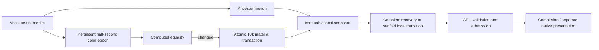

# Burst recovery and desktop / software priorities

Status: measured prototype, full rendering goal active. Modern desktop GPU is
the primary 120 fps target, including effects. CPU fallback prioritizes smooth
interaction and continued complete-frame publication. Neither is qualified yet.

## Workload and finding

An ordinary ancestor animation can have an acceptable median while a material
change stalls the owner for several target intervals. The new sustained fixture
keeps 10,000 leaves and ten isolated shadow groups moving at 60/120 Hz and changes
every leaf's color once per half second. Dense color is persistent state derived
from an absolute source epoch: skipped visual ticks cannot erase the change.
Computed equality suppresses dense fanout between changes. Every run lasts ten
seconds per rate and checks final pixels against a fresh renderer.

On this regression host, original dense-change completion medians are roughly
40 ms. The local publisher reconstructs topology after material changes; its
consumer also reconstructs a resolved packet and clears routing before full GPU
recovery. Packet re-resolution duplicates work: full owner publication already
owns the exact resolved scene.

## Implemented decision

A full `LocalFrame` stores its already resolved immutable paint/property arrays
in the existing `OnceLock`, sharing them through Arcs. Recovery metadata stays
complete: no delta base, full damage, every item in updates, no order/removal
delta. Placement successors start with an empty resolved cache, so they cannot
reuse obsolete geometry. Complete validation, failure/retry and leases remain.
No new application dirty API is introduced.

This avoids reconstructing world geometry, property maps and paint pages twice.
It retains an extra packet header and complete update index earlier, sharing
payload; it does not eliminate O(N) full publication, topology, validation or GPU
recovery. Old snapshots retain their exact scene.

## Next API decisions

Use dependency lifetimes and required work as the starting point: identical
immutable input should not be recomputed; changing one fact should invalidate
only its consumers. Keep a common correct route, reduce redundant traversals and
allocation, and measure the whole frame. Do not add integer/scene-specific public
APIs or further policy switches to chase this fixture. A candidate without stable
benefit can be rejected;120fps is an acceptance target, not permission to weaken
semantics or accumulate special cases.

1. Separate immutable local material content from placement and topology. Color
   must not inherently mean new topology or a missing transition. The next
   internal route needs owned material pages, exact predecessor / structural
   provenance and independent material/spatial frontiers. Resource, command-count,
   ink/effect and structure changes must invalidate their actual dependencies.
   Color-only bounds reuse cannot authorize arbitrary paint changes. Skipped
   bases retain complete recovery.
2. Keep lossless transactions atomic. Ten thousand sinks cannot be partly
   committed to meet a deadline. Admit replaceable visual demand before fanout,
   coalesce obsolete animation samples and preserve business/lifecycle events.
   Measure owner dispatch/retirement: faster GPU raster cannot erase observed
   pre-completion owner spans.
3. Keep normalized layer comparison default off. This same-executable burst
   experiment loses routine CPU time and deadlines with raster translation reuse.
   Prefer persistent validated content/environment facts to O(primitives) proofs
   each frame. Keep original raster for uncertain clips, sampling and resources.
4. Preserve requested GPU effects. Do not meet 120 fps by silently disabling them,
   deepening queues or omitting overdue samples. Report losses, longest unsatisfied
   bursts and age to first on-time recovery, including skipped ticks and losing runs.
5. On CPU, keep input/state/lifecycle owner work runnable while resumable raster
   runs off owner. Retain the previous complete image plus matching hit packet;
   never publish partial isolated groups. Finish active work and coalesce pending
   demand to avoid cancellation starvation. Lower cadence is permitted; decorative
   simplification requires permission. CPU jobs bound operations, not wall-clock
   preemption. Native upload/input, pressure and fractional fidelity remain open.

## Evidence and limits

Two reversed-order original/new pairs reduce dense submission medians 18–26%.
120 Hz p99 improves 39.25 -> 37.47 ms and 40.05 -> 34.29 ms. The first pair's max
worsens 42.37 -> 46.18 ms and losses worsen 105 -> 134; the second's max improves
50.92 -> 41.09 ms and losses improve 91 -> 88. This shows less routine recovery
work, not stable 120 fps or eliminated burst stalls.

Captures retain correlated phase rows, source/owner skips, nineteen dense epochs,
recovery intervals, final pixels, hashes and 250 ms known compiler/renderer process
observations. The sampler cannot prove GPU/OS isolation or power/thermal stability.
Timing covers source through synchronous GPU completion on Ryzen 4800H / GTX1650Ti
Vulkan, not modern desktop, native display or physical input qualification.
See [all evidence](performance/2026-11-13-burst-recovery/README.md).

Next priority is material/placement transition continuity, then visible pipelined
60/120 Hz burst/resize/resource/cold-cache validation on modern desktop hardware,
alongside native CPU fallback responsiveness. The overall goal remains active.
