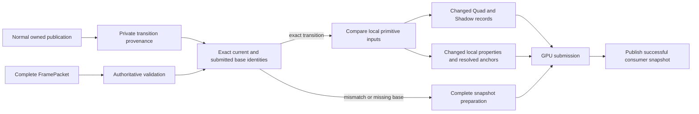

# ADR: Reuse local primitive inputs against a proven submitted base

Status: implemented; measurements and validation are recorded in the
[consumer-routing evidence](performance/2026-11-12-consumer-routing/README.md).

## Context and requirements

Owned page publication reduced 10,000-descendant translation publication work,
but submission still took about 9.6 ms on the recorded Vulkan host. Every
resolved descendant entered spatial BTree lookups and Quad/Shadow preparation,
even when only an ancestor property changed. GPU arena equality prevented writes
but did not remove CPU reconstruction and map lookups.

Reuse requires the exact state that was successfully submitted. Validation's
snapshot is insufficient: it can advance before a stale or conflicting packet
is rejected. Public revision numbers do not prove delta completeness, either.
The normal publisher, missing-base recovery, mutable public packets, deep
anchors, topology edits, resources and multi-frame lifetimes must remain correct.

## Decision

Keep a separate renderer snapshot of the most recently submitted immutable
paint/property roots, tree/revision and bounded spatial depths. Only publish it
after GPU submission succeeds. Reject a different authoritative root at the
same submitted tree/revision before the equal-frame shortcut.

The producer seals `PaintUpdates` with private provenance for the current and
base tree/revision, paint/property root identities, removal/order Arc identities
and damage value. Paint/property references are Weak: old roots' payloads are
not kept alive by a provenance chain. Public delta index mutation clears the
proof; replacing or modifying any attested root/header invalidates it. Both
normal selective publishers and forced full extraction seal transitions.

A claimed consecutive base without valid provenance forces complete snapshot
resynchronization, retirement from the authoritative live set and full redraw
in both cached and original preparation modes. Unknown deltas remain supported
as input; they cannot use incremental application. Existing malformed-packet
validation and stale-frame rejection still run first.

For a proven transition with stable item positions, compare only delta items to
the actual submitted items. Quad inputs are size, fill material and commands.
Shadow inputs are size, resolved radius and shadow list, independently of Quad
material/border changes. Shared placement excludes resolved world origin/clip
from these local geometry inputs. World-instance mode includes origin/clip.
Spatial records update on local state changes and on resolved origin/clip
changes at root/every-32-node anchors. Image/glyph updates retain their existing
paths. Stable depth arrays are shared; reparenting rebuilds all spatial metadata.
Count/order/identity changes fall back to complete delta preparation.

`set_cached_primitive_routing_enabled(false)` preserves the original consumer
preparation as an A/B control. Changing it forces resynchronization; reset keeps
the option and drops cached state. It does not change shader ABI, GPU allocation,
upload comparison, composition or completion rules.

## Alternatives, costs and limits

Caller-supplied dirty flags cannot establish completeness. Revision-only cache
keys and validation-cache snapshots can skip required updates. Independently
diffing every complete snapshot would preserve arbitrary incremental packets
but reintroduce a scene scan on sparse updates. Private producer provenance
allows the existing complete-packet contract to supply a conservative fallback.

The cache holds one current pair of roots plus one depth byte per paint item,
and uses temporary routing entries for changed input classes. It shares existing
resource payloads. Provenance retains small Weak allocation headers, but no old
paint/property contents. Comparing a dense resolved subtree is still linear;
unshared command/shadow lists may require value comparison.

This does not remove publication extraction, page-directory maintenance,
composition bounds/topology checks, backend prefix validation/property ancestry
scans or full root raster work. It does not establish whole-application frame
rate, native surface presentation, general affine properties, arbitrary clips,
filters, cross-platform behavior or completion of the full RFC.

## Validation

Exercise exact normal provenance across selective/copy/full publication; header,
root, removal/order/damage and delta mutation; Weak payload release; bounded
deep anchors; independent size/material/radius/shadow classification; valid
retries after rejected equal-revision scenes. Hardware compares the same
packets through both consumer modes with shared/world placement, mixed
Quad/Shadow/image/glyph content, scaled fractional clipping, opacity, resize,
reparenting, skipped frames, missing deltas/removals, slot reuse and device reset.
Retain the full previous hardware suite and normal gallery checks.

Measure commit/publication/submission separately and wait for GPU completion
per frame. Both A/B sides use owned publication, shared GPU placement, private
provenance and full root redraw. Include dense ancestor translation and sparse
material updates, cold/warm hit-index cases, alternating order, raw samples,
work counters, losing cases and source manifests.
