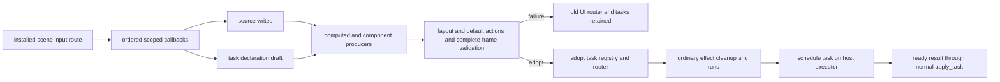

# ADR: Event-scoped task declarations join the owner transaction

Status: experimental implementation, 2026-11-19. Complete RFC remains active.

## Problem and decision

Components could start short-lived UI tasks while constructing output, but ordinary
event callbacks had only source writes and after_commit business actions. A button
starting a preview/query would otherwise have to update owner task state in a
second transaction, with ambiguous rollback/retirement and capacity behavior.

Add start_task/task/cancel_task to EventContext. They implicitly use the registered
handler's logical scope, including ancestor callbacks; the event's target does
not determine task ownership. No arbitrary foreign scope or mutable render tree
is exposed. Source writes and task declarations remain one synchronous candidate.
The shared UiTaskPool and UiTask lifecycle contracts remain the only admission and
result algorithms.

All accepted callbacks from one routed result share an EventTasks draft in order.
A later callback reads prior declarations/cancellations. The draft is staged into
the ordinary LogicalEdit before component/layout producers run, so producer task
changes and final scope retirement use the same resulting registry. Callbacks
never launch work synchronously; failed handler/default/layout/frame validation
drops declarations and permits. A task declared in a scope retired by that event's
source-driven producer never launches. Failed cancellation/replacement preserves
old live work. Busy may set a loading source in the same candidate.

Both handle_input/process_input_effects and standalone dispatch_event use this
mechanism. Standalone dispatch still does not own propagation/default lists;
prevent_default remains unsupported there. Stale/foreign events are rejected
before callbacks and therefore before task declarations.

After full adoption, router identity adopts as before, ordinary cleanup/effects
run, then task launch closures schedule work; after_commit event business actions
follow the existing owner-input return path. These are not externally atomic
effects. A post-commit panic cannot undo adopted UI/tasks, and skipped launch
closures terminate as Cancelled. Application launch callbacks must only schedule,
not synchronously perform IO/CPU or block later business actions.

## Costs and alternatives

The task registry map becomes Rc-shared copy-on-write. Creating an event draft
shares the map and pool with O(1) reference-count operations; actual first task
mutation clones the sparse map and entry Rc handles. Read-only events do not
clone all task entries. A changing callback can still pay O(task entries), plus
normal input graph/source/producer/candidate/layout costs. No performance gain
claim or new per-render-node field, source schema, GPU format or Taffy change.

after_commit could schedule unowned work, but cannot make replacement/cancel part
of the same transaction. A separate event queue/runtime would duplicate scope,
generation and capacity rules. EventContext now reuses their common task registry
construction helpers instead.

## Limits

No automatic task-result callback or implicit source setter crosses threads.
Owner waits UiTask::ready and applies the complete result explicitly. Input is
still serialized on the owner and arbitrary callbacks cannot be preempted. This
does not add async event handlers, task priority, byte quotas, KeepAlive activation,
automatic hooks, DOM capture/default compatibility or independent presentation.
See [task contract](RETAINED_UI_TASKS.md),
[input transaction](RETAINED_INPUT_PROCESSING.md) and
[verification](performance/2026-11-19-event-tasks/README.md).
