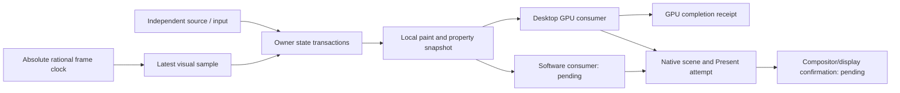

# ADR: Desktop frame deadlines and responsive software rendering

Status: active implementation; scheduling and publication optimizations exist.
An experimental local-first snapshot now feeds the normal GPU gallery. The CPU
renderer, native sustained presentation and complete local hit/damage/cache
design remain open. This decision does not close the RFC acceptance goal.

## Requirements

The primary target is modern desktop GPUs at 120 Hz, with an 8.333 ms frame
interval, including decorative effects. Avoiding burst stalls takes priority
over a favorable average. Report p50/p95/p99/max, missed deadlines, obsolete
visual samples and consecutive unsatisfied target ticks. Software rendering
prioritizes responsiveness, retaining layout, clipping, group opacity, text,
hit geometry, state transactions and lifecycle semantics.

This host's Ryzen 7 4800H / GTX 1650 Ti is a regression baseline, not a modern
desktop GPU qualification machine. Native display timing and GPU-completed
offscreen timing are distinct evidence.

## Decisions affecting framework APIs

1. Keep state transaction/event ordering separate from visual sampling. A host
   may skip obsolete animation samples, never arbitrary business commands or
   resource/lifecycle operations. `FrameClock` has absolute rational deadlines
   and reports skipped visual samples; it creates no polling timer or worker.
   Existing `UpdateSender` is explicitly last-value delivery and is exercised
   with a real independent OS producer and owner waker in sustained tests.
2. Bound visual pending work before expensive packet construction. The existing
   one-packet `FrameQueue` only bounds already-built output; it cannot undo CPU
   work spent producing superseded packets. Keep GPU in-flight limits and
   completion-safe resource ownership independent of animation cadence.
3. Avoid making fully resolved per-descendant world geometry the permanent
   primary API. Today's `PaintItems::get`/index return `&PaintItem` and every
   item owns world coordinates. Therefore moving one ancestor still publishes
   O(N) descendant geometry even when GPU upload is 96 bytes. A subsequent
   local-first snapshot must expose explicit `resolve_geometry(node)` and
   consistent hit-test/damage traversal, with shared immutable local chunks and
   property ancestry. Preserve old snapshots and complete resync. The new
   experimental `LocalFrame` now implements publication and a direct GPU
   spatial consumer with those explicit resolution APIs. Damage remains full,
   hit traversal linear, and opacity/layout/material/skipped-base transitions
   recover through full resolution. See the [local snapshot decision](ADR_RETAINED_LOCAL_SNAPSHOT.md).
4. Retain the current packet contract during measured optimizations: reuse
   owned local payloads and ordered f32 geometry operations for property-only
   updates; aggregate sparse property edits across disjoint subtrees; rebuild
   dense persistent maps once rather than repeatedly copying AVL paths. Keep
   `SelectiveReextract` as a same-runtime baseline. Hash lookup tables do not
   define paint order; explicit preorder and ordered property maps still do.
5. Separate requested rendering preference from actual backend capabilities.
   Experimental `RenderPreference`/`SoftwareEffects` describe intent only;
   they are not a capability claim and no software renderer consumes them yet.
   Software may omit decorative box shadows only with explicit application
   permission. It must not approximate semantic group opacity, clipping, text
   content or event geometry. A real CPU raster path and fidelity/performance
   tests are required before calling software rendering supported. WGPU
   software adapters and GPU framebuffer readback do not establish that path.
6. A native Present attempt has its own receipt: window-local sequence,
   device epoch, monotonic call start/return, native status and normal-queue
   acceptance. Occlusion is a non-error status but is not queued display work.
   Failed/skipped draws clear old attempts; recovery clears feedback and
   advances epoch. Unsupported platforms return `None`. A Present-return
   timestamp is never named display completion or input-to-photon latency.

## Alternatives and consequences

Using average FPS hides long stalls. Sleeping relative to completed work hides
missed arrivals and accumulates drift. The sustained harness instead uses an
independent absolute-clock producer and reports source skips/coalescing/misses.
Synchronous per-frame GPU waits provide a conservative completion scope and
must be complemented by pipelined throughput and visible presentation tests.

Making the GPU faster alone cannot remove CPU packet publication or owner
scheduling stalls. Implicitly lowering all effect quality risks semantic
differences. Increasing queue depth can improve throughput but worsens input
age and memory pressure; queue bounds, explicit simplification and local-space
composition are preferred architectural controls.

The property-only resolver still clones resolved items and scans changed
subtrees. Dense rebuilding can copy unchanged map entries; it is selected only
above 64 real edits and above a quarter of existing entries. This is a measured
heuristic, not a universal threshold. Rerun on modern desktop hardware before
adopting performance claims or tuning defaults.

The local snapshot route now uses indexed immutable placement pages rather
than the resolved resolver's AVL maps. Full backend spatial validation also
uses a contiguous projected mirror, preserving all checks. The
[dense-page evidence](performance/2026-11-12-dense-pages/README.md) compares exact
previous/current binaries with unchanged layer policy. These changes reduce
dense CPU cost but do not remove owner transaction work, full validation,
driver/completion waits or the effect-layer raster/cache design limitations.

The [compact transport evidence](performance/2026-11-12-compact-transport/README.md)
keeps spatial transport private, removes paint/resource clones and sorts touched
dirty-bit words for GPU ranges. Source-local ordered memberships remain the
dispatch authority when exact binding lookup uses a hash table. Dense submit
medians improve 16–19%; commit/publication regress and total gains are small.
Sustained independent/effects p99 remains about 39 ms at 120 Hz. No application
API should promise frame deadlines from reduced upload volume alone. Dense
state preparation, preconstruction admission and local-space effect content
identity remain necessary, independently of software backend implementation.

## Remaining acceptance

- Local-first indexed damage/hit performance and general incremental updates;
  affine/complex clip support. The experimental snapshot's correctness path
  currently uses full damage and linear hit traversal.
- Local-space layer cache keys/placement so ancestor movement can retain
  unchanged effect raster content instead of rerasterizing each layer.
- Native visible 60/120 Hz sustained source-to-present qualification, accurate
  per-scene receipt correlation, refresh/occlusion information and a supported
  compositor/display observation path. Physical input latency is separate.
- Pipelined measurements, larger pixel extents, text/images, resize/resource
  churn and cold cache/allocator/device-recovery spikes.
- Real software renderer, explicit capability negotiation, progressive work
  budgets and software responsiveness/fidelity acceptance.
- Modern desktop hardware runs, multiple independent runs and idle/energy data.

References: [progress](RETAINED_IMPLEMENTATION_PROGRESS.md),
[GPU placement](ADR_RETAINED_SPATIAL_GPU.md),
[native surface](ADR_RETAINED_NATIVE_SURFACE.md).
