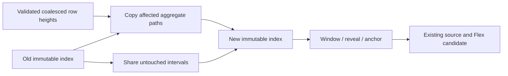

# ADR: Share immutable height intervals across virtual-list revisions

Status: experimental internal implementation, 2026-11-19. Public API unchanged;
the complete rendering/Flex RFC remains active.

## Problem and decision

Mounted-row measurement bounded row construction, but changing seven estimates
still rebuilt the whole N-height prefix table on the UI owner. Immutable source
and in-flight frame snapshots prohibit in-place mutation. Replace the flat table
with a persistent balanced aggregate tree, shared by declared and measured lists.
Window selection, reveal and keyed rebase use the same index.

Each interval owns count and f64 sum. Uniform ranges are implicit count/height;
nonuniform leaves own at most64 exact f32 heights and local f64 prefixes.
Branches split at count/2. Sorted unique edits traverse shared ancestors once,
copy only affected leaves/paths, and share untouched Arc intervals. All-uniform
siblings collapse; reverting estimates can return to the O(1) fixed form.
Canonical splitting/collapse permits structural equality, using pointer equality
to skip shared branches. Same-value edits return the original snapshot.

Fixed lists remain count/height O(1). First sparse edits to100,000 fixed rows do
not materialize100,000 heights. Variable construction is O(N), temporarily holds
the incoming height vector, and uses O(N) storage in the worst case. Variable
height/edge/window/reveal/anchor queries are O(log N), with bounded leaf work;
total is O(1). Coalescing K inputs uses O(K log K) ordered-map work and sparse
lookup/update is bounded by O(K log N + changed_leaves*64), without a flat
directory copy. Dense edits can still touch the entire index. Dropping a large
unshared old tree can cost O(N); retaining revisions retains their unique paths.

The public VirtualListMetrics/Items::with_heights signatures and positive finite
validation remain. Invalid candidates leave all old snapshots usable. Height-only
edits preserve row factory and key index identity. Source adoption, ordinary
Flex, clipping, scroll policies, CPU/GPU frames and lifecycle remain authoritative;
the tree only indexes row extents, not UI geometry.

## Numerical contract and trade-offs

Exact input f32 heights are retained instead of recovering them by subtraction
of distant global prefixes. Aggregate sums use f64 with deterministic balanced
grouping. Addition order differs from a sequential prefix build, so extreme
range/precision combinations may round differently. Logical layout and scroll
outputs remain f32; this is not an arbitrary-precision coordinate contract.
Fractional common row heights, exact boundaries on both sides of leaf/branch
splits, sparse/dense revisions and fresh-build equality are independently checked.
The constructor keeps positive-progress and finite-total validation, and changed
totals beyond f32 range reject. No special algorithms for particular scenes.

A mutable Fenwick tree would need an O(N) clone for immutable revisions. A flat
array of shared pages would still copy a page directory and rewrite suffix sums.
The aggregate tree removes suffix work while keeping normal owned snapshots.
Its costs are more pointers/refcounts/metadata and slower queries compared with
a contiguous prefix array. Small lists with a large fraction of changed rows can
be slower. Keep these controls visible instead of claiming universal speedup or
adding unmeasured heuristic thresholds. Key insertion/deletion/reordering still
builds a new dataset/index; an incremental key/order protocol is separate work.

## Verification and remaining scope

Independent former flat-prefix reference checks windows at preceding/exact/next
f32 positions, empty/zero-height viewport,64-row split boundaries, fractional
extents and successive sparse/dense edits. Structural controls inspect Arc
sharing over100,000 nonuniform rows and first sparse updates of implicit fixed
ranges; old snapshots and a distant keyed anchor remain intact without payload
calls. Existing measurement failure rollback/host installation and real-text
full Flex CPU/GPU controls continue to exercise adoption.

The release benchmark compares changed snapshots and complete window results
against the previous prefix algorithm, with alternating order and warmup. It
isolates metric work: no source candidate, row mount, Taffy clone, raster or
presentation is timed. See [measurements and reproduction](performance/2026-11-19-height-index/README.md).
More granular measurement invalidation, private Taffy-tree copying, key/order
updates, arbitrary user callbacks, memory quotas and independent native
presentation remain open. No sustained60/120Hz or statistical99% claim follows.
