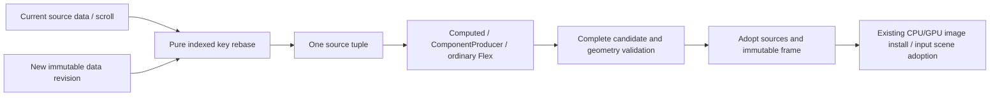

# ADR: Keyed list revisions preserve current reading position atomically

Status: experimental explicit Rust API, 2026-11-19. Full RFC remains active.

## Problem and decision

Keeping a numerical scroll offset while prepending/deleting rows or changing
declared heights moves the content a user is reading. Following every append
also pulls a reader away from older messages. Preserve a stable row and its
pixel position using the current source transaction. Keep ordinary Flex,
component lifecycle, immutable frames and host input-scene adoption unchanged.

Add `VirtualListItems::keyed(metrics,keys,row)` as an opt-in immutable dataset.
Construction validates key count and global uniqueness without invoking payload
factories. An ordered vector and BTreeMap inverse index are shared by clones;
indexing adds O(N) metadata and O(N log N) inverse-index build work. The existing unindexed lazy constructor
remains useful when no anchor is needed. Keyed factories return only Props; the
index supplies the same stable key used by component reconciliation.

`items.rebase(new,offset,old_viewport,new_viewport,policy)` is pure. It reads no
payload, layout, mutable host or previously queued frame. Policies are:

- KeepOffset: retain the requested numerical offset within new bounds; no key
  index is needed.
- KeepVisible: keep the first intersecting old key at the same pixel position.
  A shortened anchor clamps its inset so that key remains intersecting where
  representable. If removed, prefer the first following surviving old key, then
  preceding; preserve that candidate's old screen coordinate where bounds allow.
  No remaining key or a zero-height old viewport falls back to used offset.
- FollowEnd: if the old effective position is within a finite nonnegative
  tolerance of the end, follow the new end. Otherwise use KeepVisible. Thus an
  append does not pull a reader who moved away. Empty old content follows the
  new end under this explicit policy.

The result reports offset, chosen key, reason and whether bounds/shortened inset
prevented full preservation. Rebase is vertical and normalizes horizontal offset
to0, matching VirtualList. FollowEnd and KeepVisible require keyed datasets,
including empties. Returned positions inherit existing f32 layout precision.

## Adoption and ownership

`ReactiveTransaction::rebase_virtual_list(items_source,scroll_source,new,... )`
reads both current values, plans and stages both writes using the existing nested
source transaction. A prior wheel or programmatic update therefore wins over
an old background request's captured offset. It does not replay scroll deltas.
Update any viewport source in the same outer transaction if dimensions change.
Pure producers continue to read final values only. ComponentProducer can select
ordinary VirtualList props from this dataset source; no second list runtime is
needed. EventContext forwards this operation into its current input transaction.

Derived readers settle the complete new data/scroll tuple; they do not observe
an intermediate pair. Source/computed/producer/layout/frame failure leaves both
live values, prior component state and complete frame unchanged. A caught error
inside the helper restores partial writes through the nested savepoint, including
when dataset is writable but scroll is derived. Scope/task identities and normal
retirement rules are unchanged; overlapping stable rows keep local state.

The framework cannot infer which business revisions should be accepted. Hosts
still reject stale results using task/Store ownership and choose a data/viewport
transition explicitly. Independent source writers that bypass rebase keep their
normal numerical-offset behavior. No silent scroll source write is added to
layout or rendering.

## Alternatives, costs and limits

A mutable last-frame anchor inside a producer would advance before adoption and
could corrupt rollback. Automatically adjusting every source update would also
hide user scroll intent and impose dataset indexing on all lists. Use explicit
pure planning and ordinary source adoption instead.

Key lookup is O(log N); anchor selection is O(1) for fixed heights or O(log N)
for variable prefixes. If the chosen key was deleted, finding a surviving old
neighbor can scan O(N) keys. This avoids all row factories but is not a bounded
time/byte guarantee. Key index and variable metrics rebuild on data replacement;
incremental data structures remain future profiling work. Keep large immutable
data off the owner where possible, respecting existing Send/owner-local boundaries.

No automatic intrinsic measurement, height-estimate feedback, installed-frame
anchoring across an independently moving renderer, nested-scroll compensation,
sticky headers, all-data navigation/accessibility or independent presentation is
introduced. Policies preserve ordinary vertical declared-extent reading; they
do not promise arbitrary visual identity across business transformations. "99%"
remains figurative common fluid/intuitive UI, without a statistical gate. No new
FPS/tail-latency or sustained60/120Hz claim follows from this stage.

See [list API](RETAINED_VIRTUAL_LIST.md),
[original list decision](ADR_RETAINED_VIRTUAL_LIST.md) and
[verification](performance/2026-11-19-list-anchoring/README.md).
