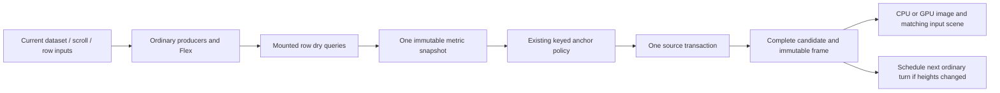

# ADR: Mounted virtual rows use ordinary layout for height feedback

Status: experimental Rust API, 2026-11-19. Full RFC remains active.

Same-day follow-up: [persistent height indexing](ADR_RETAINED_HEIGHT_INDEX.md)
replaces the prefix rebuild described in this stage's initial implementation.
Height-only feedback now copies affected paths/leaves and reuses untouched
intervals; initial variable construction, Taffy cloning and candidate costs remain.

Further follow-up: [compact subtree queries](ADR_RETAINED_SUBTREE_QUERIES.md)
replace the whole live-tree dry clone with the mounted-row subtree union.
Scratch caches are cold; complete-root queries retain the original clone path.

## Problem and decision

A declared-height list cannot naturally accommodate wrapped text, decoded image
dimensions or changing ordinary Flex content. Measuring all rows defeats
virtualization. Add optional `MeasuredVirtualList<C>` over the existing
`VirtualList<C>`, with keyed estimates held in an ordinary writable dataset
Signal and the existing scroll Signal. Row components and renderers need no new
measurement protocol. The allocated viewport remains explicit.

The owner calls `LogicalUi::settle_virtual_list_measurements(max_rows)` after
ordinary source/producer/layout settlement and before image preparation. It
queries only currently mounted row wrappers through the same Taffy/Flex, text,
image and owned content-measure inputs. Content sizing bypasses the wrapper's
old estimated height; the inline size is the committed list box width, with a
definite percentage-width basis and unbounded block space. The list has no
padding, border or reserved scrollbar gutter of its own. Its viewport Props
must still represent the parent's real allocation, as in the declared API.

Queries share one private Taffy clone per list. No dry query publishes geometry
or mutates live layout caches. Public `UiTree::dry_measure_nodes` exposes the
same batched isolated query for other consumers. Empty batches avoid cloning.

## Behavior and adoption

`MeasuredVirtualListProps` contains stable `items` and `scroll` source identities,
viewport, overscan, max_rows, minimum_height and scroll_policy. Defaults match the
declared list, plus a 1px positive floor and KeepVisible. The dataset must use
`VirtualListItems::keyed`; duplicate feedback owners for either dataset or scroll
source reject, including when currently hidden. Remount with a new key to change
source identity. The registry follows existing scope/candidate retirement and
uses Rc/COW storage; failed adoption cannot leave a live registration behind.

`VirtualListMetrics::with_heights` and `VirtualListItems::with_heights` validate
positive finite sparse updates and coalesce duplicate indices to the last value.
Equal results share the existing metrics. Changed heights build one immutable
prefix table while keeping the key index and row factory identity. The helper
does not invoke row payloads; the subsequent normal component reconciliation
still constructs selected payloads as usual.

All measured changes across lists are gathered before any source writes. Budget
overflow, invalid measurement or a failed source/layout/frame candidate preserves
all live datasets, offsets, scopes and the complete prior frame. Successful
feedback uses the existing `rebase_virtual_list` transaction: KeepVisible keeps
the reading key/pixel inset; FollowEnd follows only a reader already near the
current end. A newer wheel/source value is the one read by the transaction.
Normal effects/tasks follow each successfully adopted owner transaction; the
initial estimate and later measurement are separate adopted revisions.

Only one measurement round runs per call. Smaller rows may expose another row,
which is measured on a later ordinary turn. The host must schedule that turn
when changed_rows is nonzero, rather than looping inside one input callback.
OwnerDemo does this before CPU/GPU image construction and retains the existing
complete-image/input-scene installation. Zero-sized or display:none ancestor
lists defer feedback and retain estimates. Same final render revision and source
change counter skip repeated stable measurements; changes to source content or
viewport invalidate the proof. Caches remain hints, not a second layout truth.

## Alternatives and limits

Measuring every row eagerly would make ordinary input proportional to the whole
payload set. A second approximate text/Flex solver could disagree with normal
layout. Writing source state inside a layout producer would introduce hidden
feedback and transactional ambiguity. An unbounded convergence loop can consume
the UI turn. Explicit one-round owner feedback reuses the existing contracts.

This stage adds capability, not a claimed timing/FPS improvement. Prefix rebuild
is O(N) per changed dataset and private Taffy cloning includes all live layout
nodes. Key index reuse avoids rebuilding its inverse for height-only changes.
The global row limit bounds selected query count, not arbitrary user code time
or memory bytes. Mounted rows are remeasured after unrelated render/source
changes too; a finer dependency cache and incremental height index remain open.

Offscreen rows retain estimates, including after width/font changes. Scrollbar
extent can evolve as new rows mount; all-data exact total height cannot be known
without measuring that data. Rows should use natural content-driven height and
pure measurement snapshots; algorithms that derive natural height from the old
estimated allocation can feed back across turns and have no convergence promise.
This is vertical normal-flow height feedback, without sticky headers, horizontal
layout, intrinsic all-data keyboard/accessibility or an independently moving
renderer's installed-frame anchor protocol. Native presentation remains driven
by GPUI callbacks. No statistical 99%, p99 gate or sustained 120Hz claim.

See [public usage](RETAINED_VIRTUAL_LIST.md),
[keyed anchoring](ADR_RETAINED_LIST_ANCHORING.md),
[verification](performance/2026-11-19-list-measurement/README.md).
