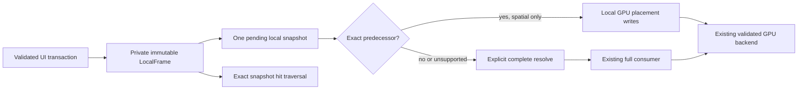

# ADR: Immutable local snapshots before resolved world geometry

Status: implemented experimental GPU route; remaining acceptance stays open.

## Context and requirements

The primary target is a modern desktop GPU at 120 Hz, including effects.
An 8.333 ms interval is a deadline, and p99/max, consecutive misses, source
coalescing and cold/recovery stalls matter alongside throughput. Software
rendering prioritizes interaction responsiveness. No software renderer is
implemented by this change.

The resolved `FramePacket` owns world coordinates for every paint item. Moving
one ancestor therefore rebuilds descendant geometry even when the GPU needs
one 96-byte placement write. Earlier sustained measurements exceeded both
60 Hz and 120 Hz at 10,000 leaves. A faster GPU cannot remove that CPU work.

## Decision

Introduce an experimental `LocalFrame` with private immutable ownership. It
retains shared local payloads, a stable preorder/parent index and a persistent
map of placement overrides. Consecutive property updates publish changed local
placements without rewriting descendants. The normal retained GPU gallery
uses this path; the vector bridge retains the resolved compatibility path.

- `resolve_geometry(node)` returns owned geometry from this snapshot. It
  traverses ancestry and preserves the original ordered f32 operations.
  `resolve()` explicitly materializes and caches the complete compatibility
  packet. Neither promises constant-time work. The existing `published_frame()`
  accessor resolves a newer local snapshot lazily, so diagnostics remain
  current; normal GPU prepaint avoids that accessor.
- The GPU consumer accepts an incremental update only with the exact private
  predecessor, unchanged surface/scale and enabled shared placement/content
  support. It writes changed local records and affected depth-32 anchors.
  Non-anchor preparation uses local data exclusively; anchors resolve world
  geometry to preserve the existing bounded shader traversal.
- The predecessor is weak. Current snapshots retain a baseline payload and
  current persistent overrides, without retaining every prior snapshot.
  GPU submission leases retain frames until completion. An old snapshot can
  render after its mutable owner has been dropped.
- Opacity changes, layout/material/topology/viewport changes, skipped bases,
  consumer switches, reset and incompatible capabilities use complete
  resolution and the existing validated recovery path. No mutable public dirty
  flag grants incremental reuse. Conflicting same-revision resolved content
  remains invalid even across representation switches.
- `LocalFrameQueue` coalesces complete immutable snapshots with one pending
  entry. It avoids implicit resolution. It bounds published work; deferring
  obsolete snapshot construction before publication is still separate work.

## Alternatives and trade-offs

Retaining only the resolved packet preserves reference-returning APIs but
requires descendant CPU publication. Replacing every packet API immediately
would expand compatibility risk before measurement. The experimental local
route allows direct comparison and complete fallback with the existing path.

Local snapshots currently use full damage, linear exact hit traversal and
full-viewport isolated effect layers. The latter avoids stale resolved layer
bounds during ancestor motion but can increase raster cost and texture memory.
The paired benchmark records this difference: it is a comparison of complete
routes, not an isolated publication-only experiment. Tight local-space layer
bounds and placement-independent raster cache keys remain necessary.

Independent updates still require one validated source/sink update and local
placement record per changed node. Immutable maps, temporary vectors, GPU
preflight, order/resource/cache scans and completion collection can still
produce stalls. This change does not establish sublinear arbitrary updates.

## API consequences and remaining work

Keep the fully resolved reference-returning API as a compatibility facility.
Framework consumers should be able to request local immutable data and resolve
world geometry explicitly. Do not expose the current baseline/override layout
as the permanent public chunk-store contract before damage, hit indexing,
general transforms and resource epochs have been qualified.

GPU and CPU consumers should share state/layout/clip/text/event semantics while
negotiating backend capabilities and optional decorative effect budgets.
Software must avoid unbounded render queues and prioritize current interaction;
actual raster implementation and responsiveness/fidelity tests are still open.
Requested preferences alone are not backend support or a measured quality policy.

The next API priorities are deadline-aware host admission before snapshot
construction, separately acknowledged visual samples and lossless commands,
and completion/presentation observations with explicit scope. Keep a single
pending visual sample and bounded in-flight ownership rather than accumulating
work after a late frame. For dense animation, prefer a retained ancestor
property when the semantics permit it; genuine independent changes still need
batch processing and cannot be silently dropped from a state transaction.
Effect raster identity must eventually be independent of layer placement so
moving unchanged content can reuse its raster. CPU work budgets and optional
decorative simplification must not change semantic group opacity or hit geometry.

Remaining acceptance includes local-space effect reuse, dense independent
transactions, indexed local hit/damage queries, pipelined native visible
60/120 Hz, presentation receipt correlation, larger surfaces and resource/cold
spikes, modern desktop hardware and a real CPU renderer. Offscreen synchronous
GPU completion does not prove visible 120 fps or physical input latency.

See [progress](RETAINED_IMPLEMENTATION_PROGRESS.md) and
[frame deadlines](ADR_RETAINED_FRAME_BUDGET.md).
