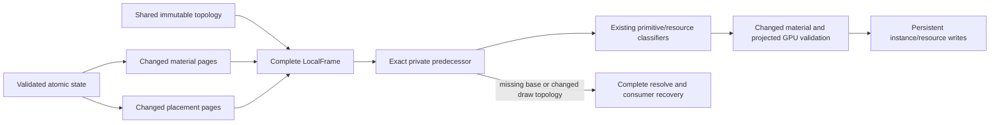

# Independent material, placement and topology lifetimes

Status: implemented prototype; full RFC acceptance remains active.

## Basis

Local material, node placement and render topology have different consumers.
Changing a color, border or shadow parameter does not inherently change parent
links, child order or layout. The previous local publisher treated every paint
change as a complete scene boundary, recomputing world geometry/property maps
and resetting consumer spatial/routing state. Burst captures showed most of a
roughly35ms material frame occurring in owner publication and submission.

Keep one immutable scene, update facts independently, and derive only required
work. There is no new application batch authority, fixture-specific condition,
integer requirement, quality reduction or optimization switch.

## Producer

The local subscriber has a separate generation-checked material journal. Both
resolved and local publishers call the same material refresh routine: commands,
fill color, shadows, images and prepared glyphs depend on content size, not
world position. Changed immutable paint pages are patched with the existing
owned-page implementation. Placement overrides and render preorder are shared.
The local subscriber clears only its journals; resolved publication retains all
unconsumed paint/property changes. A weak owner paint identity detects another
subscriber advancing the owner baseline without keeping that old root alive.

Layout/visibility/structure/viewport changes retain complete publication. Every
snapshot is complete and independently resolvable after owner destruction. Its
compatibility cache starts empty after an incremental material update, so it
cannot expose stale baseline world coordinates. Old snapshots stay immutable.
Final equality suppresses material deltas restored before local publication.

This retains one local journal per owner slot capacity and changed-page payloads.
The resolved subscriber may accumulate dirty membership until it publishes.
Payload changes retain old immutable pages while in-flight/shown snapshots need
them. There is no overall physical-memory bound from this change.

## Consumer

The exact predecessor check runs before cross-snapshot indexed reads. Same
surface/scale and shared spatial/content capabilities are required. The existing
composition topology predicate checks changed commands, image/text presence,
effect reference and shadow count/inset ordering. A changed draw topology falls
back to the full route; material page publication itself remains general.

Adjacent changed material indices share an open-ancestry geometry traversal;
sparse gaps do not force resolving unaffected descendants. Each changed item is
validated, then the existing routing classifiers and primitive/resource builders
produce Quad, Shadow, image and glyph writes. Current inherited clip and resolved
content origins are available for glyph validation. Projected GPU record and
resource validation still runs. No material change alone uploads spatial nodes.

The experimental tight ink index includes both material and placement subtrees,
so changed shadows/visibility/ink cannot reuse obsolete bounds. It disables lazy
translation proof on material frames. Layer raster invalidation still follows
actual instance/resource writes; unchanged painter topology does not mean
unchanged pixels. Queue ordering, completion leases, error/reset behavior and
complete missed-base/device recovery remain intact. Opacity edits still use
complete recovery rather than extending this prototype's proof.

## Evidence and limits

Initial reversed pairs reduce material publication medians13ms ->5–6ms and submit
15ms ->10–11ms;120Hz p99 is about22ms vs35ms. All deadlines still do not pass.
The second pair's longest consecutive unsatisfied interval worsens5 ->6, even
though overall losses and p99 improve. Full raw evidence and final-source runs
are in [the material study](performance/2026-11-13-material-placement/README.md).

Core tests exercise independent multi-frame journals, simultaneous material and
placement edits, old snapshots, resolved subscriber handoff and visibility
recovery. Hardware cases cover fractional scale, nested effects, deep anchors,
color/decorations/shadow parameters, same-size image pixels, text color,
material-only zero spatial upload, skipped material bases, changed draw topology
and reset. Full-suite pixels and the normal reactive example remain required.

No 120fps, native input/display or modern desktop qualification is implied by
this host's source-to-synchronous-GPU-completion data. Remaining dense commit,
geometry/material copies, dependency scans, driver submission, resource pressure
and visible presentation need measurement. The API direction is independent
owned facts and validated transitions, not public algorithm choices. CPU fallback
still prioritizes owner responsiveness and complete output with matching hit
geometry; native integration/fidelity is a separate open stage.

## Follow-up: avoid retaining transient resolved material

Material geometry is now validated/classified/prepared directly in its visitor
lifetime. Only changed image/glyph inputs remain owned for resource batching;
ordinary material updates no longer allocate/clone a full changed-item array.
A late failure poisons the consumer before GPU submit; reset is mandatory and
previous complete pixels stay unchanged. Exact-predecessor wrong-scale glyph
failure/reset controls exercise that boundary at three scales.

Reversed120Hz pairs reduce submit medians13.88/12.61ms ->9.32/8.54ms, but first
60Hz regresses and first120Hz longest unsatisfied interval worsens9 ->14 despite
better p99/max. Retain the general working-set reduction without claiming stable
stall improvement. See [evidence](performance/2026-11-13-material-stream/README.md).

## Follow-up: order indices before building wide material records

The publisher now maps journal membership to immutable topology indices, sorts
those indices once, and refreshes material in that order. Both the owned patch
array and changed-index journal are then ordered by construction. The dirty
journal still defines membership only; ID or insertion order cannot define paint
order. Full recovery and exact predecessor authority are unchanged.

The [ordering study](performance/2026-11-13-publication-order/README.md) retains
synchronous and pipelined reversed pairs. Synchronous publication medians fall
9–15%; pipelined publication improves7/8medians but one60Hz case regresses3.4%.
Completion tails/losses remain mixed and dense owner work remains near20ms.
Keep the structural work reduction without making a deadline or API-policy claim.
This applies to sparse and dense material, without scene-specific conditions.
