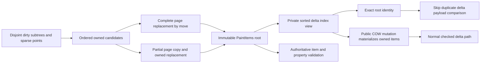

# ADR: Move owned paint pages and share authoritative delta views

Status: implemented for review; [validation and measurements](performance/2026-11-12-page-ownership/README.md) are recorded.

## Context and requirements

The shared-property GPU stage reduced ancestor uploads to 96 bytes but left
complete owner updates expensive. A phase probe on the same Vulkan host measured
about 18.2 ms publication and 11.8 ms submission for 10,000 descendants; commit
itself was about 7 µs. Publication inserted an already ordered extracted subtree
into a BTreeMap, cloned every affected old page, then cloned updated items into
both the new page and an independently owned delta list.

The full RFC still requires immutable snapshots, P0–P5 routing, persistent paint
storage, normal UI integration and measured completed-work benefits. This change
must preserve final preorder, mixed dirty-write precedence, sparse updates,
layout/property output, hit/damage semantics, resource ownership, skipped-frame
resync and multi-frame lifetime. Mutating a public packet must not inherit a
trusted delta identity accidentally.

## Decision

The default selective path accumulates dense subtree candidates contiguously,
uses disjoint ranges plus a sparse point set to suppress duplicate extraction,
and sorts once for publication. Complete changed pages take ownership of new
items. Partial pages clone the old page once, then move changed items into it.
The original BTree candidate map and copying path remain selectable with
`FrameBuildPolicy::SelectiveCopy`; forced `Full` extraction remains separate.

`FramePacket::updates` becomes `Arc<PaintUpdates>`. The default delta is a private
sorted unique index list holding the exact immutable `Arc<PaintItems>` root.
This removes duplicate item/resource-handle copies while retaining complete
ownership independent of the tree. Explicit item lists remain supported. Public
index mutation materializes a separate owned list through COW.

Only an indexed view matching the authoritative root by actual Arc identity can
skip duplicate delta payload comparisons. Constructor invariants are private;
revision numbers and equal data do not establish identity. Authoritative item,
spatial/property, header, removal and order validation remain. A detached root or
mutated delta uses the original checked path, including duplicate detection.

## Alternatives and trade-offs

Keeping only page moves would retain the second full delta payload copy and
comparison. Sharing individual `Arc<PaintItem>` values would add an allocation
and pointer indirection per item. A private page/index view reuses the existing
snapshot representation with one bounded index allocation instead.

Lazy world geometry could avoid descendant extraction but changes hit/damage,
layout and publication contracts substantially. This change reduces duplicate
work within the current complete resolved-snapshot contract; dense extraction,
the page directory and renderer/backend scans remain.

Costs include an index per updated item and one snapshot-root reference. Indexed
access adds a page lookup; mutating a view intentionally clones the complete delta
list. This is an experimental API change: callers requiring a contiguous slice
use `to_vec()`, and explicit construction uses `Arc::new(PaintUpdates::from(...))`.
Iteration, integer indexing, length and COW item mutation remain available.

## Validation and failure modes

Compare owned, original copying and forced full output for dense/sparse/mixed
layout/property/material changes, ordered deltas, damage, warm hit indexes,
images/shadows and retained old snapshots after tree drop. Detached-but-equal
roots must be checked rather than trusted; mutation and duplicate item lists
must reject without poisoning valid retry. Real window clicks and hardware
mixed-primitive/scale/isolation/skip/reuse cases exercise the normal path.

Completed-work A/B keeps the same shared GPU representation, shader and full
root redraw in both modes, including phase measurements and cold/warm hit-index
maintenance. Preserve losing samples and distinguish logical clone/move counts
from allocator/driver memory. Cross-platform/native presentation and remaining
full-goal acceptance are unchanged.

## Measured outcome

The complete regression passes 483 hardware scenarios with 472 byte-exact pixel
comparisons. At 10,000 descendants, the owned path clones 64 old page items and
zero delta payloads instead of 10,002/10,001 respectively. Completed medians
improve about 28.7% with an unused hit index and 25.5% with a maintained warm
index. Single material updates show small pooled regressions at 10,000 nodes;
keep all losing samples and avoid a general small-update performance claim.
Dense extraction and remaining consumer/backend scans still dominate the full
pipeline, which is not yet qualified for sustained 60/120 Hz/native presentation.
