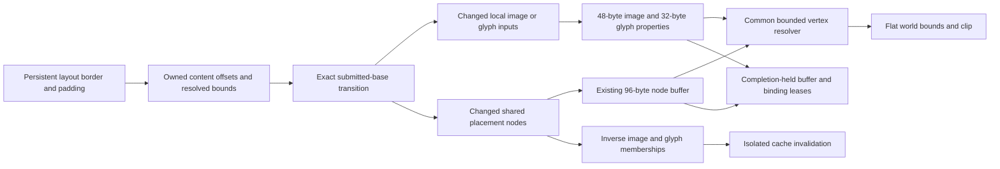

# ADR: Share hierarchical GPU placement with image and glyph draws

Status: implemented; [hardware and timing evidence](performance/2026-11-12-shared-content/README.md).

## Context and requirements

Quad/Shadow already use shared 96-byte placement nodes, but each image and text
draw still stores world origin/clip independently. Moving or clipping an ancestor
rewrites 48 bytes per image and 32 bytes per text node despite unchanged pixels,
masks and local geometry. The complete RFC requires property reuse across all
supported primitive types, correct isolated caches, immutable snapshots and
completion-held resources through normal UI updates.

Content origin is computed as `(border_origin + border) + padding`. Recovering
the offset by subtracting resolved origins, or collapsing border/padding into a
single sum, changes f32 operation order. An equal current world content box does
not prove unchanged local inputs for future ancestor movement.

## Decision

Publish four immutable `PaintItem::content_offsets`: border x/y then padding x/y.
Full and selective publication compare these fields independently of resolved
rectangles. Validation checks finite values and exact agreement with the owned
content origin. Normal producer provenance includes the authoritative item root
as before; detached/mutated snapshots cannot inherit its incremental proof.

Add optional `SpatialContent` to raw image/glyph descriptors. It references a
one-based shared node slot and carries ordered local border/padding components.
None keeps original absolute semantics. Image bounds z/w remain physical size;
shared image x/y and clip inputs are superseded by the shared content origin and
clip. Shared glyph origin/clip are likewise resolved from the node and offsets;
its scale must match the shared spatial scale. A node without a shared clip is
unclipped, subject to the image's own bounds.

Keep image geometry at 48 bytes and glyph properties at 32 bytes. A u32 slot tag
uses reserved metadata space. Shared records reuse the otherwise-absolute
origin/clip coordinates for local offsets. Legacy records keep world values.
CPU mirrors store exact u32 words so reference tags never pass through f32.
Shared images omit unused per-draw viewport dimensions, avoiding record writes
on surface-only resize. Legacy transport remains the control.

Extract one WGSL resolver prefix shared by Quad, Shadow, image and glyph
pipelines. Image/glyph pipelines bind the existing spatial group at index 2.
Vertices resolve the bounded hierarchy, apply ordered content additions and
scale, then pass flat physical bounds/clip to fragments. Glyph rounding remains
the original global-baseline, ties-away-from-zero operation before target-camera
subtraction. Fragments never walk the hierarchy.

For exact normal consecutive frames with shared content enabled, classify local
resource inputs against the actually submitted snapshot. Ancestor-only changes
need no image/glyph descriptors. Resource/color/shape/local inset changes still
update their draws; skipped/untrusted bases, mode changes and reset consume full
snapshots. Original resource-input preparation remains when shared content is
disabled. Older timing controls disable the new content path explicitly.

Each resource cache retains inverse property-to-draw memberships. Preflight
selects affected old shared draws using indexed spatial frontiers or projected
ancestry fallback, plus explicit replacements. Capacity/scale/enable changes
check all retained shared references. Validate actual projected content origins,
physical image edges and glyph baseline extremes, including unmentioned draws.
Deleting/replacing bindings can repair references in the same batch. Memberships
change only during application after every preflight check succeeds.

Affected shared image/glyph IDs invalidate existing isolated raster caches even
with zero resource descriptors. Existing spatial/texture/buffer/page bindings
remain in completion leases. No new GPU allocation class is introduced; reset
recreates the epoch and preserves the configured content option.

`set_shared_content_enabled(false)` selects per-draw world placement while
keeping shared Quad/Shadow placement. Its default is true; effective sharing also
requires shared spatial placement. Switching forces full resync, including equal
revision packets, and does not rebuild unchanged glyph instances or textures.

## Alternatives and costs

Subtracting world rectangles loses original additions. Reading Taffy from the
consumer violates owned snapshot lifetime. Rewriting world properties retains
O(draws) upload calls for ancestor changes. Expanding every GPU record is
unnecessary because shared and absolute modes use different coordinate inputs.

Costs include 16 more logical bytes per PaintItem, inverse memberships and a
bounded vertex walk for image/glyph draws. Affected shared draws require projected
finite-arithmetic validation; old resource-ID, layer/order and lease scans remain.
This does not establish general affine/complex clips, image fit/filter/decoding,
rich/bidi/color text, compaction/global budgets, native presentation or completion
of the complete RFC.

## Verification

Test equal world boxes with different ordered local insets across all publisher
modes. Keep normal-click GPU tests and the previous hardware suite. Compare both
content paths with both publisher/spatial controls and three scales, including
deep anchors, clip/scroll/opacity, resource swaps/removal, layout, reparenting,
missing deltas, mode switches and reset. Add fractional padded content, sampled
CPU-expected image texels, wrapping text, cropped layers, surface-only resize and
old snapshots after producer/font-context drop.

Raw backend tests must reject bad references/offsets/scales and retained-content
overflow caused by ancestor-only writes, including zero descriptor updates.
Check later layer/damage rejection and valid retry, zero-upload ancestor raster
invalidation, and atomic shared/absolute rebinding while disabling/re-enabling
the spatial system. Measure completed normal owner updates on mixed scenes with
the same publisher, Quad/Shadow hierarchy, backend index, full redraw and content;
include translation, clipping and sparse text color rather than assume all
workloads improve.
