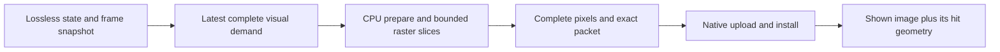

# Experimental cooperative software consumer

Status: implemented experimental CPU raster consumer; native integration and
responsiveness/fidelity acceptance remain open. Overall rendering goal active.

The target is modern desktop GPUs at 120 fps, including effects, with particular
attention to p99/max and consecutive unsatisfied deadlines. The 8.333 ms work
budget includes owner construction, backend/driver submission, completion and
presentation stages as applicable; a fast median or a faster GPU alone is
insufficient. The current Ryzen 4800H / GTX 1650 Ti is a regression host, not
qualification for modern desktop hardware. CPU fallback prioritizes responsiveness
and complete, consistent displayed frames. It may use a lower visual cadence;
semantic state/input/lifecycle transactions remain lossless.

## Decision and implementation

`retained::software::SoftwareJob` consumes an owned, immutable `FramePacket` and
produces CPU pixels without using WGPU or a GPU readback. Construction, stepping,
cancellation/destruction and resource retirement belong on a worker. Hosts choose
work quotas and service input/lifecycle between slices. The implementation is a
32x32 tile interpreter with a separate preparation phase and fixed scratch for
up to 32 nested isolated groups. Each item preparation bounds command/effect
counts; pixel work, group clears/composites and output copies advance resumably.
Every tile finishes in painter order with group isolation before private output
is eligible for publication. No partial transaction or partial image is shown.

The host owns scheduling and presentation. `SoftwareFrame::hit_test` uses the
packet that produced that completed image, rather than whichever tree revision
happened to finish updating most recently. Install a completed frame only after
native upload succeeds; completion alone is not proof the OS displayed it.
The prototype is not yet wired into normal native window paint or input dispatch.

The supported experimental primitives are solid fills, uniform rounded corners
and inside borders, rect clips, immutable RGBA images (nearest texel as in the
current retained GPU image shader), prepared grayscale glyph masks at their
published device scale, and nested isolated opacity. Resolved placement comes
from the owned packet. Fractional raster/clip edge exactness is not fully
qualified; the comparison harness retains differences instead of widening its
one-channel tolerance to hide them. Exact shadows return an explicit unsupported
result. `OmitDecorativeShadows` permits omission and counts it; this does not
authorize changing text, clip, layout, group opacity or interaction geometry.

`max_bytes` admits output, fixed tile scratch, plan capacity and a conservative
effect-index estimate. Packet/resources, caller-retained completed frames and
allocator overhead are excluded. Allocation is fallible; invalid data or an
unsupported primitive poisons a job so subsequent stepping cannot publish a
partially validated plan. A zero quota does no work. Cancellation is explicit.
Quotas count operations; they do not bound allocator, driver, OS scheduling,
page-fault or destruction latency. Plan growth may reallocate/copy existing
records, so a strict constant-time slice guarantee would be incorrect.

## Alternatives and trade-offs

- Synchronous full-frame CPU rendering is retained as a measurement control by
  stepping the same job to completion. It monopolizes its render/event worker
  for longer spans; splitting work adds dispatch overhead without guaranteeing
  higher throughput.
- GPU software adapters and readback bridges do not exercise this consumer and
  cannot substitute for real CPU responsiveness evidence.
- Showing partial tiles reduces time to first changed pixels but complicates
  isolation and hit geometry consistency. This prototype retains the previous
  complete image until replacement is ready.
- Cancelling every job on the next 120 Hz sample can starve publication if CPU
  raster exceeds 8.333 ms. The cadence harness finishes active work, coalesces
  pending visual demand, then starts the newest complete snapshot. A future host
  may abandon work for resize/source replacement, with bounded retirement.
- Tile replay currently visits all plan operations per tile and does not use
  damage, raster caching or tile bins. This is a semantic/scheduling prototype,
  not a competitive software renderer throughput claim.

## Verification and remaining work

Unit tests compare tiny and completion-sized quotas across tile edges, nested
opacity, image lifetime, clips/decorations, old shown geometry, cancellation,
unsupported effects, resource admission and malformed effect topology. Hardware
validation compares actual CPU output with original/fresh WGPU output at four
scales, retaining fractional discrepancies. The CPU-only sustained harness uses
independent 60/120 Hz visual/probe arrivals, compares completion-sized and small
quotas, records all source ticks/coalescing/deadline losses, oldest unhandled
synthetic probe latency and raw work-slice/completion samples. It excludes owner
construction, OS input dispatch, native upload and visible presentation. Its
probe therefore cannot be called input-to-photon or end-to-end UI latency.

Required before production acceptance: full fractional edge semantics and richer
text/image/primitive fidelity, explicit general backend capability outcomes,
harder memory accounting/pooling/pressure tests, damage/tile indexing, actual
worker host integration and native completed-frame upload, cancellation/churn
tails and input responsiveness under resource pressure. These remain separate
from the primary modern-GPU effects/cache and visible 120 Hz qualification.
