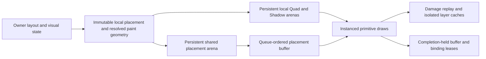

# ADR: Shared hierarchical GPU placement for retained primitives

Status: implemented for review; [validation and measurements](performance/2026-11-12-spatial/README.md) are recorded.

## Requirements and context

The complete RFC requires persistent property trees, generic instance storage,
P2 updates and actual lifecycle/pixel/performance evidence. Quad and Shadow
currently embed resolved world origin and inherited clip in every instance.
Moving/clipping a parent therefore rewrites descendant geometry even though its
local geometry is unchanged. Text already separates local glyph geometry from
flat node properties; images retain a separate draw-resource path.

This change must preserve owner hit/damage geometry, exact logical f32 operation
order, inherited rectangular clips, clamped scrolling, isolated group opacity,
immutable snapshots, generation-checked reuse, skipped-frame resync and native
completion-held resource lifetime. It must handle deep trees without truncation,
reject malformed/cyclic references and keep the original path as an A/B control.

## Decision

Publish local render placement separately from resolved paint/hit bounds. A
96-byte shared node record carries logical layout/translation, scroll, local
clip, parent/depth and anchor data. Quad and Shadow records reference its stable
arena slot. Primitive geometry remains local across inherited motion/clipping.
The original world-instance path remains a selectable control and reset retains
the selected mode. Ordinary UI uses the shared path when validation succeeds.

Vertex shaders walk at most 32 nodes and evaluate them from root to leaf in the
same operation order as owner extraction, applying physical scale last. Root
and every 32nd node are resolved anchors, so deeper trees remain correct with
bounded shader work. Ancestor motion updates boundary anchors rather than every
primitive. The initial version retains CPU subtree extraction for hit/damage;
it does not claim a sublinear complete owner update.

Retained-only shader variants reuse the pinned full renderer's primitive math.
They replace transport loads and pass resolved origins as flat varyings, avoiding
property-tree walks in fragment shading. Original full-renderer shaders stay a
separate reference/control. The pinned source transformations assert their exact
match count, so upstream drift fails explicitly instead of silently changing ABI.

Property buffers use the common typed mirror/growth/range-upload machinery.
Each submission explicitly leases its property buffer, settings and binding.
Queue order protects prior reads before later writes; replacement allocations
remain leased until completion. CPU slots defer reuse by completion serial.
Property changes invalidate affected primitive ranges and their isolated rasters
even when no geometry bytes are uploaded. Current preflight/invalidation still
scans allocations; indexed dependency dispatch remains future work.

## Alternatives and costs

* Flat resolved slots reduce per-primitive bytes but still rewrite every
  descendant slot on ancestor changes. They do not satisfy hierarchical sharing.
* Unbounded vertex walks permit arbitrary work and make malformed parent cycles
  dangerous. Depth-checked bounded segments retain correctness with explicit
  anchor-update cost at deep boundaries.
* Compute resolution could avoid repeated vertex traversal but needs ordered
  dependencies, extra dispatch/synchronization and independent measurements.
  The current vertex path provides a directly testable baseline for that choice.
* Full affine transforms, generalized clip shapes and shared image/glyph adoption
  need additional semantics; this decision covers the existing translation,
  rectangular clip and scroll contract rather than claiming those are complete.

Costs include 96 bytes of initial node storage, a settings uniform, an additional
binding and per-vertex tree reads. Small or deeply nested scenes may lose to the
world-instance path despite reduced upload volume. Performance conclusions must
include these costs, CPU validation and actual completion, plus losing runs.

## Validation and failure modes

Owner tests cover local placement changes whose final world bounds cancel out.
Consumer validation checks parent-before-child edges, local/resolved consistency
and authoritative delta equality, including children in reused immutable pages.
Backend preflight checks finite fields, slot/range bounds, depth/parent relations
and primitive references before queue mutation. Invalid packets must preserve
serial, storage and pixels for retry.

Hardware checks must compare both modes with the original/fresh full reference,
including fractional/nested clips, empty masks, scrolling, mixed primitives,
isolation cache invalidation, deep anchors, topology changes, in-flight growth,
removal/reuse, reset and skipped frames. Timings must distinguish backend
transport from owner publication and complete UI/native presentation. The full
RFC tracker remains authoritative for remaining platform and acceptance work.

## Measured outcome

The shared hierarchy removes descendant Quad/Shadow uploads for the covered
ancestor updates, and the complete hardware regression passes 399 scenarios.
Owner-to-completion timings show only small, variable median changes (about
5.0% at 1,000 and 3.2% at 10,000 quads), with losing rounds and substantial
pre-submit cost at 10,000. Upload savings do not establish a substantial complete
pipeline speedup. Keep the world-instance control and prioritize incremental
owner/backend processing before a broader performance conclusion.
