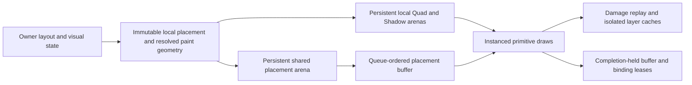

# ADR: Shared hierarchical GPU placement for retained primitives

Status: implemented for review; [validation and measurements](performance/2026-11-12-spatial/README.md) are recorded.

## Requirements and context

The complete RFC requires persistent property trees, generic instance storage,
P2 updates and actual lifecycle/pixel/performance evidence. Quad and Shadow
currently embed resolved world origin and inherited clip in every instance.
Moving/clipping a parent therefore rewrites descendant geometry even though its
local geometry is unchanged. Text already separates local glyph geometry from
flat node properties; images retain a separate draw-resource path.

This change must preserve owner hit/damage geometry, exact logical f32 operation
order, inherited rectangular clips, clamped scrolling, isolated group opacity,
immutable snapshots, generation-checked reuse, skipped-frame resync and native
completion-held resource lifetime. It must handle deep trees without truncation,
reject malformed/cyclic references and keep the original path as an A/B control.

## Decision

Publish local render placement separately from resolved paint/hit bounds. A
96-byte shared node record carries logical layout/translation, scroll, local
clip, parent/depth and anchor data. Quad and Shadow records reference its stable
arena slot. Primitive geometry remains local across inherited motion/clipping.
The original world-instance path remains a selectable control and reset retains
the selected mode. Ordinary UI uses the shared path when validation succeeds.

Vertex shaders walk at most 32 nodes and evaluate them from root to leaf in the
same operation order as owner extraction, applying physical scale last. Root
and every 32nd node are resolved anchors, so deeper trees remain correct with
bounded shader work. Ancestor motion updates boundary anchors rather than every
primitive. The initial version retains CPU subtree extraction for hit/damage;
it does not claim a sublinear complete owner update.

Retained-only shader variants reuse the pinned full renderer's primitive math.
They replace transport loads and pass resolved origins as flat varyings, avoiding
property-tree walks in fragment shading. Original full-renderer shaders stay a
separate reference/control. The pinned source transformations assert their exact
match count, so upstream drift fails explicitly instead of silently changing ABI.

Property buffers use the common typed mirror/growth/range-upload machinery.
Each submission explicitly leases its property buffer, settings and binding.
Queue order protects prior reads before later writes; replacement allocations
remain leased until completion. CPU slots defer reuse by completion serial.
Property changes invalidate affected primitive ranges and their isolated rasters
even when no geometry bytes are uploaded. Current preflight/invalidation still
scans allocations; indexed dependency dispatch remains future work.

## Alternatives and costs

* Flat resolved slots reduce per-primitive bytes but still rewrite every
  descendant slot on ancestor changes. They do not satisfy hierarchical sharing.
* Unbounded vertex walks permit arbitrary work and make malformed parent cycles
  dangerous. Depth-checked bounded segments retain correctness with explicit
  anchor-update cost at deep boundaries.
* Compute resolution could avoid repeated vertex traversal but needs ordered
  dependencies, extra dispatch/synchronization and independent measurements.
  The current vertex path provides a directly testable baseline for that choice.
* Full affine transforms, generalized clip shapes and shared image/glyph adoption
  need additional semantics; this decision covers the existing translation,
  rectangular clip and scroll contract rather than claiming those are complete.

Costs include 96 bytes of initial node storage, a settings uniform, an additional
binding and per-vertex tree reads. Small or deeply nested scenes may lose to the
world-instance path despite reduced upload volume. Performance conclusions must
include these costs, CPU validation and actual completion, plus losing runs.

## Validation and failure modes

Owner tests cover local placement changes whose final world bounds cancel out.
Consumer validation checks parent-before-child edges, local/resolved consistency
and authoritative delta equality, including children in reused immutable pages.
Backend preflight checks finite fields, slot/range bounds, depth/parent relations
and primitive references before queue mutation. Invalid packets must preserve
serial, storage and pixels for retry.

Hardware checks must compare both modes with the original/fresh full reference,
including fractional/nested clips, empty masks, scrolling, mixed primitives,
isolation cache invalidation, deep anchors, topology changes, in-flight growth,
removal/reuse, reset and skipped frames. Timings must distinguish backend
transport from owner publication and complete UI/native presentation. The full
RFC tracker remains authoritative for remaining platform and acceptance work.

## Measured outcome

### Dense backend validation refinement

Dense transport now uses a contiguous write list and epoch-stamped reverse
membership to retain the final parent per slot before constructing an ordered
map. The existing density threshold may select a full check for heavily
overlapping transport even when unique dirty membership is small; it is a
private work heuristic, never caller authority to omit validation. The final
projected prefix resolves in 32 depth buckets, once per node, retaining exact
root-to-leaf f32 operation order. Slot order need not be topological. Raw record
and range validation still checks every overwritten value; final graph edges
use last-writer semantics. Unreferenced/re-exposed slots remain validated.

Plans commit only after all packet consumers pass. Temporary stamps may advance
on rejection; authoritative parent/child state, mirrors, serials and pixels do
not. Dense plans invalidate resolved memo state so a later sparse update reads
the actual committed ancestor mirror. The original full-walk backend remains
available with indexed spatial validation disabled. This costs an additional
O(N) temporary resolved array and depth membership alongside the projected
mirror; it is not a physical memory admission guarantee. No public owner API,
buffer ABI or shader changes are required. See the
[alternating and sustained evidence](performance/2026-11-13-dense-validation/README.md).

### Next API decision: placement-independent effects

This section is a proposed contract, not an implemented cache capability.
Modern desktop 120 Hz acceptance requires avoiding redundant effect raster
work as well as CPU preflight. A stable layer ID alone cannot identify reusable
pixels: current target coordinates and primitive clips remain world-relative.
The proposed renderer boundary separates immutable local content identity,
placement, and raster environment, with the following requirements:

- Content identity includes ordered children/commands, materials and resource
  epochs, local clips/scroll, nested effect content and the applicable fidelity
  policy. An ancestor moving the whole isolated group may change placement
  without changing its local content. Independently moving a child changes
  that group's content; it cannot be hidden as a placement-only cache hit.
- Clips inside an isolated group affect raster content. An external clip may
  move to composition only when the renderer proves equivalence with the
  original clipping/isolation order, including nested groups and shadows.
  Group opacity remains semantic and is never reduced for responsiveness.
- Raster environment includes physical scale, extent, color/alpha convention,
  resource/device epochs and sampling phase. Integer physical translations can
  be exact texture-load reuse for a qualified subset. Fractional movement,
  scaling, rotation or bilinear filtering can change edge/text coverage;
  they require explicit equivalence tests or rerasterization. A cache may not
  silently weaken the exact mode merely to improve benchmark throughput.
- Content versions and placement handles remain private, generation-checked
  and immutable per submitted snapshot. Cache eviction cannot change scene
  semantics. Allocation pressure must have a bounded fallback/defer outcome;
  older submissions retain resources until their own completion fences.

Before exposing this as a public framework contract, compare cached and fresh
output for positive/negative integer and fractional motion, nested external
clips, overlapping opacity, shadows, text/images, viewport edges, scale changes,
resource replacement and multi-flight eviction. Measure rasterized pixels,
allocation spikes, frame age and p99/max at 60/120 Hz. Today's local route still
rerasterizes moving effects and uses full-viewport layers; this proposal does
not count as that implementation or acceptance.

### Experimental integer-translation subset

The [backend-verified layer translation probe](ADR_RETAINED_LAYER_TRANSLATION.md)
now implements a default-disabled subset of that proposal: compare complete
ordered Quad/Shadow records after target-relative placement/clip normalization,
and reuse a valid same-extent raster for qualifying integer physical motion.
No caller version or digest authorizes reuse. Fractional geometry, nested layers,
resource draws, unsupported scale/patterns and large proofs retain original raster.
Targeted and sustained [evidence](performance/2026-11-13-layer-translation/README.md)
shows a useful overdraw opportunity, but rebuilding proof records adds backend
work. The generalized persistent content/placement/raster-environment contract
above remains proposed, and local full-viewport output still does not qualify.

### Original shared-hierarchy baseline

The shared hierarchy removes descendant Quad/Shadow uploads for the covered
ancestor updates, and the complete hardware regression passes 399 scenarios.
Owner-to-completion timings show only small, variable median changes (about
5.0% at 1,000 and 3.2% at 10,000 quads), with losing rounds and substantial
pre-submit cost at 10,000. Upload savings do not establish a substantial complete
pipeline speedup. Keep the world-instance control and prioritize incremental
owner/backend processing before a broader performance conclusion.
