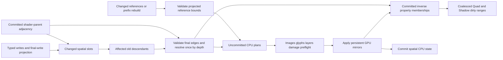

# ADR: Index validated GPU placement and inverse primitive references

Status: implemented; [hardware and completed-owner evidence](performance/2026-11-12-spatial-index/README.md).

## Context and requirements

Consumer input routing removed repeated local Quad/Shadow preparation, but the
backend still validated every spatial slot by walking to its anchor, checked
every Quad/Shadow prefix reference, and traced each primitive's ancestry when a
property changed. Even one material update with no spatial writes scanned all
spatial and instance prefixes. The current complete RFC goal requires selective
backend dependency processing while retaining malformed-input preflight and
multi-frame/resource correctness.

Raw GPU batches are public inputs. Revisions and caller dirty hints cannot be
trusted to establish state identity. Cached validation must describe actual
successfully applied mirrors, include unreferenced slots in the addressable
prefix, follow overlapping-write transport order, and handle capacity changes,
unwritten empties, scale, enable/disable, reset and later preflight rejection.

## Decision

Keep CPU shader-parent adjacency, child positions and memoized resolved
origin/scroll/clip for the validated spatial prefix. On stable capacity/scale,
start with written slots and visit their old descendants once. Validate each
final parent/depth edge, including unmodified children of changed parents.
Resolve affected nodes in 32 depth buckets using newly computed parent state or
the committed parent's state. Monotonic bounded depths exclude cycles. Anchors
are independent shader roots, as in the existing GPU contract.

The unconditional prototype improved sparse updates but regressed dense ancestor
movement in its three-execution probe. Preserve that probe and its changed-source
snapshots. The default now stops frontier construction once it exceeds
`max(64, capacity / 4)` nodes and uses original full projected spatial validation
and per-instance ancestry invalidation. This is a bounded heuristic, not a learned
cost model. Reference-prefix checking still reuses valid inverse-table bounds.

Dense fallback commits only changed topology, and marks all resolved memos
unusable without rewriting them. Subsequent sparse updates reconstruct needed
unchanged ancestors from the actual mirror with a bounded walk and scratch
memoization. They never trust values cached before the dense change. A complete
rebuild restores full memo validity. This avoids forcing a whole index rebuild
on the first small update after a dense frame.

Old descendants plus every changed slot cover reparenting: each new edge belongs
to a written node already in the seed set. Visiting old subtrees may conservatively
invalidate extra work after a move, but cannot omit a changed descendant. Scale,
capacity, missing index and mode transitions rebuild from the real projected
storage prefix. Newly exposed mirror values are validated rather than assumed
empty. Typed field/range checks still run for every submitted write.

Use scratch visitation/resolution stamps during preflight, but return separate
plans for authoritative changes. Only after all image/glyph/layer/damage checks
pass does application commit them. A rejected input may resize or stamp scratch
buffers but cannot move the authoritative adjacency/resolved base. GPU-stage
failure keeps the existing recreate/reset requirement.

Quad and Shadow have independent inverse reference tables: slot-to-property,
positions within each property's users and dense user lists. Stable prefixes
check projected changed references; the committed maximum reference proves
unchanged entries remain inside the new spatial bound. Prefix changes or a bound
below that maximum trigger complete projected checking. Same-batch replacement
can repair otherwise-invalid old references. Updates detach/attach memberships
by swap removal with O(1) position maintenance. Empty and property-zero entries
need no user lists; high-water mirrors retain their existing transport semantics.

Affected spatial slots select primitive users directly. Sort/deduplicate selected
slots and coalesce adjacent dirty ranges for existing raster invalidation.
Geometry writes retain their own dirty ranges. Image/glyph paths, GPU ABI,
draw order, actual uploads, layer/completion leases and shaders are unchanged.

### Rejected dense invalidation probes

The [dense invalidation study](performance/2026-11-13-dense-invalidation/README.md)
measured three attempts to reuse full-prefix validation for raster dependencies:

1. Unconditional final-topology closure plus inverse-user gather/sort regresses
   ancestor submit medians 15.7–35.1%. Sustained dense/effects 120 Hz p99 remains
   31.60–31.77 ms, with 1,199 consecutive unsatisfied target ticks.
2. Restricting closure to dense submitted transport retains original ancestor
   processing but produces no stable dense/effects gain: both submit medians
   regress 0.8% and completed medians regress 0.4/1.6%.
3. Contiguous dense reference selection avoids user sorting but dense/effects
   submit medians regress 23.0/30.3%, completed medians 16.7/27.4%.

Preserve exact changed-source ZIPs, all alternating raw samples and losing tails.
The runtime is restored to `634c8ba`: projected depth validation remains, dense
raster invalidation still uses actual per-user ancestry. Sparse indexed processing
is unchanged. New backend correctness regressions stay: isolated Quad and retained
image/glyph five-frame comparisons exercise dense ancestor invalidation, overlapping
reparent, old unrelated ancestor reuse and new ancestor invalidation, against the
original unindexed control. No public API, shader or fidelity policy changes.

The probes demonstrate that computing a generic affected frontier is not free;
shallow trees and contiguous raw ranges can favor direct ancestry tests. These
measurements do not prove the original method is optimal for deep/fragmented
scenes or modern desktops. Further policy complexity needs a concrete workload
benefit, and no caller-selected dirty-authority or unchecked route follows.

`set_indexed_spatial_enabled(false)` keeps the original full validation and
per-instance ancestry walk as an A/B control. The default is true. The normal
FramePacket wrapper forces resync when switching and preserves the option on
reset. Disabled spatial batches clear indices. Older owner benchmark controls
explicitly disable the new backend index on both sides.

## Alternatives and limits

Skipping all checks on unchanged input headers would trust unverified public
batches. Rechecking only written nodes misses invalid unchanged children and
overflowing descendants. Rechecking only drawn slots misses invalid data that a
later order could expose. Copying whole projected mirrors would retain linear
work for sparse frames. Backend-owned indices permit local reuse without those
assumptions.

Extra CPU state includes adjacency/positions, memoized values, scratch stamps,
primitive references and inverse memberships. There are no additional GPU
records or uploads. Capacity changes rebuild rather than compact; high-water
CPU memory and global resource budgets remain open work. Ancestor movement must
still validate affected descendants for finite arithmetic, so dense movement is
still linear. This change does not remove producer extraction, page-directory,
composition/effect-reference, layer/resource/lease scans or full-root raster work.

## Verification

The actual pure backend index implementation is also compiled into locked core
tests. Compare 600 mixed graph updates to an independent full root-to-leaf walk,
including reparent/clip/scroll/overlapping writes; check 200 inverse-membership
edits against complete prefix selection. Exercise late-discarded plans, child
edge errors, cycles, descendant/scale overflow, capacity shrink/grow, reexposed
primitive references and valid retries.

Keep the complete hardware regression. Run identical mixed packets through
indexed and original backends with both publisher/placement controls at three
scales. Raw backend cases must reject malformed nodes/references and later
layer/damage failures before any serial/state change, then accept zero-write
retry with identical pixels. Confirm inactive mirror exposure and final-write
projection. Benchmark only the backend-index switch with the same owned
publisher, cached consumer input routing, shared layout, full redraw and
per-frame completion, retaining all raw samples and losing cases.
