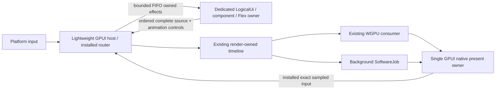

# ADR: Keep the native window service light and move UI ownership to a worker

Status: experimental integration, 2026-11-19. Full RFC remains active.

## Context

The render-owned timeline can sample without UI callbacks, but the ordinary owner
host also held LogicalUi on GPUI's platform thread. A blocked callback still stopped
draw/Present. The architecture calls for one swapchain owner and a lightweight
platform service when native window operations require their original thread.

## Decision

Create a dedicated thread that constructs and owns LogicalUi/Rc sources/Flex.
Keep the GPUI window, native renderer and animation sampler on the platform service.
Reuse typed reliable Commands for event/request-response transport. Responses
contain complete immutable source scenes, accepted environment and animation data;
adopt by original request order. Do not send mutable UI or platform objects.

Add atomic AnimationRuntime::activate so a rejected controller cannot leave a new
source half-adopted. Expose UiInputScene::frame as a read-only exact geometry lease.
Sample output stream remains separate from authored tree/generation. Source scale
and logical extent travel with each response; new host DPI cannot reinterpret old
glyphs. Installed input uses that same completed image.

## Alternatives and costs

Running arbitrary UI code on the native thread retains the original stall.
Moving only offscreen GPU work does not isolate Present. Owning a second HWND or
swapchain for the same content would complicate input/Z-order/lifecycle and is
unnecessary for validating this ownership split. A new custom event queue would
duplicate existing Command sequencing, completion and capacity; use it explicitly
as an owner RPC transport in the example, not as a business state mutation.

Asynchronous owner dispatch adds response latency and complete scene leases.
64 accepted-or-awaiting-adoption host requests bound response count, not total
bytes or processing duration. Normal visual snapshots are not coalesced across
controls; a future protocol may do that only with explicit causal acknowledgement.
Input overflow reports an error and retains router state, without claiming robust
unbounded OS input. Host text preparation and GPU submit still can stall the native
service. The split adds one OS thread per example window; this is not yet a chosen
cross-application scheduler policy.

CPU completes one job before sampling its successor. It intentionally trades
cadence for forward progress and coherent images. Requesting a next frame after
install is necessary; notify during drawing does not itself create frame demand.

## Verification and open work

Owner controls verify FIFO down/up over a stalled owner, once-only activation and
wrong-scale rejection. Kernel tests verify source+controls activation rollback.
Native100ms/500ms controls observe distinct samples and accepted Present attempts
on GPU without diagnostic draws inside the interval, then compare full native pixels.
CPU records the short intervals as observations and separately requires complete
sample/Present progress during2s. The debug raster takes around500ms, so zero short
interval samples is recorded, not reclassified as fluid animation. This stage
qualifies ownership isolation and coherent eventual images, not CPU cadence.
See [recorded evidence](performance/2026-11-19-split-presentation/README.md).

This establishes only the selected desktop ownership split and workload. General
host API, portable font/image workers, budgeted PendingScene, direct interactions,
priority admission/shutdown policy, actual display timing and macOS/Linux/mobile
qualification remain open. The old host remains HostDrivenPresentation. No blanket
guarantee or numerical99%/p99 gate is introduced.
