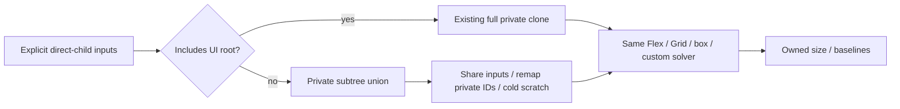

# ADR: Isolate direct-child queries with compact subtree unions

Status: experimental internal kernel integration,2026-11-19. Full RFC active.

## Problem and decision

Public dry_measure_node/axis/baselines/nodes queried small portions of the live
tree but cloned every Taffy node, child list, context and cache first. Pure
measurement cannot overwrite live scratch geometry, so removing isolation is
incorrect. Keep isolation and the same layout algorithms; copy only the union
of queried nodes and all their descendants. Complete UI-root queries preserve
the former whole-clone route and warm caches because they exclude no ordinary
unrelated branch. This is a coverage rule, not a scene-specific threshold.

The vendored Taffy method `clone_subtrees_for_measurement(roots)` returns a
private TaffyTree and corresponding remapped root IDs, preserving input order
and duplicates. Iterative traversal deduplicates overlapping roots, including
ancestor/descendant query order, with no scan of unrelated nodes or source arena
capacity. Ordinary node removal/generation validation applies before copying.
Internal root parent links outside the union are cut; child order is retained.

Styles, immutable custom delegates and direct-parent metadata share Arc values.
Included NodeContexts clone normally; exact-measure/tracked-input capabilities,
constraint boxes and containment style indices follow included nodes. Caches,
old layouts, OOF identities and last-placement observations start empty because
they can name old IDs or assert placements that do not exist in the new tree.
Queries use the actual caller's explicit constraints, bases, known-size flags,
sizing mode and axis intent. No ancestor is needed to guess them. Baseline
queries retain the existing complete placement arithmetic/suppressed-write path.

## Ownership and compatibility

All cache/scratch/context mutations belong to the returned tree, even on failure
or unwind. Shared immutable content may maintain its existing pure resource
cache; this operation cannot freeze an interior-mutable arbitrary user capture.
The framework's MeasureSnapshot/ParentLayout APIs contain no Taffy NodeIds, and
the measure adapter consumes snapshots, so internal remapping cannot leak into
public geometry/input/lifecycle identities. Public query signatures do not change.

Raw kernel callers must use the returned IDs and must not embed live IDs in a
NodeContext callback intended to resolve them in the new tree. This method is
not a published subtree geometry clone, a cross-owner handle, a containing-block
substitute or an automatic responsive-builder proof. Ordinary final layout,
measure_node_with_constraints root queries and transactional full-layout clones
keep their existing implementation. It does not migrate every private preview.

## Cost and alternatives

Let U be unique queried-subtree nodes and E their included child edges. Std
lookup/build is expected O(U+E), with O(U) private storage and traversal/remap
state; no-std alloc uses ordered maps and adds lookup logarithms. Large included
child lists/user contexts still cost their full clone. Caches are cold, so a
large subtree with warm final caches can be slower than the full-clone route.
Requesting the entire UI root keeps the old route; almost-root subtrees are not
predicted automatically. Querying deeply overlapping roots is deduplicated.

Keeping a persistent query tree would need exact subtree invalidation and cache
memory limits. Mutating the live tree then undoing scratch writes risks rollback
and callback errors. A second solver would diverge from normal Flex/text. Start
with the compact owned boundary and report its copying/cold-cache costs. No new
threads, unsafe arena access or heuristic cost model is introduced.

See [CPU comparison and controls](performance/2026-11-19-subtree-queries/README.md).
Remaining work includes granular remeasurement invalidation, reusable bounded
query caches, ordinary source/candidate cost, full responsive planning copies,
native presentation independence and the broader Flex/RFC acceptance matrix.
