# ADR: Final reactive inputs drive scoped UI tasks

Status: experimental Rust implementation, 2026-11-19. Complete RFC remains active.

## Context

Queries and previews normally follow a component's current parameters. Explicit
event task replacement works, but leaves applications to repeat equality,
coalescing, cancellation and capacity handling. A mount-once component also needs
prop changes to restart its short-lived work without remounting it. Preserve the
existing source engine, scope lifetime, complete candidate validation and host
executor. Common intuitive behavior takes priority over rare-case scheduling;
"99%" remains figurative, without a statistical acceptance gate.

## Decision and ordering

Add `UiTaskEffect<I,T>` with explicit `Signal<I>` or `ReadProp<I>` input. Inputs
are ordinary typed values; combine several parameters through an existing pure
computed source. The factory is owner-local and stable by Rc identity. Cloning
it preserves identity; deliberately replacing it restarts even equal input.
`I: Clone + PartialEq` may contain owner-local values; only selected owned Send

```mermaid
flowchart LR
    Source[Source transaction] --> Build[Computed / props / producers / responsive]
    Build --> Retire[Retire dead scopes and sources]
    Retire --> Input[Compare final task input]
    Input --> Admit[Existing task admission and deferred launch]
    Admit --> Validate[Complete frame / input defaults / validation]
    Validate --> Adopt[Adopt source / logical / task state]
    Adopt --> Effects[Ordinary effects]
    Effects --> Launch[Schedule on host executor]
    Launch --> Result[Explicit ready / apply_task / image installation]
```

data and `UiTaskContext<T>` go to the executor. Output stays Send+Sync.

One scope/key has one task declaration. A surviving equal final input and cloned
factory preserve its current task, including Applied/Abandoned/Cancelled terminal
status. A changed input replaces once, after all props/computed/responsive sources
settle. Intermediate writes and a final return to the old input do not launch.
Input defaults following this stage change render scroll geometry only. The
ordinary final frame validation still precedes adoption and worker scheduling.

The declaration exclusively owns its task key. Manual LogicalUi/LogicalEdit and
EventContext start/cancel reject that key; remove_task_effect transactionally
removes the declaration and cancels current work, then manual ownership is
available. Scope retirement removes declarations through the same registry.
Retiring an input in another surviving scope rejects the whole candidate rather
than retaining a dangling dependency. A same-candidate retired task never starts.

## Capacity and errors

Changed input cancels its old task upon successful adoption even when admission
is full. The new source/UI state commits and status becomes WaitingForCapacity;
task::<T> returns None while waiting. Old completion cannot overwrite current
state. This differs deliberately from explicit start_task returning Busy and
preserving the old task: a reactive task must correspond to its new input.

There is no hidden queue or timer. The host awaits the existing shared capacity
receiver and calls retry_task_effects. Logical edits and frame production also
give waiting declarations an opportunity. Repeated new inputs while full keep
only the latest value. A cancelled running worker retains its permit until exit;
capacity1 replacement can therefore wait even when that worker is the only work.
Capacity release is observation, not reservation or a fairness guarantee.

Candidate failure/unwind leaves the old input, task, registration and frame live.
Post-commit ordinary-effect panic cannot roll back adopted state; undispatched
launches become Cancelled as before. No implicit retry of terminal tasks occurs.
Use a changed explicit input revision or a new factory for a deliberate retry.
Worker/output business errors remain payloads handled by the application.

## Alternatives and costs

Keep explicit start_task for independently triggered work. Use task_effect for
short-lived work determined by current parameters. Capturing arbitrary callback
reads as ambient async hooks would add another dependency mechanism and obscure
which values cross the executor boundary; retain one explicit typed input.
Business Commands retain independent application lifetime.

Registry and observation maps are Rc/COW. Settlement currently scans registered
task effects and compares existing source observations; actual task changes clone
sparse maps, allocate and reserve through UiTaskPool. Inputs clone on the owner,
including attempted admission; prefer compact immutable request values. This
stage does not claim reduced latency, bounded owner pauses or a new performance
result. It also routes ordinary edits/frame production through the logical
candidate while task effects exist. Final source/candidate/layout costs remain.

No private executor, automatic result callback, async handler macro, KeepAlive
activation, priority/fairness, byte quota, timeout or dedup scheduler is added.
Inactive keys still need lifecycle cleanup. Uncooperative workers can continue
computing. Host-driven native presentation remains a separate unfinished area.
Public source schema, Taffy solver and GPU formats are unchanged.

See [public usage](RETAINED_UI_TASKS.md),
[shared admission](ADR_RETAINED_UI_TASK_ADMISSION.md) and
[verification](performance/2026-11-19-task-effects/README.md).
