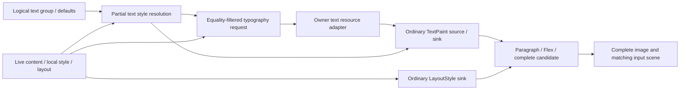

# ADR: Inherited text inputs prepare ordinary owned paragraph resources

Status: experimental Rust API, 2026-11-19. Full RFC remains active.

## Decision and ownership

Theme groups already inherit through logical providers, but a caller still had
to shape every label and manually bind foreground. Introduce a uniform Text
component and a backend-independent text-style data contract, with only an
explicit list of inheritable properties. Reuse the existing computed graph,
providers, ordinary component scopes, text sink and paragraph/Flex lifecycle.

Family/weight/slant/size/line-height/foreground resolve independently. Inherit,
Initial and explicit values have different typed representations. Unitless line
height is retained as a factor through scopes and multiplied only at the final
consumer; absolute line height remains absolute. Full ThemeGroup defaults/reset
semantics are unchanged. Invalid upstream data cannot hide behind overrides.

TextStyleScope resolves its outer dependency in its own ordinary scope, then
forwards a ThemeScope containing the resolved complete group and child Props.
This respects existing providers' one-time source/absence capture: resolving and
declaring the same key in one scope is forbidden. There is no global context or
render-parent lookup. Scopes and computed projections are explicit retained cost.

Standalone Text still resolves optional text-theme absence. The owner's cached
theme-session flag now includes resolved theme keys (including absence), so
subsequent source/Props changes use established complete-frame validation even
without a declared provider or layout producer. The flag changes only with
successful registry adoption and retires through the same provider machinery.
No registry scan is added to ordinary frames. First-frame construction remains
explicit. Rollback uses the existing candidate, not compensating source writes.

The typography request excludes color and layout. Color changes can reuse the
same paragraph/resource without invoking preparation; width changes reuse it and
rewrap through normal layout. Content, typography, adapter identity, explicit
font revision and raster scale determine resource invalidation. Current computed
sources retain their latest resource; this does not add a historical text cache.

TextPreparer is an owner-local resource capability; it runs before pure layout
and never on a render worker. It must use captured inputs and immutable outputs.
The GPUI adapter lowers the framework font descriptor and reuses the original
paragraph/grayscale glyph preparation. Renderer work owns only TextResource,
not the adapter or font callbacks. Explicit font_revision/scale inputs let a
host invalidate fonts/DPI; automatic OS observation remains separate work.

## Alternatives and costs

Implicit ambient font reads inside layout would make caches/frame consistency
depend on untracked state. Storing arbitrary font callbacks in a frame would
violate owner/thread boundaries. Reimplementing wraps or per-label widths would
split the geometry truth. Existing owned paragraph/resources avoid those paths.

Inheritance could have been made a second graph on render nodes; that would
duplicate sources/rollback and lose portal logical ancestry. Existing complete
theme groups plus typed partial resolution provide one source of truth, at the
cost of wrapper scopes and O(consumers) fanout during wide changes. Each Text
has ordinary computed nodes and bindings. Large strings clone Arc handles but
equality can still compare contents. Preparation is synchronous and cannot be
preempted by these APIs. Weak glyph caching follows existing resource lifetime.

Speculative resource memoization/counters may advance even if a later frame
rejects. Adapters must not perform external business side effects. Immutable old
resources/frames remain valid; cache changes are not UI-state adoption. There is
no promise that source/candidate/layout work is O(1), nor a new FPS improvement.

## Scope and validation

This implements uniform text inheritance and the ordinary Text entry point.
Rich text, editable/IME/selection, portable font tables, automatic font/DPI
subscriptions, token expression Style IR, budgeted theme scene preparation and
independent native presentation remain open. Low-level explicit TextPaint and
UiContent text resources retain their existing semantics. No renderer format,
UI source schema or Taffy solver is changed.

See [usage](RETAINED_TEXT_COMPONENTS.md) and
[controls and completed results](performance/2026-11-19-text-inheritance/README.md).
