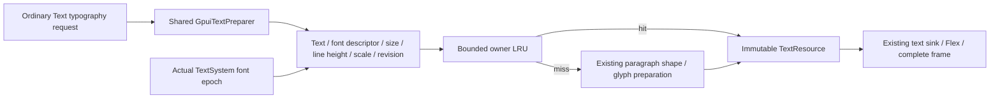

# ADR: Bound and share owner-side prepared text resources

Status: experimental Rust API, 2026-11-19. Complete RFC remains active.

## Problem and decision

Ordinary Text filters unchanged typography for each component, but independent
labels still prepare separate ParagraphSnapshot/TextResource values. Returning
to a recently used size repeats that work. Share complete immutable resources
through the existing owner font adapter, with explicit entry/payload bounds,
invalidation, disable/clear controls and counters. No new source graph, layout
solver, renderer primitive or component identity is introduced.

Cache scope is one GpuiTextPreparer, which owns one WindowTextSystem. A group key
contains family/weight/slant, finite font-size/line-height/scale bits and explicit
font_revision; a borrowed text lookup compares the exact UTF-8 contents, including
hard newlines. Actual font epoch invalidates the entire cache on next preparation.
TextSystem identity is implicit in adapter ownership. Foreground, box width and
layout are absent because they do not affect this uniform prepared resource.
Returned resources share paragraph/wrap/glyph-chunk memoization as before.

Use a BTreeMap of typography groups, standard randomized HashMap text lookups
and BTreeMap recency records. Hits hash input text and update O(log entries)
recency; no O(capacity) search or growing recency log. A miss allocates source
key text only if retained. Hash collisions still compare full text. The private
u64 recency counter clears cache on exhaustion. Maps and Arc references add cost.

Default bounds are 128 entries and 8 MiB of accounted preparation payload.
These are initial configurable policy, not device-derived optimal thresholds.
The payload accounts source/family bytes, shaped-line/run/glyph arrays, resource
records and unique glyph masks within each resource. Shared allocations can be
charged again between entries; allocator/map capacity, shared GPUI caches,
later wrap/chunk/GPU allocations and caller-held resources are excluded.
This is explicitly not a process-memory bound. Entry count bounds directory
cardinality independently; each original resource keeps its existing limits.

Oversized resources bypass storage; hits remain usable. Limit changes evict LRU
entries until within both bounds. Zero entries or payload bytes disables storage
and avoids key/hash/accounting work on that path. clear_cache removes only cache
references and preserves cumulative counters. Eviction never invalidates a
resource owned by a component, frame or GPU operation. Retirement follows normal
Arc ownership. Clearing a large cache can synchronously release payloads; this
stage does not add a deferred resource retirement service.

## API and consistency

GpuiTextPreparer exposes set_cache_limits(TextCacheLimits), clear_cache and
cache_stats(TextCacheStats). prepared_resources still counts successful actual
preparations, excluding hits. Hits/misses/evictions/bypassed/font_invalidations
are cumulative; entries/payload_bytes describe current cache ownership. Lookup
misses can precede preparation errors; invalid typography/scale rejects before
lookup. Failed preparation is not inserted. Existing owner/rollback rules stay:
cache and diagnostics may change during a failed speculative UI edit, while
sources/Props/scopes/complete output remain unadopted.

Explicit font_revision is part of identity, not a global invalidation command.
Old revisions can remain bounded in the cache and can be reused if the caller
intentionally returns to them. Actual font database epoch always invalidates.
Neither mechanism is an automatic source notification: host must still request
an update with new revision/preparer identity after changing fonts. Old prepared
frames remain usable even after the font owner/database/cache changes.

## Trade-offs and validation

Weak-only entries would not reuse resources after remount/theme toggling; an
unbounded strong map would retain arbitrary content. Separate renderer caching
would not remove owner shaping and would create another text input truth. The
bounded owner LRU removes repeat preparation using existing immutable contracts.
Misses pay lookup/accounting/eviction and can regress when content exceeds the
working set. Unique long input hashing still costs text length; full source/
computed/candidate/layout work remains. This cannot prove frame cadence.

Real-font tests compare cached resources/ordinary Text output with uncached
full Flex on CPU/GPU, and check LRU, payload/entry bounds, clear/disable, full
key changes, font epoch, error preservation, old frames and ordinary host
regressions. Release A/B includes repeated labels, mixed labels, capacity misses
and ordinary component/complete-frame updates, with timing boundaries explicit.
See [verification and measurements](performance/2026-11-19-text-cache/README.md).

Budgeted asynchronous preparation, cross-scale paragraph reuse, rich text,
portable resource schemas, automatic host font subscriptions and independent
native presentation remain open. Complete RFC is not marked complete.
