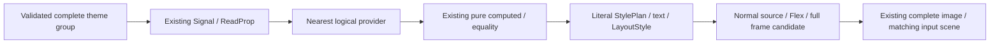

# ADR: Complete typed themes inherit through logical providers

Status: experimental explicit Rust API, 2026-11-19. Complete RFC active.

## Problem and decision

Applications need common colors/spacing/typography values that survive portals
and change without remounting every component. The existing style engine accepts
literal typed properties and ordinary computed sources; Store/Command providers
already define nearest logical scope ownership. Reuse them for typed immutable
whole-group values, with read-only consumer inputs and equality-filtered selectors.

Add ThemeKey with associated complete Values/default/validation, immutable
ThemeGroup<K>, and logical provide/use/select APIs. TypeId distinguishes groups
with the same value type. Group construction from defaults explicitly resets
omitted overrides; it is not an incremental merge with outer values. Construction
checks equality reflexivity and key-defined validity before source staging.

## Logical and source ownership

Provider source identity is stable for its scope lifetime. Consumers resolve once
through logical ancestors, independent of render host and portal parentage. They
receive ReadProp only. A changed provider value updates those consumers; swapping
identity or declaring after resolution in the same scope rejects/remounts
explicitly, matching existing providers. Later ancestor shadowing affects new
consumers only; existing resolutions do not retarget. Generation/foreign source,
missing dependency path, scope retirement, failed declaration poisoning and
final dependency validation
reuse the same registry/candidate machinery. No global context/TLS is introduced.

ThemeScope<K,C> is a transparent ordinary component. It computes the theme and
child Props from its live payload, provides one group and forwards the derived
read-only payload to a keyed child. Both outputs settle with the original input
transaction. The child retains state and no extra render/layout box is created.
Its source input belongs to the wrapper and retires with the child. A private
mount-only forwarding helper handles this explicit wrapper; it is not a second
component reconciler or public arbitrary child-input writer. Normal component
type/key/host identities and lifecycle still apply.

Transparent scope cannot register a layout producer against a parent's render
host: that would violate the existing one-owned-writer rule. Input forwarding
uses the source graph instead, allowing normal Flex siblings and nested scopes.
ThemeScope's child has Clone Props; its key remains one internal child identity.
Mix independent sibling regions through existing ComponentSite/ComponentPlan.

The owner caches whether the adopted registry contains a theme provider. The
flag updates only after successful registry adoption and avoids scanning all
providers on every ordinary frame call. A theme-bearing UI uses logical editing
and the last established constraints/viewport for normal source/edit updates,
even without layout producers, so source+style+Flex+frame validate before adoption.
Initial no-frame construction stays explicit. Complete-frame failure keeps old
group values, props, scopes/local state, providers and published frames. Normal
post-commit effects/tasks remain outside rollback, as before.

## Alternatives, costs and limits

Reading a global mutable theme in each layout/paint callback would break source
observations and frame consistency. Passing arbitrary business Store snapshots
as a hidden theme overload would mix namespaces and ownership. A new theme graph
would duplicate source transactions/equality/retirement. Typed group sources fit
the existing contract and are backend-independent; app code can use ordinary
StylePlan or text preparation from selected values.

Theme selectors are owner-local pure Rust closures and need not be serializable;
they do not execute in the renderer. Each consumer's projection may execute on
group change; unchanged projections stop sinks, not all upstream evaluations.
Whole-group comparison can cost group size, and switching a widely used group
can still incur O(consumers) style/layout work plus ordinary candidate/graph
cost. Registry COW/lookup/validation follows existing providers. No timing/FPS
gain is claimed from this capability stage.

The complete RFC's portable token references/derived expression graphs, token
missing/cycle errors, automatic text inheritance, ThemePatch, component parts,
system theme subscriptions, cross-language ABI and independently adopted
renderer StyleEpoch/PendingScene preparation remain future work. There is no
implicit inheritance of layout/border/fill and no automatic provider relocation.
Input capabilities/disabled semantics are not overridden by visual themes.

See [usage](RETAINED_THEMES.md), [providers](RETAINED_SCOPED_PROVIDERS.md) and
[verification](performance/2026-11-19-themes/README.md).

Follow-up: [ordinary inherited Text](RETAINED_TEXT_COMPONENTS.md) implements the
enumerated uniform text properties through this group/provider contract. Rich
text and the complete token expression/Style IR remain outside that stage.
