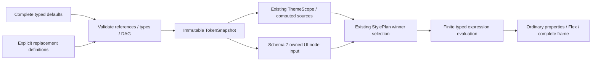

# ADR: Typed symbolic tokens evaluate into the existing style pipeline

Status: experimental Rust data/API, 2026-11-19. Full RFC remains active.

## Decision

Complete Rust theme groups exist, but literal Style IR still required user
closures to translate every theme into values. Add a typed named token schema,
owned flat expression vocabulary and immutable resolved table. Extend the
existing StyleValue/StyleRule to reference/evaluate it, then feed ordinary
StyleResolution/sinks. Do not build a parallel layout or renderer truth.

Symbolic group/name/kind IDs avoid process-only TypeId names. Supported TokenType
is sealed to existing owned style vocabulary plus explicit font/duration data.
Flat operations reference earlier indices, bound allocation/work/depth and can be
inspected by other frontends. Derived token references are a separate finite DAG;
use iterative ordering and an actual repeated cycle path for errors. Every schema
definition is verified, and each resolve starts with fresh complete defaults.
No retained callback executes in the renderer or token evaluator.

Style composition selects winning atomic rules before condition/expression
evaluation. Shorthands lower to projection ops. This preserves Initial and
external whole-rule replacement; unused branches may refer to absent tokens but
remain structurally type-checked. Final result validation preserves property
semantics, including opacity, bounds, Grid/shadow payload limits and the existing
linear Calc percentage basis. Encoded straight RGBA mixing is explicitly defined.

Logical frontends reuse ThemeGroup<TokenThemeKey>/ThemeScope/ReadProp. Primitive
owned UI input adds an explicit node token table and operation, requiring schema
7. Sender is responsible for choosing the logical environment, as UiNode's render
graph alone cannot express component portals/providers. Snapshot recovery and
exact replay capture authored values. Planner compares references from winning
rules, conservatively including inactive branches, and skips unrelated changes.
Empty tables share one immutable Arc; authored UiNode grows by one snapshot handle.
No token table is attached to every retained RenderNode or GPU instance.

## Alternatives and costs

Arbitrary closures would not provide inspectable expressions or deterministic
cross-frontend behavior. String interpolation/CSS parsing would weaken typing and
duplicate existing LayoutLength/Dimension. A second mutable token graph would
duplicate source rollback/lifetime machinery. Resolve a complete pure table, then
reuse ordinary sources and style planning, accepting O(definitions + references)
graph work with ordered-map factors and per-expression temporary allocations.

Expressions are validated at construction/use, and snapshot equality can cost
the table size. Wide theme switches still fan out through normal owner work.
References from overridden rules do not invalidate; inactive winning branches
still contribute conservatively. There is no dynamic dependency scheduler or
claimed O(1) theme switch. Symbolic ownership enables future serialization but is
not proof of a stable wire ABI. Existing source schema is intentionally bumped
instead of hiding a semantic extension behind version 6.

## Verification and remaining work

Core controls cover defaults/reset/derived arithmetic, symbolic type separation,
raw operand errors, missing/cycles/duplicates/limits, StyleRule/Initial/shorthands,
property validation, logical sources and UI replay/recovery/rollback. Real Noto
token width/padding/color updates compare complete CPU/GPU images and sibling
geometry with literal full Flex references. Unread-token changes skip style
evaluation. See [verification](performance/2026-11-19-tokens/README.md).

Serialization/ABI, token macros/compiler, complete curve/font resource schemas,
component parts/ThemePatch, budgeted preparation, render-domain StyleEpoch and
independent native presentation remain open. No FPS/tail or success-ratio claim.
