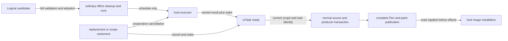

# ADR: Scoped short-lived UI tasks over host executors

Status: experimental implementation, 2026-11-19. Complete RFC remains active.

## Context

UI component work such as a preview query or image preparation can finish after
its component disappeared or after a newer request replaced it. Generation-safe
Signal validation alone does not cancel wasted work, wake a waiting host, or
prevent a stale result from overwriting a still-live shared source. Business
commands such as save/download must survive ordinary component unmount.

Existing logical edits already validate source propagation, component producers,
Flex/text layout and complete immutable frames before adoption. Scope keys and
generation checks own component lifetimes. Host executors already own threads,
task priorities and shutdown. Adding a new pool or another state graph is unnecessary.

## Decision

Add explicit `UiTask<T>`, `UiTaskContext<T>` and `TaskApply<R>` to the existing
LogicalUi/LogicalEdit/ComponentContext APIs. A sparse registry indexes active tasks
by scope/key. A registry entry owns cancellation; the escaped result handle does
not. Each replacement has a distinct shared identity, including same scope/key.
Source/effect/event/task key spaces stay separate.

Task launch closures are deferred until after successful adoption and ordinary
effect cleanup/runs. They must only schedule work. Failed candidates do not launch
new work or cancel existing tasks. Successful task replacement cancels the old
entry before new launches. Scope reorder retains tasks. Both manual and
transactional retirement, including producer removal, cancel owned subtree work;
owner Drop cancels before reactive effect/source cleanup.

The worker capability is Send+Sync for Send+Sync output and owns no UI reference.
`complete` provides one immutable output and wakes the owner. `cancelled` wakes
cooperative async work without polling. A worker that ignores cancellation may
continue external effects, but late completion is rejected. A dropped or panicking
worker becomes Abandoned; queued launch closures dropped before launch become
Cancelled. Business errors should be represented by `T = Result<Output, Error>`.

The owner waits explicitly, then `apply_task` rechecks registry identity and runs
its source callback only for a current Ready task. It reuses the installed layout
constraints/viewport or active producer session and publishes complete output.
Failure preserves Ready for retry and rolls back source/layout. Successful output
becomes Applied before ordinary effects, preventing duplicate application after a
post-commit panic. A result that removes its own component is still Applied.

No callback or arbitrary front-end code executes under the task mutex. Waker and
output destruction happens outside it. One owner readiness waiter and one worker
cancellation waiter are supported. Cloned handles are observation capabilities,
not a broadcast multi-waiter event primitive.

## Alternatives and costs

- Direct Signal senders remain useful for latest visual values, but do not tie
  each async request's result to a replacement generation. They remain available.
- A private runtime/thread pool would duplicate host scheduling and require new
  shutdown/priority policy. This API accepts scheduling closures instead.
- Cancelling Command on component unmount would change accepted business intent;
  Command keeps its independent application lifetime.
- Scope fields on every node are avoided. Registry changes clone the sparse map
  and Rc handles; unchanged candidates share entries. A live task allocates one
  shared mutex/state and launch closure; Ready owns one Arc output. This is a
  lifetime/correctness capability, not a demonstrated latency improvement.

## Limits

No global/per-window task capacity or byte budget, priority, deduplication, timeout,
automatic result callback, detached application task pool, async constructor,
effect-driven restart macro, KeepAlive activation generation or cross-language
wire ABI is implemented here. Applications bound keys and executor work explicitly.
Result adoption must be serialized on the owner. A launch callback or application
effect can still block that owner; this API does not preempt it or make native
presentation independent. Ready output destruction may run on the UI owner and is
not claimed to have bounded cost. The retained source schema and GPU format remain
unchanged; Error adds InvalidTask and LogicalUi has explicit cancellation Drop.

See [verification and reproduction](performance/2026-11-19-ui-tasks/README.md),
[component plans](RETAINED_COMPONENT_PLANS.md),
[business commands](RETAINED_TYPED_COMMANDS.md) and
[native host](RETAINED_GPUI_OWNER_HOST.md).
