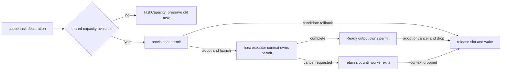

# ADR: Bounded admission for scoped UI work

Status: experimental implementation, 2026-11-19. Complete RFC remains active.

## Requirements and decision

The [scoped task lifecycle](ADR_RETAINED_UI_TASKS.md) already rejects stale
completions, but cancellation alone does not stop a worker. Repeated replacement
could launch arbitrarily many cancelled, still-running jobs and compete with
input/render preparation. A completed-but-unapplied result can also retain data.

Introduce `UiTaskPool`: an admission limit shared by one or more LogicalUi owners,
including several windows. It creates no pool of threads, runtime, pending queue,
timer or priority policy. Executors retain scheduling responsibility. A default
owner has capacity64; applications can attach a pool with an explicit positive
limit before their tasks exist. This is a conservative work-count default, not a
CPU count, frame budget or measured optimal threshold.

Admission occurs before allocating/publishing the task entry or running user
work. Capacity failure returns `Error::TaskCapacity`, leaves old task and sources
alone, and does not poison a component candidate. Callers may publish a loading
state in that same edit. A failed final frame validation drops provisional work
and its permit; pool diagnostic counts describe attempted reservations and are
not transactional business state.

A permit follows declared work → worker context → complete immutable output.
Cancellation does not release a running context's permit. A ready result keeps its
slot until successful adoption or cancellation destroys it; failed apply preserves
both output and reservation for retry. Output destruction occurs before capacity
release, outside task/pool locks. Escaped observation handles do not retain permits.
Both declaration and output count prevents cancellation/replacement from bypassing
the bound. It can make replacements temporarily Busy; the application chooses
whether to preserve old work or cancel it and wait, without hidden overcommit.

`open_capacity` creates one explicit capacity receiver. `ready` waits without a
polling timer and is woken by released permits. It yields current statistics when
capacity is available, not a reservation; another owner may acquire it before a
retry. Dropping the receiver allows another to open. The receiver holds a weak
pool reference and returns None after all pool/permit owners disappear. Sharing
admission across owners is supported; host retry ordering is centralized by the
single receiver. This is not a fairness/multi-subscriber scheduler.

## Alternatives, costs and limits

- Releasing on cancel would let uncooperative old workers escape the bound.
- An internal work queue with priorities would add another scheduling authority,
  queue payload ownership and starvation policy; keep these with the host until
  representative work justifies a shared scheduler.
- Per-task bytes would be guesses for arbitrary Rust closures/results and hidden
  allocations. This stage bounds work count, never claims a hard memory limit.
- No reserved input priority is implied. Hosts must keep input transactions
  separate, choose modest background concurrency and avoid synchronous heavy
  launch callbacks. This admission limit alone cannot guarantee fluent frames.

Pool reserve/release takes one short shared mutex. Cloning the pool is Arc cloning;
registry mutation still clones sparse maps as before. There is one readiness
waker, copied/removed outside user work, and no periodic wakeup. LogicalUi cannot
migrate live tasks to a different pool; configuration checks both entries and
remaining work in its current shared pool. Public Error adds InvalidTaskPool and
TaskCapacity; no source schema, Taffy solver or GPU format change.

The permit remains held while a successful result callback/effects still borrow
its output. Such a callback/producer starting another task may need spare capacity
or handle Busy; capacity must not be released while the borrowed data is live.
Abandoned/Applied registry entries still require replacement/cancel/scope cleanup;
this bounds work, not arbitrary registry keys. No byte quotas, preemption,
priority/fairness guarantee, task timeout, KeepAlive activation, automatic async
hooks or independent native presentation is implemented here.

See [contract](RETAINED_UI_TASKS.md) and
[verification](performance/2026-11-19-task-admission/README.md).
