# ADR: Bounded vertical list UI over ordinary Flex and keyed components

Status: experimental Rust implementation, 2026-11-19. Complete RFC stays active.

## Context and decision

The RFC asks for100,000 data rows with live UI proportional to the viewport and
overscan. Preparing/layouting/painting every offscreen component cannot meet this
structural requirement. Reuse the existing pure source engine, keyed component
sites, ordinary Flex, input transaction, task retirement and immutable frames.
No alternate renderer or list-specific layout solver is introduced.

`VirtualList<C>` is an ordinary mount-once component. Props specify immutable
`VirtualListItems<C>`, a stable source-owned vertical scroll, logical content-box
viewport, pixel overscan and max_rows. Row Props are Clone; use compact immutable
handles. Fixed metrics store count/height in O(1). Declared variable heights use
one immutable f64 prefix table built in O(N); selection is O(log N). Only selected
row factories run. Stable factory identity represents a dataset revision; replace
the handle when captured data/order/payload changes. Mutable hidden captures are
outside the pure producer contract.

```mermaid
flowchart LR
    Event[Wheel / programmatic source] --> Tx[Ordinary input/source transaction]
    Tx --> Select[Metrics window + bounded pure factories]
    Select --> Plan[Keyed leading / row / trailing sites]
    Plan --> Flex[Ordinary Flex + row content + clip]
    Flex --> Frame[Complete local frame and input scene]
    Frame --> Raster[Existing CPU / GPU consumer]
    Raster --> Host[Explicit host image install / scene adoption]
```

Leading/trailing spacers represent offscreen extent. Each selected keyed row has
one ordinary exact-height clipped box containing the user's component. User
content can use Flex, text/images and effects inside that declared extent. Row
heights are positive border-box values, without inter-row margin/gap; include
spacing inside the row. This is declared-extent virtualization, without measuring
all hidden rows or inventing automatic measurement/anchor feedback. A zero-height
viewport mounts no rows. Selection above max_rows returns VirtualListLimit before
row factories, retaining the previous complete frame.

Explicit viewport dimensions can be supplied from an existing proven two-axis
Flex allocation builder. Parent assignment and window dimensions remain distinct.
The internal list box has this size and does not independently participate in
arbitrary flex-grow; an ordinary allocated parent provides responsive placement.
Width changes that alter row height require a new declared metrics snapshot.

## Lifecycle and current interaction

Overlapping same keys retain local state and output; leaving the window unmounts
normally, including effect cleanup, handler/source retirement and task cancellation.
Re-entry creates a new generation. Durable drafts/selection belong in parent or
business state keyed by row ID. There is no unbounded KeepAlive cache. Only the
selected keys are checked for duplicates, because constructing/checking every
offscreen row would defeat the interface; global dataset key uniqueness is the
application's contract. An offscreen duplicate entering the window after its old
instance retired does not imply persistent state identity.

`metrics.reveal(index,offset,viewport)` computes an explicit nearest reveal for an
off-window row. Set the source normally, install the complete new image/scene,
then request focus on the mounted identity. Tab/focus traversal covers mounted
nodes only; all-data keyboard navigation/selection and automatic anchor retention
are future policies. Router retains its installed scene until host adoption;
retired focus/capture clear on adoption. No new row receives an old row's event.

The caller's source is a requested offset. Effective geometry and selected rows
clamp to current data/viewport. A wheel step normalizes the source to its current
clamped range. If data shrinks then later grows, applications wanting to preserve
the used position explicitly normalize their requested offset; this stage does
not silently mutate caller state during a pure producer.

## Shared controlled scrolling

Expose pure `UiScrollState::consume`/`UiScrollStep`, shared with default wheel
math. f64 intermediate addition, f32 representable offsets and rounding checks
keep residual distance from reversing direction. Default route accumulation
continues in f64. `EventContext::remaining_wheel_delta` and `scroll_wheel` let
controlled widgets consume the current transaction's source before ancestor
handlers/defaults. Prevent-default and propagation remain independent.

After controlled consumption, remaining defaults resume at the last handling
node on the original installed ancestry. This survives a virtual row's retirement
in that same source/producer transaction. Final validation still requires that
anchor and its ancestors survive eligible with the original route; reparenting,
disable/removal does not retarget to a different element. Outcomes retain the
original event target/evidence and include controlled+default consumption.
Standalone dispatch_event has no defaults, so remaining_wheel_delta is None and
scroll_wheel rejects. Existing native defaults and UiDocument behavior remain.

## Costs, alternatives and limits

Full lists remain appropriate for small datasets and are the correctness control.
Absolute row positioning or a custom list solver would duplicate placement and
overflow behavior; ordinary Flex spacers/boxes keep one layout truth. Per-row
content producers add bounded scheduling/allocation costs, and global candidate,
scope ordering and source propagation costs remain. Overscan and max_rows bound
mount work but cannot preempt expensive user factories/mounts. No new byte quota
for arbitrary user data is claimed. Extremely large logical extents still inherit
f32 spatial precision; no special coordinate rebasing is added here.

No automatic intrinsic row measurement, incremental variable-height index edits,
anchor preservation across data insertion, sticky headers, horizontal/RTL/column
virtualization, global keyboard traversal, semantics/accessibility virtualization
or independent native presentation is implied. GPU remains preferred on modern
desktop; CPU uses the same complete-frame contract. "99%" is figurative common
fluid/intuitive behavior, without a statistical acceptance gate. This stage makes
no measured FPS, tail-latency, memory-byte or sustained60/120Hz improvement claim.

See [public usage](RETAINED_VIRTUAL_LIST.md),
[component lifecycle](RETAINED_TYPED_COMPONENTS.md) and
[verification](performance/2026-11-19-virtual-list/README.md).
