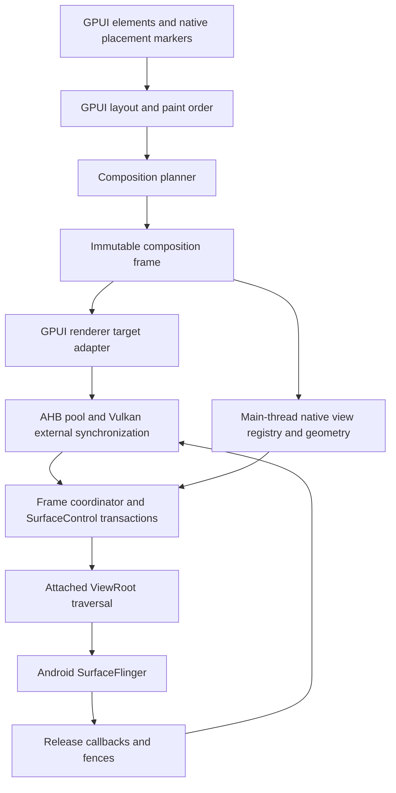

# Android native composition technical plan

Proposed follow-on work, prepared on November 11, 2026.

## 1. Purpose and scheduling

Extend gpui-box's self-rendered Android application path with native-view embedding
and a system compositor integration inspired by Flutter Hybrid Composition++
(HCPP). Preserve GPUI's existing state, layout, input, scene, and rendering model.
Android continues to own native views, IME, accessibility, and final composition.

This work follows the M0–M6 Android application release track in PROJECT_PLAN.md.
It has C0–C5 milestones. Its Android stages can be scheduled independently of M7
desktop distribution and M8 iOS validation. Shared-contract extraction follows
the separate iOS validation gate. C0 is a bounded research spike that
may run after M0 to reduce renderer uncertainty. The remaining stages depend on
the basic runtime, lifecycle, and text path being verified.

The proposed initial capability tiers are as follows.

| Tier | Rendering and composition | Entry gate |
| --- | --- | --- |
| Self-rendered | GPUI WGPU, standard Android SurfaceView presentation | Base Android renderer/device matrix |
| Basic native embedding | Native host overlay above GPUI, rectangular bounds, constrained ordering | C1 native-view lifecycle, input, and accessibility checks |
| System composition, experimental | AHB-backed GPUI base/overlay layers, native View hierarchy, synchronized transactions | API 35+ distribution floor, verified Vulkan interop, C0 and C2 gates |
| Expanded mixed composition | Additional supported clips/transforms or GPU layers | C4 correctness and performance evidence per capability |

These tiers are independent of a device's general ability to run gpui-box. Capability
queries expose the active tier and supported operations. A requested capability
is validated before displaying a page.

## 2. Verified references and boundaries

Flutter documents HCPP as experimental, opt-in, and available from Flutter 3.44.
Its documented requirements include API 34+ and Impeller with Vulkan. Those
requirements describe Flutter's implementation. gpui-box uses API 35+ as
its experimental eligibility policy and validates every Android API and Vulkan
feature it actually calls. [Flutter platform views](https://docs.flutter.dev/platform-integration/android/platform-views)

Android documents `AttachedSurfaceControl.applyTransactionOnDraw()` from API 31.
It consumes a transaction for synchronization with the next ViewRoot draw, and
does not itself schedule a draw. Call it on the UI thread, validate attachment,
check its boolean result, and invalidate the View when required. API level alone
does not establish a working compositor. [AttachedSurfaceControl](https://developer.android.com/reference/android/view/AttachedSurfaceControl)

The inspected Flutter source seals raster transactions into per-frame batches,
defers View mutations while a frame awaits traversal, and associates buffer
callbacks with `present_id`. PR #194591 documents the multi-frame race that these
mechanisms address. Use the code and regression cases as engineering references.
[Flutter controller](https://github.com/flutter/flutter/blob/d9b77d26265f5130ec6b250f087289fd3dddf5bf/engine/src/flutter/shell/platform/android/io/flutter/plugin/platform/PlatformViewsController2.java)
[Synchronization fix](https://github.com/flutter/flutter/pull/194591)

GPUI's inspected WGPU renderer acquires a surface texture and presents it through
its queue. It also contains internal offscreen rendering paths, surface replacement,
and resource reuse. These are useful starting points. AHB import and external
fence interoperability require a separate spike. The underlying WGPU Vulkan HAL
offers raw texture wrapping, which still requires correct allocation, device,
state tracking, synchronization, and destruction. [GPUI renderer](https://github.com/zed-industries/zed/blob/f8cfc7ed9e57503def9479138894f3139f5400cc/crates/gpui_wgpu/src/wgpu_renderer.rs)
[Pinned Vulkan HAL](https://github.com/gfx-rs/wgpu/blob/cddb2f5d80dc0009b2ef6767635140cacf90a007/wgpu-hal/src/vulkan/device.rs)

## 3. Architecture and module boundaries

Keep Android implementations in `gpui_android` and its Kotlin host. Proposed
modules include `native_view`, `composition`, `frame_coordinator`, `vulkan_ahb`,
`buffer_pool`, and `surface_control`. The renderer exposes a narrowly scoped
target adapter after C0 proves it viable. Preserve the ordinary surface target.

Start with Android-local placement/frame types. Extract a small shared composition
contract after the iOS track demonstrates matching semantics. Its eventual
contract describes placement, paint ordering, clips, opacity, visibility, and frame
identity. Platform services, OS handles, and fence types remain platform-owned.

Initial GPUI/native ordering supports a base GPU layer, native views in host order,
and an optional top GPU overlay. Preserve ordered layer descriptions in the frame
contract so a future planner can support more layers. Admit only scenes whose
ordering can be represented exactly by the enabled tier. Multi-overlay, occlusion
culling, and complex mutators each require their own evidence.

## 4. Frame contract and scheduling

The following are proposed data concepts, with exact APIs left to implementation.

| Record | Required contents |
| --- | --- |
| `CompositionFrame` | Runtime/view generation, surface generation, monotonically increasing frame ID, immutable native placements, ordered GPU layer plans, disposition |
| `NativeViewPlacement` | Stable generation-aware view ID, logical/physical bounds, supported transform/clip, opacity, visibility, focus intent |
| `LayerSubmission` | Layer ID, buffer lease ID, surface generation, present ID, target format/size, owned ready fence |
| `PresentationRecord` | Exact submission identities, previous consumer references, callback status, release fences, retirement state |

Frame progression is prepared, rendering, sealed, staged-for-traversal, submitted,
and retired. Cancellation is legal at defined boundaries and releases only
resources whose ownership has returned. Transaction completion and buffer
reusability are tracked separately.

### Required invariants

1. Every sealed frame pairs its own native geometry with its own GPU submissions.
2. A ViewRoot traversal has at most one staged geometry snapshot. Later native
   mutations wait until that snapshot is consumed or explicitly cancelled.
3. Frame ID, surface generation, buffer lease, and present ID remain distinct.
   A reused buffer receives a fresh lease and present identity.
4. Resource reclamation follows the exact consumer reference and release fence.
   A later callback arriving first cannot make an earlier buffer reusable.
5. Detach increments generation, invalidates queued native operations, and stops
   access to the old surface before the destruction callback returns.
6. GPUI's App, Window, mutable state, and native View objects retain their owner
   thread. Only owned immutable plans and explicit resource handles cross threads.

Initially GPUI UI/layout and Android View operations share the system main thread.
Raster work can remain there for the C0 correctness spike. A later dedicated raster
executor is permitted only after profiling and an ownership audit. A GPUI Scene
must be converted to safe frame-owned data before crossing that boundary.

### Bounded queue and traversal behavior

Begin with one staged frame and one pending complete frame. Apply backpressure
before acquiring another render target when both slots are occupied. Configure a
three-buffer pool per active GPU layer as the initial measured candidate, with a
global byte budget. Never block the system main thread waiting for pool space.

A newer prepared frame may replace a pending frame only before that frame's
native geometry is applied or its transaction staged. Drop the entire obsolete
geometry/buffer unit. GPU work already launched retains its lease until completion
and safe reclamation. Submitted frames drain through normal consumer-release
tracking. Keep dropped, superseded, submitted, and displayed counts observable.

Stage native geometry and matching GPU transactions as one frame unit, then call
`applyTransactionOnDraw()` and request traversal. The call consumes the transaction
according to the platform contract. Track its success separately from the retained
frame/buffer ledger. Handle a missing root, a false return, skipped pre-draw,
detach, resize, and a window that becomes invisible. On unsuccessful handoff,
follow the verified API ownership rules before releasing any buffer resources.
Do not mutate staged geometry merely because another Choreographer callback fired.
Test the selected draw-consumption signal and skipped-draw behavior against the
actual host. A watchdog cancels or resets a stalled session through ownership-safe
teardown and emits diagnostics, with no synchronous UI-thread fence wait. Work
already transferred to ViewRoot drains or is superseded using the verified
platform protocol. Cancellation only invalidates local plans and future work.

## 5. Renderer interop and resource protocol

### C0 experiments

1. Query exact Vulkan device/queue, AHB external-memory import support, compatible
   formats/usages, semaphore sync-FD support, and required feature enablement.
2. Allocate an AHB with GPU render-target, sampled-image, and compositor usage as
   required by the device and API. Query allocation properties and import it into
   the same Vulkan device used by the renderer.
3. Wrap the image through a narrow WGPU/HAL target boundary. Validate image layout,
   external queue-family ownership, usage tracking, memory binding, and destruction.
4. Render a real GPUI scene to that target, including alpha, text, clips, paths,
   atlas updates, and antialiasing. Export a ready sync FD tied to the actual GPU
   submission and correct memory barriers.
5. Present the AHB through SurfaceControl. Track completion and previous-buffer
   release, then safely reuse it. Repeat under surface and device recreation.

C0 compares supported WGPU/HAL interop, a bounded upstream renderer extension, and
a platform-specific target adapter. Select an approach only after demonstrating
correct synchronization. If WGPU device creation or external submission cannot
satisfy the protocol, document the necessary renderer changes and revised scope.

### Fence and handle ownership

The GPU ready/acquire fence gates compositor reading. The release fence gates
producer reuse. Consume/duplicate/close semantics are explicit for each JNI and
NDK boundary, including every error path. Treat fence `-1` according to the called
API's documented already-ready/released semantics.

`ASurfaceTransaction_setBuffer()` transfers ownership of the acquire fence FD to
Android. A previous release fence returned in transaction statistics belongs to
the caller, who must close it. That fence describes the previous buffer on that
surface. Transaction callbacks can arrive out of order or after detach. Record
submission identity and consumer references before handoff. Copy any needed stats
and acquire owned handles during the callback's valid lifetime.
[NDK surface-control contracts](https://developer.android.com/ndk/reference/group/native-activity)

Validate the applicable completion/statistics path on API 35 and newer.
`ASurfaceTransaction_setBufferWithRelease()` is an API 36 capability and needs a
guarded adapter if adopted. C0 must verify the Java/NDK transaction bridge and
ownership semantics on every supported API level. After the platform consumes a
transaction, retain its frame/submission ledger until consumer-release conditions
are established. Unhanded transactions are closed through their local owner.

Resize creates a new pool generation. Old pools drain asynchronously, including
the last displayed buffer, before destruction. Device loss quiesces submission
and rebuilds resources without reusing a potentially in-use image. Track buffer
bytes, in-flight leases, fence FDs, and late callbacks in diagnostics.

## 6. Input, accessibility, and capability negotiation

The composition planner supplies a consistent geometry/clip snapshot for both
rendering and hit testing. Resolve pointer ownership on down, preserve it for the
gesture sequence, and send cancellation when ownership changes or a view detaches.
Native view internals process their own gestures. GPUI processes its own raw
touch stream. Native/GPUI arbitration covers scroll interception, overlays,
multi-touch, focus, and system back.

Native text editors use their native input connection. GPUI editors use gpui-box's
UTF-16 adapter. Focus transfer ends the previous editing session and avoids stale
composition callbacks. Combine existing GPUI semantics with Android native-view
accessibility traversal, including bounds, z-order, hidden nodes, and actions.

Capability selection checks OS APIs, attached-root availability, Vulkan features,
AHB formats, external fences, driver policy, and initialization success. Use
`auto`, `basic`, and `system` modes in the later application configuration.
`auto` attempts the verified system tier and falls back to basic embedding at a
frame boundary. Strict `system` reports a typed unavailable error if initialization
fails. Record the reason and preserve navigation and native-view state where the
host supports reattachment. Repeated failure disables the experimental tier for
the current session. Tests can force each tier.

The basic tier guarantees its declared rectangular overlay contract. A page
requesting unsupported mixed ordering receives a capability error or supplies an
explicit application fallback. Devices below the base GPUI renderer's requirements
remain outside its supported device matrix.

Define support separately for rectangular clipping, rounded clipping, affine
transforms, alpha, native SurfaceView children, protected content, HDR, wide color,
screenshots, and accessibility. Cross-native backdrop filters, arbitrary overlap,
and native magnifiers require independent evaluation. Use premultiplied alpha and
an explicit SDR color/dataspace candidate in C0, then validate blending against
native surfaces.

## 7. Follow-on milestones

| Milestone | Deliverables | Exit evidence |
| --- | --- | --- |
| C0, interop spike | AHB target, external fences, tested Java/NDK transaction bridge, renderer decision | Actual GPUI pixels presented from AHB and safely reused, API 35/current device runs, validation-layer logs and resource accounting |
| C1, basic NativeView | Generation-aware registry, WebView element, rectangle placement, focus and teardown | Shared gallery page scrolls/moves native content, keyboard and TalkBack work, detach/recreate cancels stale callbacks |
| C2, synchronized composition | Base/overlay AHB layers, sealed frame queue, traversal gating, present/release ledger | Sustained native scrolling with moving GPUI overlay, correct frame-ID pairing, no early reuse under injected callback reordering |
| C3, resilience and fallback | Runtime probes, strict/basic/auto selection, bounded budgets, loss/reset paths | Older/non-eligible supported devices use basic tier, forced failures recover without leaks or stale geometry |
| C4, measured expansion | Explicit mutator capability matrix, input arbitration, supported native SurfaceView cases | Per-capability functional and visual checks, IME/accessibility tests, Perfetto comparison and memory/FD stability |
| C5, Android composition release | Versioned public NativeView API, compositor documentation, measured limits | Android device matrix passes, release/fallback and resource-stress gates pass |

After M8 establishes the iOS baseline, a separate cross-platform composition gate
validates a native-view prototype against the official Metal/UIKit path. Extract
shared placement semantics only after both prototypes pass. That gate has its own
implementation estimate and does not block C5's Android release.

Planning allowance for C0 is 1–2 engineer-weeks. Remaining work is provisionally
12–22 engineer-weeks plus 25–40% contingency, to be re-estimated after C0 and C1.
This allowance is additional to M0–M6. iOS implementation is estimated separately.

## 8. Acceptance and stress scenarios

- Prepare N, N+1, and N+2 before ViewRoot draws N. Assert buffer/geometry pairing.
- Skip or cancel traversal, merge transactions, detach/reattach immediately, and
  deliver old callbacks after a new session starts.
- Reorder completion callbacks and delay release fences. Assert no live buffer
  is overwritten and each owned FD is closed exactly once.
- Exhaust the buffer/byte budget, inject allocation/import failure, and verify
  nonblocking backpressure and explicit fallback.
- Resize, rotate, lock/unlock, background/resume, destroy surfaces, and lose the
  Vulkan device while frames are staged or submitted.
- Mix GPUI text, transparent overlays, WebView scrolling, focused native inputs,
  system keyboard, TalkBack, and system back. Test native SurfaceView separately.
- Exercise 60/90/120 Hz devices, noninteger density, minimum eligible API, recent
  API, two GPU vendors, and basic-tier devices below the system-composition floor.
- Capture Perfetto frame timelines and layer traces with frame/generation/present
  identifiers. Measure build/layout/raster/traversal/present time, missed frames,
  input latency, memory, FD count, thermal behavior, and idle wakeups.

The C2 gate requires machine-checked pairing and buffer-ownership assertions in
addition to visual inspection. C4 publishes measured improvements and limitations
against the same basic-tier workloads. C5 requires repeated lifecycle stress with
stable resource counts and documented behavior for every advertised capability.

## 9. Later iOS mapping

Reuse official `gpui_ios` and `gpui_apple`. Map validated placement semantics onto
UIView/CALayer and evaluate transaction-synchronized Metal presentation against
the current upstream rendering path. Keep scheduling, drawable ownership, and
Core Animation transactions specific to Apple APIs. `presentsWithTransaction`
is an investigation point whose presentation timing must be checked in the actual
renderer. Android buffers, SurfaceControl handles, and fence FDs stay in Android.
Extract shared composition types only once both platform prototypes justify them.
[Apple presentation property](https://developer.apple.com/documentation/quartzcore/cametallayer/presentswithtransaction)

## 10. Decisions remaining for the implementation spike

C0 chooses the smallest viable WGPU target extension, exact Vulkan feature set,
transaction bridge, tested pixel format, and release-callback adapter. C1 chooses
the precise NativeView factory/lifecycle API. C2 proves the traversal-consumption
signal and queue invariants. C4 sets measured performance limits. Each decision
is documented with code revision, device/OS, validation evidence, and fallback.
