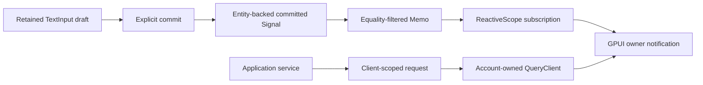

# Architecture decisions

Prepared on November 11, 2026. User requirements are accepted. Technical choices
below are proposed defaults pending the Android feasibility milestone.

## ADR-001 — Deliver a coordinated distribution with a small upstream patch surface

### Context

Application developers need a consistent GPUI version, reusable components, mobile
support, and release tooling. GPUI and Kit evolve independently and can expose
incompatible types if multiple GPUI package identities enter the graph.

### Decision

Provide an application-facing `gpui-box` facade over a tested, fixed dependency set.
Anchor platform work to official Zed GPUI, preserving its workspace and coordinated
crate set at one pinned revision. Maintain `gpui-android` under the distribution's
root `crates` directory and keep
necessary upstream changes in a documented patch queue. Use optional compatible
Kit layers once the official baseline works. Select the exact package graph
during M0 and make graph inspection a release check. Official source is copied directly under `vendor/gpui`, including its local
build/test dependency closure. The original workspace manifest and file hashes
are retained. The root distribution workspace uses local path dependencies.

### Alternatives considered

- A permanently independent engine fork offers control but increases upstream
  merge and compatibility work.
- A component-only library has a smaller surface but leaves Android and release
  integration to each application.

### Consequences

The distribution owns compatibility testing and migration guidance. Consumers
must use the facade's coordinated GPUI identity. Upstream snapshots are adopted
through validated upgrades.

## ADR-002 — Use an Android native host with Gradle-owned packaging

### Context

Android needs platform lifecycle, native surfaces, text composition, Java-thread
services, resources, signing, and application-store packages.

### Decision

Use a thin Kotlin Activity/SurfaceView host with a typed JNI bridge and direct
InputConnection integration. The system main thread owns GPUI state, layout,
input, and initial GPU submissions. Android drives foreground tasks and frames.
Use cargo-ndk for Rust ABI builds and the Gradle Wrapper for Android packaging.
Evaluate the existing GPUI WGPU renderer with Vulkan first. Confirm the host, renderer, text
stack, accessibility bridge, and full tool tuple in M0.

### Alternatives considered

- GameActivity provides useful text/lifecycle glue, while android-activity's
  native-thread loop would change the selected main-thread ownership model.
- NativeActivity simplifies an initial host but requires additional text-input work.
- Makepad's integrated tooling is a workflow reference whose renderer and UI model
  would introduce a second framework if embedded directly.

### Consequences

gpui-box maintains the Android host and dispatcher integration directly. Background
work returns to the system main thread through explicit dispatch. Native reentry,
GPUI borrows, and main-thread blocking require clear invariants. M0 can revise the
host or rendering choice if measurements fail the required acceptance cases.

## ADR-003 — Make mise the developer tool and task entry point

### Context

Rust and Android builds depend on several tool versions. Contributors need a
consistent setup across Windows and CI.

### Decision

Pin shared Rust tools and tasks in `mise.toml`. Pin Temurin Java and cargo-ndk
in the opt-in `mise.android.toml` environment for Android development.
Let Android SDK tooling manage SDK packages and license acceptance, with explicit
SDK/NDK pins added by M0. Pin Gradle 8.13 in both the Android mise environment and
the checked-in wrapper, including the wrapper distribution checksum. Avoid duplicate Rust
version declarations unless a documented consumer requires one.

### Consequences

The checked-in configuration is the tool-version source of truth. Contributors
still provision host compilers and Android SDK prerequisites. CI will run the
same mise tasks and Gradle Wrapper as local development.

## ADR-004 — Use channel-specific update providers

### Context

Desktop installers, Play-managed applications, and directly distributed Android
packages use different installation and trust mechanisms.

### Decision

Expose a shared update state machine with explicit provider capabilities. Android
uses Play delivery or verified APK handoff to the system installer. Desktop update
installation is implemented in the parallel desktop distribution track. Signed
metadata and application identity checks are part of the direct-download protocol.

### Consequences

The API represents user-action requirements and unsupported operations. Tests
must exercise actual distribution channels. Android recovery respects versionCode
and signer rules. Platform-level rollback promises require their own evidence.

## ADR-005 — Preserve reusable interaction behavior and add adaptive presentation

### Context

Kit contains substantial existing component work. Android introduces touch,
keyboard occlusion, navigation, font scaling, and accessibility requirements.

### Decision

Audit and reuse compatible behavior/components, then add mobile presentation and
application patterns where needed. Validate a focused catalog in a shared gallery.
Keep application services and heavyweight optional features separable.

### Consequences

Shared views remain practical while platform differences stay visible. Component
availability is documented against the tested platform matrix. Desktop-only
dependencies require feature or target isolation.

## ADR-006 — License original contributions under Apache-2.0

### Context

The user selected Apache License, Version 2.0 for gpui-box.

### Decision

Apply Apache-2.0 to original project contributions. Declare `license = "Apache-2.0"`
in future workspace package metadata. Preserve third-party licenses, copyright
headers, and applicable NOTICE obligations when incorporating upstream work.

### Consequences

The repository includes the complete Apache-2.0 text. Release packaging will
produce a third-party inventory and notices based on actual included dependencies
and assets. Copyright ownership follows the relevant contributors.

## ADR-007 — Separate runtime, view attachment, surface, and GPU resources

### Context

Android activity recreation, surface replacement, backgrounding, and GPU device
loss have different lifetimes. Delayed work can outlive its native objects.

### Decision

Track `GpuiRuntime`, `ViewAttachment`, `SurfaceSession`, and `RendererResources`
independently. Tag asynchronous work with generation-aware handles and cancel
obsolete requests. Before a surface-destruction callback returns, finish all host
access to that surface. Persist application-owned serializable state for process
recreation. Preserve GPUI's existing foreground/background executor distinction.

### Consequences

Lifecycle transitions become explicit test targets. Surface recreation can retain
application state and reusable GPU resources. Main-thread ownership simplifies
text and native UI integration. A later rendering-thread change requires evidence
and ownership-safe frame data.

## ADR-008 — Reuse mobile protocols and stage native-view integration

### Context

Official GPUI already includes raw touch, gesture processing, UTF-16-based text
interfaces, window insets, AccessKit semantics, and an iOS backend.

### Decision

Adapt Android to those existing protocols. Keep Rust authoritative for editable
text. Reuse the existing iOS/Apple path during the later iOS validation track.
After the self-rendered application is verified, introduce a restricted native
view host with rectangular bounds and simple overlay ordering. Design external
textures independently.

### Consequences

Mobile work extends existing GPUI behavior and requires focused interoperability
tests. Initial Android delivery stays bounded. Native composition and iOS
certification have their own acceptance gates.

## ADR-009 — Stage Android system composition behind measured interop gates

### Context

Native views and GPU-rendered content need matched geometry, buffer ownership,
and traversal timing. Flutter HCPP demonstrates an experimental system-composition
approach whose APIs and renderer assumptions require gpui-box-specific validation.

### Decision

Follow the base Android release with C0–C5 in ANDROID_COMPOSITION_PLAN.md. Prove
AHB/WGPU target and external-fence interoperability first. Preserve a basic
native-overlay tier, then add an opt-in system tier using sealed frames,
generation-aware ownership, bounded queues, ViewRoot synchronization, and exact
release tracking. Use the distribution-wide API 35+ floor for the system tier while
checking the actual minimum for each called API.

### Consequences

The base Android delivery has an independent release gate. System composition
needs device capability negotiation, failure recovery, and resource stress tests.
Shared composition types are extracted after Android and iOS demonstrate matching
needs. Renderer and host changes remain narrowly scoped and separately reviewed.

## ADR-010 — Manage desktop, mobile, and components in one distribution repository

### Context

The user clarified that gpui-box manages desktop and mobile together, including
future reusable component libraries. The user requires upstream source to be
copied directly into this repository.

### Decision

Keep imported engine/backend code under `vendor/gpui`, distribution APIs/services
and CLI under `crates`, reusable UI under `components`, runnable consumers under
`examples`, and native hosts/packaging under `platforms`. Preserve desktop platform
source and expose desktop application startup through the common facade. Android
is the first new backend. Desktop packaging can progress independently after its
shared tooling prerequisites exist.

### Consequences

Desktop development uses the base Rust mise environment. Android tools are opt-in.
Each platform has separate build/device validation while sharing source, APIs,
components, and release management. Imported source is versioned directly with
provenance and retained license material.

## ADR-011 — Require Android API 35 and stage device qualification

### Context

On November 11, 2026, the project owner selected API 35 as the minimum and
deferred physical-device tests during the current implementation phase.

### Decision

Use minSdk 35, targetSdk 35, compileSdk 36, and cargo-ndk platform 35. Complete M0
with Windows and API 35 x86_64 emulator execution, both Android ABI builds, and
automated IME protocol/lifecycle evidence. Track ARM64 hardware, real Chinese
keyboard candidate UI, and vendor-specific renderer qualification as deferred
release work. Keep physical-test status explicit in milestone reports.

### Consequences

The host can directly use modern WindowInsets and system-back APIs. Emulator
evidence supports continued platform development. Hardware qualification remains
a separate prerequisite for declaring supported release devices.

## ADR-012 — Prototype explicit Entity-backed state and application-owned caches

### Context

The component layer needs retained input drafts, selective subscriptions and
stale-response protection while desktop and Android share one GPUI identity.

### Decision

Implement Signal, Memo, Store selectors, Binding and ReactiveScope directly over
GPUI Entity/observe/notify. Scopes batch owner notifications and release retained
subscriptions on clear/drop. Input controllers own draft, composition and directed
selection. A Binding updates a separate committed value explicitly. One QueryClient
owns each account's cache. Requests carry client identity, cancellation and request
IDs. Mutations reconcile against the captured cache revision and account epoch.
Account changes cancel requests and clear cached data. Applications select their
executor and transport. The public API remains a prototype pending wider cases.

### Reference comparison

Web query/store patterns motivate separating server data ownership from local UI
state and revision-based mutation conflict handling. Android Repository/ViewModel
patterns motivate screen-owned lifetime and explicit cancellation. SwiftUI
Observation/Binding motivates projected values and explicit field bindings.
Riverpod motivates scoped disposal and testable service boundaries. The prototype
uses GPUI's existing scheduling and explicit subscriptions. It has eager memos,
no implicit read tracking, no background transport and no automatic refetch.

### Consequences

Real GPUI context tests can measure notification batching and selector filtering.
Render counters in the gallery describe render calls only. Layout/paint counts,
input latency, virtualized lists, multiwindow lifetimes and production service
overrides remain separate acceptance work. Conflicting mutations require refetch.

## ADR-013 — Share native lifecycle observations and bounded transient restoration

### Context

The merged lifecycle crate provides application contracts and deterministic
restoration. Android supplies platform observations and Bundle-based recreation.

### Decision

The main-Looper Android host owns one LifecycleService and installs its cloned
handle in GPUI SystemServices before application launch. Surface generation gates
visibility/focus/preference observations. Activity started/resumed and window focus
remain separate inputs. Report OS appearance, font scale, locale, animation-disabled
preference, keyguard and memory warnings. Unsupported observations stay unavailable.

Applications register a save callback and consume pending bytes through their
launch App context. Android stores at most 128 KiB in saved-instance state. The
example uses gpui-lifecycle VersionedSnapshot for route/preferences/counter,
committed value, drafts, directed selections and focus. Restore finishes composition
from the old IME connection. Activity recreation retains authoritative live Rust
state. Process recreation consumes the saved Bundle once.

### Consequences

Bundle snapshots are transient UI state. Business data and durable activation use
private storage and the activation inbox. Pending URL IDs survive Activity
recreation with a 16-entry host queue and a 256-ID process duplicate window.
Applications requiring durable routing must accept into their own persisted inbox.
GPU recovery and physical qualification retain independent gates.

## ADR-014 — Adapt Android permissions through the shared contextual service

### Context

The shared permission service owns request cancellation, UI lifetime validation,
the logical prompt lane and scoped observation. Android supplies the runtime
dialog and authoritative PackageManager state. Typed CLI declarations already
carry permission intent and contextual purpose metadata.

### Decision

Install one process-owned Android PermissionService in SystemServices before
application launch. Kotlin verifies both the generated service declaration and
the manifest, then queries checkSelfPermission and policy/rationale observations.
Support notifications, camera, microphone, foreground location and contacts.
Approximate location maps to Limited. Enterprise policy maps to Restricted.
Photos, biometrics and special access retain operation-specific providers.

The Activity owns a native prompt lane. Post dialog presentation until Rust
application borrows unwind. Correlate results with unique request IDs, release
provider borrows before completing requests and re-query actual authorization.
Surface replacement advances the host UiOwner and rejects old completions.
An already-presented system dialog remains owned until Android returns it.
Pending Activity state carries a process token to prevent old IDs from entering
a new Rust process. Unstarted posted work is excluded from restored prompt state.

Persist only actual denied-callback history for first/retry/permanent-denial
classification. Every authorization decision still probes the OS. Settings handoff
reports accepted presentation only. Regaining foreground focus reconciles observed
permission state and emits changes through the existing bounded event streams.

### Consequences

Applications use explicit contextual buttons and retain local request tasks.
Cancellation cannot close an Android-owned dialog or undo a grant. Native busy
state prevents competing prompts while that dialog remains. A reclaimed process
reconstructs service observations from the OS. Android may kill it after revocation.
Per-operation runtime evidence stays in validation reports. The provider capability
uses Compiled conservatively, and generic contract manifests retain their scope.
AndroidX ActivityResult was considered. The existing Activity/JNI host uses its
platform callback without adding a second Activity lifecycle owner.

## ADR-015 — Inspect release artifacts before publishing staged output

### Context

The source-checkout generator already owns the Android host and its configuration.
Release packaging must prove artifact identity, signing and native compatibility,
retain traceable dependency terms and preserve existing versioned output.

### Decision

Use an explicit CLI release profile with environment-backed signing inputs,
verified Gradle Wrapper and pinned/checksummed bundletool. Build both APK and AAB,
inspect signatures against the selected private-key certificate, compare their
native-library contents and validate ABI, ELF/ZIP 16 KB alignment, application
identity, manifest flags, requested permissions and service assets. Publish a
staged directory only after inspection and inventory generation succeed.

Keep debug/release JNI outputs separate. Record release profile independently
from update-channel configuration. Collect original texts plus hash-verified
commit-pinned supplemental licenses, and expose incomplete publication review
in machine-readable metadata. Include recursive output checksums and preserve
existing releases. A shared per-project packaging lock coordinates CLI packages.

The Windows portable developer path reuses the development build and the common
inventory/checksum pipeline, producing a runnable ZIP with explicit prerequisites.
The full SDK closure and desktop production installers retain their own milestones.

### Consequences

Applications supply their signing identity and credentials externally. Configuration
and inspection failures stop artifact publication. Additional exported native
components require a policy extension coordinated with the owning provider.
Build/signature/alignment evidence remains distinct from store/device acceptance,
16 KB runtime qualification and completed license review. Offline readiness and
clean-machine provisioning require their own source/tool/dependency closure tests.

## ADR-016 — Authenticate exact update payloads and correlate each delivery phase

### Context

Release artifacts now have inspected app identity, signer and digests. Channel
delivery needs pinned trust, monotonic replay protection and phase-specific
completion evidence. Native handoff and installation are separate observations.

### Decision

Add a dependency-light gpui-updates crate with an optional facade feature. Use
strict Ed25519 verification over a domain plus the exact bounded payload bytes.
Application policy owns public keys, installed identity and HTTPS origins. Validate
Android direct-APK metadata before atomically committing an AppData-backed
application/sequence/version/digest/time checkpoint under an exclusive OS lock.

Represent accepted metadata and stream-verification receipts with private fields.
Correlate asynchronous state changes with session/generation tickets. Handoff
requires a current UI owner, the latest authenticated offer and artifact receipt.
Confirm installation through a fresh matching installed-identity probe. Preserve
native cancellation and uncertain handoff reconciliation as separate results.

### Consequences

The signature protocol avoids cross-language JSON canonicalization assumptions.
The same authenticated payload can be retried after interruption while older or
equivocating payloads fail. Cryptography and persistence execute on workers.
Native adapters must bind inspected files to their grants and recheck actual APK
identity/signature, permissions and redirect origins. Durable download/installer
state, signer lineage, store channels and platform runtime evidence retain
explicit follow-up acceptance. Local settings and wall-clock checks have their
documented trust boundary. Provider manifests retain ContractOnly until adapters
supply compiled/runtime evidence.

## ADR-017 — Recover synced update tails and publish verified artifacts atomically

### Context

Signed update metadata supplies trusted byte length and digest. Downloads can
stop between a file write, a checkpoint commit and a publication rename. Native
installers may retain files while ordinary application cache cleanup runs.

### Decision

Keep one bounded transfer slot in AppData's private Data root with explicit
cleanup and an exclusive OS writer lock. Reuse bounded atomic SettingsStore for
offer/digest/size/offset/prefix-hash/phase checkpoints. Sync each bounded chunk
before committing its offset. Rehash committed prefixes on resume and adopt
bounded uncommitted tails after syncing them. Preserve inconsistent state until
explicit recovery. Require exact append offsets and fresh session/generation
tickets. Recheck full signed digest and current trust before atomic publication.

Recover a renamed file by re-verifying it before checkpointing Published. Return
a read-only file handle and stream receipt to native providers. Persist a deletion
intent before explicit discard so interrupted cleanup can resume. Preserve unknown
files. Track directory-sync uncertainty separately from logical completion.

### Consequences

Ordinary cache cleanup cannot remove active update artifacts. Explicit discard
reclaims this single slot before a different signed offer starts. Resume hashes
the saved prefix once, while each append extends an in-memory digest. Appends are
bounded to 1 MiB, artifacts to the authenticated application limit up to 2 GiB.
Crash recovery may retain bytes beyond the last reported offset, and the final
digest remains authoritative. Private roots and filesystem atomic rename remain
storage prerequisites. Native transport negotiation, APK identity/signature/URI
binding and durable installer reconciliation require platform adapters.

## ADR-018 — Resolve Android storage from application context on workers

### Context

The shared AppData service already owns bounded settings, recovery, lifetime
locks, account partitioning and export leases. Android needs authoritative
private roots without retaining Activity or doing storage work in GPUI callbacks.

### Decision

Install application context before native surface launch. Query its no-backup
and cache directory getters through a worker JNI call. Supply disjoint no-backup
control/config/data/logs/temporary roots and a separate cache root to the existing
AppData constructor. Expose roots and existing storage types through the Android
facade. Reject UI-thread discovery. Keep opened service lifetime and registry
installation under the application's ownership.

### Consequences

Activity recreation retains stable roots without Activity/surface references.
No-backup temporary exports survive ordinary OS cache eviction until explicit
lease cleanup. Durable business content uses credential-encrypted app storage,
excluded from Auto Backup. Applications requiring backup or direct-boot data need
explicit policies and separate providers. Backup/device-transfer, locked-boot,
uninstall and hardware filesystem behavior retain independent runtime gates.
