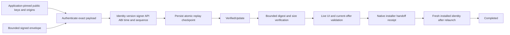

# M5 update trust and orchestration

## Implemented core

`gpui-updates` provides dependency-light signed metadata verification, a durable
replay/time checkpoint and generation-correlated orchestration. Enable the
facade's `updates` feature to use it as `gpui_box::updates`. Native adapters
publish per-operation platform/channel/evidence manifests. The crate's default
manifest records ContractOnly and an absent native adapter.

ReleaseProfile and UpdateChannel are separate. Channel vocabulary covers
development, Android Play/direct APK, desktop formats, iOS Store and Web delivery.
The executable metadata policy currently accepts Android direct APK. Channel
enumeration alone supplies no runtime provider.

## Signed format and pinned trust

SignedMetadata v1 is a JSON envelope with `schema_version`, `key_id`, `payload`
and lowercase hexadecimal `signature`. Sign Ed25519 over SIGNATURE_DOMAIN
followed by the exact UTF-8 bytes in the payload string. Authenticate before
parsing that string. The verifier uses `ed25519-dalek` strict verification and
rejects weak pinned public keys. Application policy pins up to eight public keys.
Metadata cannot replace that trust policy. Private signing keys remain in the
publisher's external signing infrastructure.

The envelope is bounded to 128 KiB and payload to 32 KiB. Unknown and duplicate
fields are rejected by strict typed deserialization. UpdateMetadata contains
application ID, channel, display version, versionCode, monotonic sequence,
issued/expiry UTC seconds and one ArtifactMetadata. Artifact metadata contains
HTTPS URL, SHA-256, byte length, APK certificate SHA-256, ABI list and API range.

Validation requires the installed application ID, a strictly increasing Android
versionCode, the same installed signer, a supported ABI and API 35 or later.
Signer rotation/lineage requires a future explicit native trust policy. Digests
and signatures use exact lowercase hexadecimal encoding. Artifact size is bounded
by an application limit of at most 2 GiB. Metadata lifetime is at most seven days,
with a five-minute future clock allowance. Expired offers fail again at handoff.

URLs require HTTPS, a host, no user information, no fragment and no controls or
whitespace. Policy pins exact origins, including ports. Subdomains and alternate
ports receive no implicit trust. Download adapters must reapply this origin policy
to every redirect, retain size bounds while streaming and avoid logging URLs.

## Persistence, retry and execution ownership

Open UpdateVerifier on the application's existing AppData owner from a background
executor. It acquires an OS file lock for one trust-checkpoint writer and reuses
SettingsStore's bounded atomic replacement. Share it with Arc for multiple views.
The checkpoint binds application ID, highest sequence/versionCode, payload digest
and observed time. Corrupt, unknown-schema or inconsistent persisted data fails
closed and retains the original. No automatic reset bypasses replay protection.

The same sequence permits an idempotent retry only for a byte-identical signed
payload. Lower sequences/versions, conflicting equal sequences and significant
clock rollback fail. Commit the checkpoint before exposing VerifiedUpdate. A
newer accepted payload invalidates held older offers through revalidation.
The local checkpoint protects restart/retry ordering within private AppData.
Rollback-resistant OS storage and trusted-time acquisition require native policy
for environments whose threat model includes local storage/clock manipulation.

Signature verification, stream hashing and persistence run on a background worker
with a UI-free OperationContext. The stream verifier polls cancellation/deadline
between reads and bounds actual bytes against authenticated size. A blocking Read
implementation must supply its own I/O timeout/cooperative interruption. Its
private ArtifactVerification receipt proves the inspected stream. Native adapters
must preserve that byte identity through private-file inspection and URI grant.
Recheck the actual APK application/version/certificate and install-source
authorization before asking Android to install.

## State and receipts

UpdateController moves through Idle, Checking, UpToDate/Available, Downloading,
Verified, AwaitingUserAction, Installing and Completed, with ordinary cancellation
and explicit retryable/non-retryable failure states. Every async phase receives
an opaque session/generation ticket. Foreign/old tickets cannot update a new
attempt. Progress is monotonic and bounded by signed length. Phase-invalid
callbacks are ignored or rejected without replacing authoritative state.

Handoff requires a current owning-thread UiContext, a verified artifact receipt,
unexpired current metadata and fresh policy validation. Retain the context through
native acceptance so an expired UI owner cannot complete its old presentation.
Cancellation after handoff cannot undo native UI. Reconcile or report a correlated
native decline before retrying. An accepted handoff reports Installing.
Only a fresh installed-identity query matching the expected app, certificate and
version marks Completed. This query also reconciles a handoff whose old UI
callback was dropped after recreation. Higher unexpected versions require a new
application reconciliation policy.

## Bounded artifact cache and transfer recovery

ArtifactCache owns one transfer slot per existing AppData owner. Open it on a
background executor and retain it throughout the transfer. Its independent OS
lock prevents competing cache writers. Files live under the private Data root's
`update-cache` directory so ordinary `AppData::clear_cache` cannot remove a
transfer or a file already used by a native installer. The maximum authenticated
size remains 2 GiB. The caller explicitly discards a superseded/completed slot to
reclaim disk space. Unknown files remain available for diagnosis.

Call `resume(verifier, update, now, context)` with a current VerifiedUpdate. It
returns a fresh opaque CacheTicket and TransferProgress. Use `received` as the
exact HTTP resume offset. Append accepts nonempty chunks up to 1 MiB, rejects
out-of-order/duplicate offsets, and bounds the total by the signed artifact size.
Session/generation tickets reject callbacks from earlier resumes or cache owners.
The transport must separately enforce HTTPS redirect origins, response status,
Content-Range, content encoding, server ETag/If-Range and network timeouts.

Each append syncs the file before atomically replacing the bounded AppData
checkpoint. The checkpoint binds the exact signed payload, artifact digest/size,
committed offset and prefix SHA-256. On resume the cache rehashes the committed
prefix. If a process stopped after a write and before checkpoint replacement,
the bounded tail is hashed, synced and adopted into a new checkpoint. This also
recovers a partial write. Missing committed bytes, modified prefixes, oversize
files, conflicting staging/final files and unknown orphan artifacts fail while
preserving their bytes. A bad adopted tail still fails the final signed digest.
Corrupt settings require explicit application recovery through SettingsStore.

`publish` checks the complete size/digest and current offer before renaming
`artifact.part` to `artifact.verified` within the same private directory. Every
cache hit is reverified. A crash after rename and before the Published checkpoint
is recovered by verifying the existing final file. CachedArtifact supplies a
read-only File at offset zero, its ArtifactVerification receipt and durability.
Directory-sync uncertainty is retained in the receipt. Windows reports FileSynced.
The native adapter must retain exact byte identity when inspecting/copying this
file and granting an installer URI. AppData roots must remain application-private.
The path checks retain AppData's documented lexical containment/trusted-root
boundary.

I/O/checkpoint failures after a mutation invalidate the active ticket. Resume
before continuing. Cancellation and deadlines are polled before work, while
rehashing, and before checkpoint commit. A reported cancellation may leave a
recoverable uncommitted tail or a renamed artifact. `discard` first persists a
Discarding intent, removes only the slot's two known regular files, then commits
an empty slot. Repeat discard after reopening to finish interrupted removal.
Transfer recovery does not restore UpdateController or native installer attempts.

## Validation and remaining adapters

Host tests cover signed/byte tampering, wrong key, strict bounds/schema/duplicates,
app/channel/version/signer/API/ABI/origin/expiry mismatches, persisted replay and
clock rollback, equal-sequence retry, competing checkpoint owners, corruption,
cancellation, stale/foreign callbacks, monotonic progress, superseded offers,
expired UI context, native decline/retry and installed-version completion.
Strict Clippy and Android ARM64/x86_64 API 35 cross-checks pass.

The initial core delivery passes 12 update tests, including key-removal
revalidation. Integrated `mise run check` passes 155 host tests plus six
compile-fail doctests and two nested child-process reports. Android API 35
ARM64/x86_64 strict Clippy passes. The facade's dependency-light `updates`
feature checks independently of native GPUI rendering features.

The cache continuation adds 15 regression tests, bringing update coverage to 27
tests. It exercises exact-offset and stale callbacks, read-only publication,
restart/prefix hashing, uncommitted-tail adoption, rename-before-checkpoint
recovery, injected append/publication checkpoint failures, interrupted discard,
missing/tampered/conflicting files, orphan preservation, bounded chunks,
cancellation/deadlines/UI rejection, offer expiry/supersession and cache cleanup
isolation. Native channel runtime qualification remains pending.

Integrated `mise run check` passes 170 host tests plus six compile-fail doctests
and two nested child-process reports. All 27 update tests also pass as an Android
x86_64 native test executable on the Android 15 / API 35 emulator. Both Android
ARM64/x86_64 API 35 all-target strict Clippy checks pass. This validates the shared
filesystem/trust/state core on Android. App-private provider wiring and installer
interaction retain their separate runtime gates.

The next #6 slice owns native HTTP download/redirect-origin enforcement, durable
installer-attempt recovery, Android FileProvider URI
grant lifetime, install-source permission, actual APK signature/identity parsing,
native user cancellation and post-relaunch package probing. Play test-track flow,
same-signer v1-to-v2 upgrade retaining app data and interrupted channel flows are
required native acceptance. Physical-device testing remains deferred. #67 links
desktop/iOS/Web provider implementations with their independent qualification.
