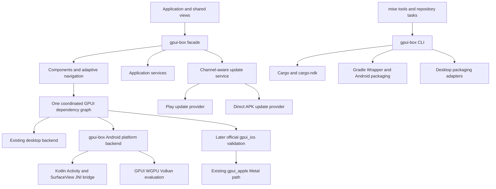

# gpui-box project plan

Draft for implementation review, prepared on November 11, 2026.

## 1. Product intent

gpui-box is a coordinated GPUI distribution for developers building native Rust
applications. It brings together a tested GPUI baseline, Android integration,
common UI components, application services, project tooling, packaging, and update
delivery. A developer should be able to create a project, run it on Windows and
Android, package it, and deliver a subsequent version using documented commands.

This is a multi-milestone framework project. Android platform integration carries
the largest early uncertainty and determines the implementation sequence.

### Confirmed requirements

- Android is the mobile target for the first phase.
- The distribution includes common components, packaging, updates, and extensions
  that simplify application development.
- mise manages development tools and task entry points.
- Repository content uses English.
- Git is initialized and original project contributions use Apache-2.0.

### Proposed defaults

These are planning decisions made by the author and can be adjusted during review.

| Area | Proposed baseline | Reason |
| --- | --- | --- |
| First desktop host | Windows x86_64 | Matches the current development environment and provides a desktop regression target |
| Android minimum | Evaluate API 26 as a starting candidate | M0 determines the actual floor from dependencies, APIs, and device evidence |
| Android SDK | compileSdk 36 and targetSdk 36 | Initial candidate, subject to current Android tooling and distribution requirements at M0 |
| Android NDK | r30, revision 30.0.16248370 | Current LTS listed by Android during research, subject to dependency verification |
| Android ABIs | arm64-v8a for devices and x86_64 for emulators | Covers primary development and distribution paths |
| Rust | 1.98.1 | Matches the inspected GPUI upstream toolchain |
| JDK | Temurin 17.0.21+9 | Initial Android build-tool candidate with an explicit vendor and patch pin |
| UI foundation | Official Zed GPUI baseline, with optional compatible Kit layers | Keeps platform integration anchored to upstream while reusing component work |
| Android host | Kotlin Activity and SurfaceView with a typed JNI bridge | Supports system-main-thread ownership and a direct InputConnection adapter |
| Rendering | Evaluate GPUI WGPU with Vulkan first on Android | Validates surface, shader, texture, and text behavior on a bounded backend |
| Application API | A `gpui-box` facade plus optional capabilities | Gives consumers a coordinated dependency graph |

M0 must pin and test the complete Gradle, AGP, Kotlin, JNI,
SDK, NDK, and JDK tuple. If the chosen AGP requires a newer JDK,
update the mise pin and document the tested tuple together. Current pins establish
the planning environment and remain subject to that compatibility check.

### Release scope

The `0.1.0` release candidate covers an Android application with Windows developer
preview, a small component catalog, basic application services, a project CLI,
signed APK/AAB output, and Android update flows for Play and direct distribution.
Windows gets a portable developer bundle in this phase. Native desktop installers
and desktop self-update are the next release track.

iOS, macOS/Linux distribution certification, web delivery, advanced editors,
plugin runtimes, hot code replacement, and additional GPU backends are later work.
The iOS track reuses official `gpui_ios` and `gpui_apple`, with device validation,
fixes, and host packaging as its focus. It retains Apple's existing Metal path.

## 2. Findings that shape the architecture

The inspected GPUI platform constructor selects iOS, macOS, Windows, Linux, and
web implementations. It has no Android constructor branch. Its platform interfaces
and WGPU renderer provide useful extension points, but Android compilation,
rendering, input, text shaping, and lifecycle behavior require a feasibility
prototype. A target-specific dependency alone does not establish Android support.
[GPUI platform source](https://github.com/zed-industries/zed/blob/f8cfc7ed9e57503def9479138894f3139f5400cc/crates/gpui_platform/src/gpui_platform.rs)

The former GPUI Component repository now presents GPUI Kit, including a facade,
behavior foundation, styled components, and an optional extension runtime. Its
manifest excludes the native platform dependency on Android and iOS. Reuse must
therefore be assessed at the component and dependency-graph level, with mobile
interaction verification. [GPUI Kit manifest](https://github.com/longbridge/gpui-kit/blob/7cd921d493f32ffefc8ddade4c84d781b2a58c23/crates/kit/Cargo.toml)

android-activity recommends Gradle packaging with cargo-ndk and documents
GameActivity's built-in IME support. Its default native application thread differs
from the main-thread host ownership selected for this design, so its event loop
is a comparison point. Makepad demonstrates the value of an integrated Rust mobile
tooling workflow. Flutter provides references for host/engine separation, IME,
lifecycle, accessibility, and platform views. Tauri provides examples of bridge boundaries and
signed desktop updates. Its updater documents desktop support and excludes
Android. [android-activity](https://github.com/rust-mobile/android-activity/blob/b4ddf059b77be12cdb955d394e65a92e7568d936/README.md)
[Makepad Android tooling](https://github.com/makepad/makepad/blob/506ec05105b9adb08d1d21f9879df181b5244ea7/tools/cargo_makepad/src/android/mod.rs)
[Tauri updater](https://github.com/tauri-apps/plugins-workspace/blob/9aa4f717152cdeceed4bada9c849ad68a9dc402c/plugins/updater/README.md)

## 3. Architecture



### Dependency and upstream strategy

Use official Zed GPUI as the platform baseline. Keep the coordinated GPUI crates
and their workspace dependency closure at one official revision. The inspected
SHA `f8cfc7ed9e57503def9479138894f3139f5400cc` is the starting candidate. During M0,
preserve the upstream workspace in a pinned checkout under `upstream/zed` while
developing the backend additions. Treat the checkout as an explicit implementation
deliverable and record all modifications in version control. Evaluate a Git
submodule backed by a maintained fork before importing it. Its remote location
is an implementation choice once an owned repository is available. Preserve
upstream history and required license files. Extracting a smaller standalone
workspace is a later milestone after the platform path works.

Maintain a release manifest that records this official baseline, any downstream
patches, optional Kit revision, Rust toolchain, Android tool tuple, and supported
targets. Kit integration follows the official baseline. If a compatible component
graph cannot be established, keep Kit optional and implement the minimal gallery
using GPUI primitives. Research anchors in REFERENCES.md have not been established
as a working dependency pair.

Applications should import GPUI types through gpui-box's facade. Every package must
resolve the same GPUI package identity, including source and revision. A Kit
release using renamed GPUI snapshot packages cannot be combined casually with a
different GPUI Git source. M0 chooses either an aligned upstream/snapshot graph or
a controlled set of minimally patched snapshots. Verify with Cargo metadata and
duplicate-package inspection before exposing public types.

The distribution repository is `https://github.com/jihuayu/gpui-box`. Cargo package
names and the CLI use `gpui-box`, with `gpui_box` as the Rust facade import.
The upstream fork or patch repository is a separate implementation choice.

Keep Android-specific platform code in a separate crate. Use upstream extension
points where they suffice. If core changes are required, maintain a small,
documented patch queue with upstream links and regression coverage. Review
upstream upgrades as dedicated changes. A tested revision remains fixed until
the compatibility matrix passes.

### Proposed repository layout

Create these directories when the corresponding implementation begins. GPUI
platform additions initially live inside the preserved upstream workspace.

```text
crates/
  gpui-box/                 Application-facing facade and initialization
  gpui-box-components/      Coordinated component exports and mobile additions
  gpui-box-app/             Navigation, configuration, storage, and lifecycle
  gpui-box-update/          Update state machine and channel providers
  gpui-box-cli/             Project creation, diagnostics, dev, build, and package
examples/
  hello/                 Smallest shared-view desktop and Android application
  gallery/               Component, accessibility, and adaptive-layout checks
templates/
  app/                   Generated Rust project and Gradle Android host
platforms/
  android/               Shared Kotlin/JNI host support and build integration
upstream/
  zed/                   Pinned official baseline, preserved workspace
    crates/
      gpui/              Existing core
      gpui_platform/     Existing selector with Android integration
      gpui_wgpu/         Existing renderer and text implementation
      gpui_apple/        Existing Apple backend
      gpui_ios/          Existing iOS implementation
      gpui_android/      New Android backend
docs/
  PROJECT_PLAN.md
  ARCHITECTURE_DECISIONS.md
  REFERENCES.md
```

### Android ownership and threading

The Android system main thread owns native UI objects, GPUI App/Entity mutation,
focus, layout, scene construction, and initial GPU submission. Android owns the
event loop. The host retains the runtime and pumps foreground work and frame
callbacks through GPUI's dispatcher. Background executors perform I/O, decoding,
and independent computation. Main-thread code must not synchronously wait for
background tasks. Release mutable GPUI borrows and internal locks before invoking
native calls that can synchronously reenter Rust.

Use four independent ownership units. These names describe proposed concepts.

| Unit | Ownership and lifetime |
| --- | --- |
| `GpuiRuntime` | App state, foreground scheduling, and services, retained across ordinary view recreation |
| `ViewAttachment` | Logical window binding to one native View, invalidated on detach |
| `SurfaceSession` | Native drawing target, dimensions, format, and monotonically increasing generation |
| `RendererResources` | GPU device, pipelines, atlas, and caches, retained or rebuilt according to device validity and memory pressure |

Track foreground/inactive/background, attached/detached, and
missing/ready/lost surface states independently. Present only when permitted,
attached, surface-valid, nonzero-sized, and dirty or animating. Surface generation
travels with asynchronous frame work and callbacks. Discard stale generations.
Before `surfaceDestroyed()` returns, stop every access to the old surface,
including submissions and in-flight work owned by the host. Handle device loss
separately from surface replacement.

JNI uses generation-aware handle tables with request IDs and explicit cancellation.
Document ownership of global references and thread attachment. Cancel or discard
callbacks from detached Views and obsolete IME sessions. FFI boundaries contain
Rust panics according to a documented shutdown policy. Persist serializable
business/navigation state through save/restore hooks for process recreation.

The Android backend is split into platform, window, surface, dispatcher, input,
IME, fonts, accessibility, and services modules. Kotlin owns Android SDK integration
and ordinary GPUI component layout/drawing stays in Rust. High-frequency input
and frame data use typed calls with explicit ownership.

Forward raw touch events with pointer ID, phase, position, and timestamp to GPUI's
existing gesture recognizer. Validate scroll-versus-tap cancellation, multi-touch
identity, long press, and system gesture takeover. Reuse WindowInsets and existing
keyboard interfaces. Define logical, physical, and native-screen coordinate
conversions once for input, caret geometry, accessibility, and native integration.
Keyboard avoidance applies each inset once. Back navigation first closes input or
transient UI, then pops navigation, then delegates to the host. Predictive-back
handling follows the target SDK contract.

### Rendering, text, and accessibility

Evaluate GPUI WGPU on a real Android surface before selecting the rendering path.
Start with Vulkan. GLES becomes a separate compatibility milestone if required.
Record driver behavior, surface loss, font loading,
shaping, glyph atlas behavior, clipping, and device-loss recovery. Advertise only
backends that pass the device matrix. If reuse fails, M0 produces a revised
renderer proposal with measured evidence before proceeding.

Start with redistribution-compatible bundled fonts and the existing CosmicText
implementation, then validate Android system discovery and fallback. Verify CJK,
emoji, bidirectional text, ligatures, scaling, caret placement, and shaping.

Implement InputConnection against GPUI's InputHandler/PlatformInputHandler
protocol, with Rust as the authority for text, selection, composing range, and
input-session identity. Use UTF-16 offsets at the protocol boundary, with explicit
conversion and surrogate-boundary tests. Cover composing replacement, surrounding
text, batch edits, selection, emoji deletion, paste, multiple fields, keyboard
reopening, and resize behavior from the first end-to-end prototype.

Reuse GPUI's AccessKit semantics and verify the exact Android adapter/version.
Stable semantic IDs, roles, names, states, bounds, actions, focus, and text edits
must reach TalkBack. Include accessibility in the first release acceptance gate.

### Later native integration

The detailed follow-on architecture, AHB/WGPU interop spike, frame/fence ownership,
runtime fallback, and C0–C5 acceptance gates are specified in
[Android native composition technical plan](ANDROID_COMPOSITION_PLAN.md).
This track follows M0–M6, with an optional bounded C0 risk spike after M0.

After the self-rendered application path passes, add a bounded NativeView feature.
Begin with an Android WebView in a rectangular region above the GPUI surface,
supporting basic position/size changes and explicit focus/lifecycle handling.
Complex transforms, interleaved composition, clipping, and opacity require
separate designs and tests. Camera/video external textures form a separate
integration capability. Later iOS work can evaluate WKWebView using the same
bounded host contract.

### Components and application services

Start with theme tokens, typography, spacing, light/dark mode, scalable text, and
touch-target sizing. Audit compatible Kit primitives before adding wrappers.
The initial catalog contains Button, Label, Icon, TextInput, Checkbox, Switch,
List, ScrollView, Dialog, Toast, and loading/error/empty states. Mobile additions
cover navigation stacks, app bars, bottom navigation, and modal bottom sheets.
SafeArea and keyboard avoidance use upstream window geometry. Shared state and
interaction logic should support narrow and wide layouts. Begin with a real form
and list gallery before expanding the component catalog.

The minimal application service layer covers lifecycle subscriptions, local
configuration, app-private storage, clipboard, external URL opening, file picking,
and explicit permission requests. Capability queries expose unsupported platform
operations. Optional capabilities should compile independently of unrelated
desktop-only dependencies.

### CLI and packaging

The proposed CLI commands are `gpui-box new`, `doctor`, `dev`, `build`, `package`,
and `update manifest`. They become available incrementally after M0. `doctor`
reports exact versions, SDK paths, licenses, NDK, compiler prerequisites, ABIs,
and connected devices with corrective commands.

Gradle owns the manifest, resources, Android dependencies, signing, APK, and AAB.
cargo-ndk builds Rust libraries into ABI-specific `jniLibs` output. Gradle invokes
the Rust build so Android Studio and the CLI share the same pipeline, with declared
inputs/outputs and correct invalidation for source, features, profile, ABI, and
toolchain changes. Pin the Gradle Wrapper and distribution checksum. Release
commands reject debug signing and missing release credentials.

Use a versioned application configuration for application ID, display name,
version, versionCode, assets, permissions, target selection, and update channel.
Validate unknown keys and invalid channel/platform combinations. Generate files
atomically and keep application-owned Android customizations in stable extension
points. Regeneration must preserve those customizations.

### Updates

The update API reports provider capabilities and a state machine covering idle,
checking, available, downloading, verified, awaiting-user-action, installing,
completed, cancelled, and failed. Persist recoverable download metadata and make
retries idempotent. Atomic file replacement protects cached artifacts. Reject
stale, expired, wrong-application, wrong-platform, and incompatible metadata.

| Channel | Delivery behavior | Acceptance behavior |
| --- | --- | --- |
| Google Play | Play In-App Updates or store handoff | Respect track availability, user cancellation, and Android lifecycle |
| Direct APK | Signed metadata, verified download, Android package installer | Verify app ID, increasing versionCode, expected signer or valid signing lineage, digest, size, and permitted origin before requesting installation |
| Desktop, later track | Signed metadata and platform-specific installer | Test installation, restart, interrupted updates, and platform-specific recovery |

Direct APK installation uses explicit user interaction and Android's install-source
permission. Preserve app data across a signed upgrade and verify completion by
checking the installed version after relaunch. Rollback on Android means a
compatible forward release with a higher versionCode or a managed recovery
procedure. Distribution-specific APIs and policy compliance are validated per
channel. Framework dependency upgrades are a separate release and migration flow.

## 4. Milestones and exit criteria

Milestones are sequential at the platform boundary. Independent component and
tooling work can expand once M0 confirms the dependency graph and Android host.

| Milestone | Deliverables | Required evidence |
| --- | --- | --- |
| M0, Android feasibility | Preserved official workspace, exact dependency graph, main-thread Kotlin host, Runtime/View/Surface ownership, rendered shared view and IME prototype, tool tuple | Same Rust page with Chinese text, counter, and input on Windows, arm64 device, and x86_64 emulator, CJK composition, rotate/recreate/background-resume checks, stale-generation rejection, renderer decision report |
| M1, platform foundation | Lifecycle, input, text, insets, clipboard, back navigation, logging, accessibility bridge | Automated lifecycle/input tests plus device recordings for keyboard, gestures, surface recreation, state restore, and TalkBack basics |
| M2, components and app shell | Initial catalog, themes, adaptive layouts, navigation, minimal app services | Shared gallery on Windows/Android, pointer/touch/keyboard cases, large text, CJK, and screen-reader navigation |
| M3, developer workflow | CLI, versioned app config, app template, SDK diagnostics, build/install/log workflow | A fresh generated project runs on Windows and Android using documented mise/CLI commands, including a path containing spaces |
| M4, packaging | Debug APK, release-signed APK/AAB, Windows portable developer bundle, metadata and license inventory | Clean-checkout builds, signature inspection, APK installation, AAB validation and bundletool-generated APK install, ABI and 16 KB page-size checks |
| M5, Android updates | Play provider, direct APK provider, signed update metadata, interruption handling | Actual Play test-track verification and APK upgrade from v1 to v2, data retention, rejected tampering/wrong signer/downgrade, cancellation and retry |
| M6, 0.1.0 candidate | Versioned docs, migration policy, CI matrix, release checklist, sample app | Another developer completes the documented setup/build/install/update journey, with recorded platform limitations and all required gates passing |
| M7, desktop distribution | Native Windows installer and updater, then macOS/Linux packaging adapters | Per-platform signing, install/uninstall, update, restart, and recovery checks on declared supported systems |
| M8, iOS validation | Official iOS/Apple backend audit, shared gallery and packaging on macOS | Initial official iOS sample baseline, shared-view iOS device tests, lifecycle/IME/VoiceOver checks |

The first iOS activity when that track starts is to run and audit the official
sample. Preserve existing iOS code and keep any available upstream iOS checks
green while Android patches land. The first phase's release gate remains Android.

M0 is a decision gate. Failure to demonstrate usable text input or a viable
renderer triggers an architecture revision. Success means a demonstrable vertical
slice and a tested tool tuple. It does not establish production readiness.

The planning estimate is roughly 18–30 engineer-weeks for M0–M6 with one engineer
already comfortable with Rust and Android internals. Allocate 2–3 weeks to M0,
4–7 to M1, 4–6 to M2, 3–5 to M3–M4, 3–5 to M5, and 2–4 to release hardening.
Allow a further 3–4 weeks for upstream/dependency and device issues, bringing the
budget including contingency to 21–34 engineer-weeks. Re-estimate after M0.
External prerequisites such as Play access and test hardware can affect elapsed
time. M7, M8, and the C0–C5 native-composition track are estimated separately.

## 5. Validation and release discipline

### Build and test matrix

- Windows x86_64 checks the development host, shared code, gallery, and CLI.
- Linux CI checks platform-neutral packages and Android cross-compilation.
- An Android x86_64 emulator runs automated installation, lifecycle, and UI smoke tests.
- At least two arm64 devices from different GPU vendors exercise rendering, input,
  and suspend/resume. Include the minimum API, a recent Android version, and a
  16 KB page-size environment across physical devices and emulator coverage.
- Emulator graphics are evaluated separately from physical-device support.

Add Rust formatting, Clippy, tests, dependency audits, feature-combination builds,
template generation, and Gradle checks as the corresponding code lands. Update
tests cover replay, expiry, interrupted downloads, retry, cancellation, and
installer handoff. Release tasks must fail when required signing or validation
evidence is missing.

### Performance measurements

After M0, record a named reference device and repeatable release-mode workloads.
Measure cold startup, UI construction, layout, GPU submission, waits, frame-time
percentiles, scrolling, memory, binary size, idle wakeups, and background behavior.
Static screens schedule frames only when required. Backgrounding stops ordinary
rendering, and repeated navigation converges to stable resource use.
The initial target is responsive 60 Hz rendering
on that reference device, with p95 frame time within its 16.7 ms frame budget for
the basic gallery. Publish measured results and exclusions with each candidate.

### Dependency and licensing policy

Preserve the upstream Cargo workspace for backend work. Add the distribution's
facade/tooling workspace when the first packages are implemented and document
their pinned path/patch integration. Commit applicable Cargo.lock files for
examples, CLI, and release reproducibility. Centralize dependency
versions, deny divergent GPUI identities, and record tool revisions in release
metadata. CI consumes mise pins and the checked-in Gradle Wrapper.

Original project code and documentation use Apache-2.0. Retain upstream copyright
headers, license files, and any applicable NOTICE content when importing source.
Track transitive licenses, fonts, icons, and shipped assets before packaging.
Produce the required third-party notices with each release. Evaluate license
compatibility before choosing an implementation dependency.

## 6. Principal risks and responses

| Risk | Early validation or response |
| --- | --- |
| GPUI internals change across snapshots | Exact release pins, bounded patch queue, compatibility tests, dedicated upgrades |
| Kit and GPUI use different package identities | Resolve and inspect one complete dependency graph in M0 |
| Android renderer or text stack is unsuitable | Real-device M0 with text input, surface recreation, and a written renderer decision |
| JNI references survive activity destruction | Generation-aware ownership, explicit detach/teardown, recreation stress tests |
| Desktop assumptions leak into components | Target feature isolation, Android compilation, touch and accessibility tests |
| Build tools drift | mise pins, wrapper checksum, explicit SDK/NDK tuple, reproducible clean builds |
| Android updates differ by distribution | Separate channel providers and channel-specific installation tests |
| Play testing requires external access | Use a supplied test application and track for M5, record the gate as pending until exercised |
| Early scope becomes too broad | Complete each vertical slice before expanding the catalog or platform list |

## 7. Immediate implementation backlog

1. Preserve the official GPUI workspace at one SHA and record license obligations.
2. Pin the Android build tuple and provision SDK/NDK through documented tooling.
3. Create the first Rust workspace and shared `hello` view.
4. Implement the main-thread Kotlin host and independent Runtime/View/Surface
   state machines, then render a real GPUI frame.
5. Demonstrate CJK input, touch, back navigation, rotation, and background recovery.
6. Run on Windows, an arm64 phone, and an x86_64 emulator.
7. Publish the M0 evidence and update the remaining estimates before expanding scope.

The current repository initialization delivers this plan, architecture decisions,
research references, mise configuration, Git attributes/ignore rules, and the
Apache-2.0 license. Implementation begins with M0 after design review.
