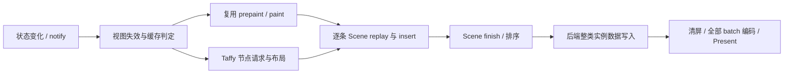

# gpui-box 渲染性能调研与可复跑基准

后续已完成单矩形局部 GPU 上传原型、硬件计时和像素对比，结果见[GPU 原型实测](GPU_QUAD_PATCH_RESULTS.md)。
下文保留第一轮 CPU 调研的范围与结果。

日期：2026-11-11。状态：**源码审计与 CPU 微基准已完成；尚未实现 retained renderer 或验证 GPU 增量更新**。
本次按用户补充要求，以性能调研为主要交付，不全面实施原架构 RFC。

需求来源：[gpui-box 渲染架构设计 RFC](https://app.notion.com/p/415d83088d4e818290cddca2f104e65c)，
主要对应第 20–28 节及第 4–6 节的布局/失效约束。读取的是 2026-11-11 的设计提案；下文区分源码事实、测量和建议。

## 1. 结论和建议顺序

**RFC 的主要性能判断成立：仅保留组件或显示列表，仍可能在 Scene 回放、绘制顺序构建、GPU 实例上传和整屏绘制上付出随场景规模增长的成本。**
但当前证据不足以支持“立即重写 renderer”“所有颜色都能 P1”“持久 Taffy 让所有单点布局变化成为 O(1)”或“每个节点建图层更快”。

建议按以下顺序推进，每一步独立计量并保留原路径作为正确性参考：

1. **先观测与避免无效工作**：同值写入/事务合并、阶段计数、分阶段耗时、帧请求原因；复用现有 view cache、文字缓存和虚拟列表。
2. **分开验证布局与 Scene 两个垂直切片**：持久 Taffy 解决布局输入生命周期；持久 chunk/primitive 解决旧绘制命令逐条回放。不要把两者收益混成一个数字。
3. **增加受限的单矩形颜色 P1 实验**：稳定 primitive 身份、CPU/GPU 地址映射、局部上传、世代和在途资源规则；正确性不成立就走原完整路径。
4. **再测批量动画和属性路径**：10,000 个简单对象需要批量接口，与逐节点分发在相同输出和输入语义下比较。
5. **最后评估 Damage / Raster Cache / 多线程**：只有 GPU、提交阻塞或像素带宽实测成为瓶颈时才升级复杂度。

## 2. 冻结基线及交付内容

| 项目 | 本次基线 |
| --- | --- |
| gpui-box 基线 | `59f9ab2b72c65ef80fe508e26252d2501f6d8e1e` |
| vendored upstream | `f8cfc7ed9e57503def9479138894f3139f5400cc`，见 `vendor/gpui/README.gpui-box.md` |
| Taffy | `=0.15.0`，与 GPUI 依赖及启用的布局功能一致 |
| 工具链 | Rust 1.98.1；Cargo 1.101.0，为本机 huacnlee/cargo 分发版本，完整版本见 metadata |
| CPU / OS | Ryzen 7 4800H，8 核 16 线程；Windows 11 企业版 LTSC，build 26100 |
| 编译 | Cargo release 默认 opt-level=3；无自定义 LTO、target-cpu |
| GPU | 仅记录设备/驱动清单，本次未执行 GPU API，不能从清单推断被测后端 |
| 数据 | 300 / 3,000 / 30,000 个叶子或矩形；布局另有一个根节点 |
| 运行 | 编译结束后串行三轮，每场景 101 个采样批次，每批至少约 1ms；保留原始批次与元数据 |

工具：[tooling/rendering-perf](../tooling/rendering-perf/README.md)。
当前工作只增加研究工具、报告、原始数据和 workspace 注册；不修改 vendored 引擎。

## 3. 当前管线在哪里仍有全量工作

这张图描述关键路径，不表示每次事件都走完整链路。GPUI 已有 idle、dirty、视图缓存与平台呈现门控。

### 3.1 生命周期和缓存

- [`Window::draw`](../vendor/gpui/crates/gpui/src/window.rs) 在帧末调用 `layout_engine.clear()`；
  [`TaffyLayoutEngine::clear`](../vendor/gpui/crates/gpui/src/taffy.rs) 清掉 Taffy 节点、几何缓存和已计算集合。
  直接删掉 clear 会遗留节点/闭包/临时 ID 生命周期问题，不是有效实验。
- [`Entity::cached`、`request_layout_view`、`prepaint_view`、`paint_view`](../vendor/gpui/crates/gpui/src/view.rs)
  已能在 bounds、content mask、文字样式、opacity 和 dirty 状态符合时复用。
  cached view 需要明确尺寸；不能把所有 auto-size view 无条件包成缓存岛。
- [`Window::reuse_prepaint` / `reuse_paint`](../vendor/gpui/crates/gpui/src/window.rs)
  仍复制/迁移 hitbox、dispatch、handler、文字布局引用等范围，并调用 Scene replay。
  只数 Render 调用会漏掉这些工作。
- `on_request_frame` 根据 dirty、force-render、动画回调、presentation demand 和高频输入等决定是否处理帧。
  **不能把 GPUI 描述成静止界面每个 VSync 都重建。**

### 3.2 持久 Taffy 的收益与边界

[`taffy.rs`](../vendor/gpui/crates/gpui/src/taffy.rs) 已有 `disable_rounding()`，
采用自身设备像素对齐策略；还会计算绝对 bounds、缓存祖先原点。
unchanged-root 微基准不包括这些后处理，不能拿几十纳秒宣称完成一帧布局。

Taffy 0.15.0 的 `set_style` 不先判断相等，直接 `mark_dirty`；`set_node_context` 也会标脏。
`mark_dirty` 沿祖先清缓存，遇到已经空的缓存可提前结束。
`compute_layout_with_measure` 在 rounding 开启时仍执行 `round_layout`，即使 measure 数是零。
这些事实来自本机与 Cargo.lock 对应的 registry 源码，可在 [Taffy 0.15.0 源码](https://docs.rs/taffy/0.15.0/src/taffy/tree/taffy_tree.rs.html) 核对。

- 纯颜色应从类型化入口避开 style/layout；只增加布局缓存而不改变失效入口，收益受限。
- equality/事务合并应在引擎适配层做，不能假设 Taffy 自动去重。
- 不变根可快速命中；真实尺寸变化仍可能让父 Flex 访问兄弟、分配空间和重新换行。
- 两次 leaf measure 不等于只访问两个节点，测量计数不能作为复杂度证明。
- 持久布局还需 owned measure snapshot、children/style/measure revision、删除、字体/DPI 失效，以及绝对 bounds 的过期规则。
- 合法布局岛必须证明外框、baseline、overflow 与父级依赖；不能任意从脏叶子脱离父节点重新布局。

### 3.3 Scene 缓存与绘制顺序

[`Scene::replay`](../vendor/gpui/crates/gpui/src/scene.rs) 遍历旧 `PaintOperation`，
clone 后再次 `insert_primitive`；后者计算裁剪 bounds、维护绘制顺序，写入 primitive 数组与 paint operation 数组。
`finish` 对多类数组排序。已排序数组有较好的常数，不能笼统说所有 finish 都是 N log N。
`BatchIterator` 即使最终只有一个 batch，也逐条消费对应数组。

[`BoundsTree`](../vendor/gpui/crates/gpui/src/bounds_tree.rs) 已有空间索引、max-leaf 快路径和 scratch 空间，
不能描述成毫无优化的线性扫描；成本取决于重叠、插入形态和排序分组。

另一个必须保留的对照是 [`Window::paint_layer`](../vendor/gpui/crates/gpui/src/window.rs)：
它为可安全分组的内容共享 draw order，减少每个 primitive 的 bounds-tree 插入。
**这个“layer”是绘制顺序分组，不是纹理缓存、GPU offscreen target 或平台 Native Surface。**
本次同时测未分组和合法分组的非重叠矩形；未分组压力用例不代表所有应用的平均表现。

### 3.4 三个后端的上传/绘制事实

| 后端 | 当前源码路径 | 可以确认 | 仍不能确认 |
| --- | --- | --- | --- |
| Windows DirectX 11 | [`directx_renderer.rs`](../vendor/gpui/crates/gpui_windows/src/directx_renderer.rs)：`render` → `upload_scene_buffers` → `update_buffer` | 非空 primitive 类别整片写入；`Map(WRITE_DISCARD)` + copy；清屏再编码所有 batch | 实际带宽、driver rename、GPU 时间、Present 延迟 |
| WGPU，包括当前 Android adapter | [`wgpu_renderer.rs`](../vendor/gpui/crates/gpui_wgpu/src/wgpu_renderer.rs)：`record_frame` → `write_instances` → `write_instance_binding` | 每帧从零组织 offset，整类数组 `queue.write_buffer`，创建 instance bindings；主 pass Clear，遍历全部 batch | staging/driver 分配成本、移动 tile 行为、局部更新收益 |
| Apple Metal | [`metal_renderer.rs`](../vendor/gpui/crates/gpui_apple/src/metal_renderer.rs)：`render_frame` → `write_instances` / `InstanceBufferWriter` | 每帧 writer 复制数组、编码所有 batch；buffer pool 在 completion handler 后回收 | 统一内存 cache/带宽/能耗收益，分层收益 |

Windows 当前原生后端不是 WGPU。WGPU 实验不能直接称作 Windows 原生链路基准。
Android 入口见 [`android/window.rs`](../crates/gpui-android/src/android/window.rs)。
Metal 已按 completion 管理帧资源，稳定 arena 应继承这个条件，不能仅靠 NodeId generation 复用 GPU slot。

## 4. CPU 实验方法和结果

测量代码直接运行 Taffy 和 checked-in GPUI Scene，不是手写简化 renderer。
几何、计数定义和 CLI 见[工具说明](../tooling/rendering-perf/README.md)。

布局用例是一层平铺的 wrapping Flex，auto 宽度叶子的 intrinsic size 由拥有式标量提供，
**没有真实字体 shaping/Paragraph**。Scene 是非重叠、可见纯矩形，无文字、图像、透明交错、滤镜。
这些是诊断单个阶段的控制实验，不是完整业务 UI。

下表由三轮 `summary.csv` 计算：展示各轮 p50 的中位数，单位 μs/operation。
每轮 p50/p95/p99、每批 elapsed 和计数全部保留；p95/p99 是**批次平均耗时分布**，不是事件或帧延迟尾部。

| CPU case | 300 | 3,000 | 30,000 |
| --- | ---: | ---: | ---: |
| `layout_clear_build_compute` | 146.525 | 4,239.400 | 47,490.000 |
| `layout_cached_unrounded` | 0.043 | 0.060 | 0.047 |
| `layout_equal_style_unguarded` | 52.219 | 1,759.600 | 18,660.200 |
| `layout_equal_style_guarded` | 0.116 | 0.131 | 0.140 |
| `layout_one_intrinsic_change` | 47.581 | 1,338.000 | 22,095.300 |
| `layout_viewport_resize` | 65.812 | 1,734.300 | 25,292.100 |
| `layout_cached_rounded_control` | 14.394 | 170.150 | 4,299.500 |
| `scene_fresh_record_finish` | 173.050 | 2,544.300 | 40,363.300 |
| `scene_cached_replay_finish` | 173.200 | 1,991.600 | 41,134.200 |
| `scene_one_color_cached_rest` | 172.387 | 1,967.500 | 44,847.700 |
| `scene_finish_already_sorted` | 0.315 | 2.351 | 121.425 |
| `scene_batch_iteration` | 0.297 | 2.655 | 83.869 |
| `scene_grouped_cached_replay` | 13.155 | 145.363 | 1,877.800 |
| `scene_grouped_one_color` | 13.149 | 171.050 | 1,946.400 |

3,000 项的跨轮波动（每列为三轮对应分位数的最小值–最大值，μs/op）：

| CPU case | p50 range | p95 range |
| --- | ---: | ---: |
| `layout_clear_build_compute` | 2,267.100–4,770.000 | 3,505.700–6,558.000 |
| `layout_equal_style_unguarded` | 861.250–2,243.900 | 1,428.450–3,332.600 |
| `layout_one_intrinsic_change` | 1,283.200–2,177.200 | 2,043.400–3,006.300 |
| `scene_one_color_cached_rest` | 1,956.700–2,985.300 | 2,977.400–3,798.300 |
| `scene_grouped_one_color` | 146.125–179.688 | 184.662–216.363 |

[三轮原始数据、summary 和 metadata](performance/2026-11-11/README.md)。

只使用最终分组对照版本的三轮数据，早期调试轮不作为报告数据。
本机未锁频、未隔离后台、未控制温度；跨轮波动必须一并查看，不能用单个“加速倍数”作为发布承诺。

### 4.1 可以从实验得出的判断

- 不变 unrounded root 能避免 leaf-layout 和 measure，证明持久化有价值。
- 单叶 intrinsic 更新只有少量 measure，但耗时随同级项增多显著上升；父布局工作仍需计量。
- 同值 set_style 仍触发布局；先比较并跳过 setter 能保住缓存，是较早可落地的优化入口。
- 默认 rounding 对照即使零 measure 也有随规模增长的遍历；GPUI 已关闭它，不能算作新优化成果。
- 旧命令回放仍做逐项 CPU 工作；paint-layer 对照用于判断 bounds-tree 插入的贡献，不能省掉全部 primitive 拷贝。
- finish 与 batch iteration 应计量，但不能在 profiling 前认定排序就是主瓶颈。

### 4.2 没有验证的性能承诺

此次没有测 Signal/Store、完整 App 构建、GPU 上传/execution、swapchain、真实输入延迟、cache 显存、空闲唤醒或移动功耗。
CSV 的 `modeled_instance_bytes` 只按实际 `Quad` 大小计算整数组 payload，
不含 alignment/globals/texture，不代表 PCIe 或显存流量。
本次 `Quad` 为 160 bytes，3,000 个实例的整数组 payload 为 480,000 bytes；
假设能合法只写一个完整实例，则数据量候选为 160 bytes，但这不是已实现的上传路径或 3,000 倍性能收益。

测试检查 retained 与 fresh-root 布局一致、Scene replay 的 bounds/color/mask/order，以及合法分组下的几何和批次。
这是 CPU 数据正确性检查，**尚未进行同后端截图像素比较**。

## 5. 对 RFC 六级路径的性能审阅

| 路径 | 实施价值 | 风险 / 需测量 |
| --- | --- | --- |
| P0 equality + coalescing | 优先级最高；避免无效失效、Scene 和帧请求 | 比较成本；同值业务事件仍可存在；事务最终值比较 |
| P1 instance patch | 稳定纯色矩形值得原型；可同时省 CPU record 与上传 | 身份、shader/blend、clip/effect、order、resource epoch、在途写入，不满足就回退 |
| P2 property/composite | transform/scroll 动画候选 | 绝对坐标/clip 可能已烘焙；opacity 未必等价分组透明度；命中/semantics/NativeView 要同步 |
| P3 paint-only | 避免无关 layout，适合持久 chunk 早期目标 | 若仍全量 replay，收益止于业务/录制层；text/image 涉及 atlas/resource |
| P4 layout+paint | 保留 CSS/Taffy 语义，重用未受影响缓存 | measure 少不代表父/兄弟工作少；geometry、绝对 bounds、snapping 也会扫描 |
| P5 structure | keyed identity 和生命周期是基础 | splice 会改变顺序、布局、focus/handler；不能只优化数组插入 |

路由应输出多阶段需求集合，P1 颜色与独立 semantics patch 可并存。
不能把六级路径当成完全有序整数而丢掉命中/语义更新。

## 6. 后端快路径应该怎样验证

### 6.1 第一个实验：固定几何，只改一个颜色

在 300/3,000/30,000 矩形上构造相同输出，参考和优化路径使用同一 shader、blend、clip 和目标尺寸。
分别测冷创建、热更新和清缓存后的恢复。先做 feature-gated backend 实验，不先改公共组件 API：

- CPU 稳定 handle：slot + generation + chunk owner；单矩形更新不重建全部 draw order。
- dirty instance ranges 合并；记录 range 数和字节，不只记 patch 数。
- GPU allocation 有 resource/surface epoch 和 completion；跳帧保留生命周期和 base revision。
- 失去局部更新能力就回原路径，计数回退原因。
- 原路径可在清空缓存后重建；比较颜色、透明、clip、重排、删除、设备恢复。

Windows D3D11 的 `WRITE_DISCARD` 丢弃旧内容，不能只复制一个槽位后假设其他槽位仍有效。
候选是 DEFAULT buffer + subresource update，或有明确 frame-ring/fence 的新分配方案，需比较 driver 成本。
`NO_OVERWRITE` 对正在使用范围和 D3D11 SRV 支持有条件，不能机械替换。
WGPU 可写稳定 storage buffer 的 offset，但 `write_buffer` 有 staging 和 submit 前的复制；一万个小写入未必优于合并。
Metal 应基于现有 pool/completion 比较按帧 page、copy-on-write 和稳定分配，避免覆盖 GPU 读区间。

结构验收：支持 P1 的颜色变化为 0 组件 setup、0 layout、0 chunk 重录，只更新所需实例数据。
**GPU 仍可整屏重画**；此步骤不包括局部像素重绘。GPU 时间和像素一致通过前不能宣传 GPU 提速。

### 6.2 批量接口：吞吐和单点延迟分开

10,000 个移动矩形比较逐实例 Signal、批量 typed patch、整数组连续更新三种生产者，
保持相同时间采样、可见性、order、hit-test 和输出。测分发、range 合并、上传调用/字节及 GPU 时间。
这不是当前工具已实现的能力。

每个对象不必一个 closure/subscription；静态模板与批量更新都可减少图管理成本。
TSX 可静态分类候选更新，仍需运行时能力判断，不能假设 shader/effect/font 都在编译期证明。

## 7. 统一观测方案与下一轮验收

沿用已有 `profiler`、`profiling::function` 和平台 GPU 标记，补充 frame/commit ID。
计数按阶段归属，避免诊断本身先全树扫描。

| 阶段 | 计数 / span | 回答的问题 |
| --- | --- | --- |
| State / Router | writes、equal skips、coalesced writes、binding visits、path/fallback | 一次颜色更新访问多少依赖，是否多请求帧 |
| Layout | roots、dirty、内部 cache hits、measure、parent/sibling visits、geometry extraction | 缓存省掉哪些工作，是否隐藏遍历 |
| Paint / Scene | rerecorded/replayed primitives、bounds insert/query、sort、batch iteration、snapshot alloc | 局部 paint 后是否全量重建/复制 |
| GPU preparation | write calls、payload/aligned bytes、staging alloc、binding/pipeline misses | patch 是否转成局部数据更新 |
| GPU / Present | encode/submit、GPU timestamp、queue depth、completion、present interval | CPU 更快是否只增加排队 |
| Input / Lifecycle | event、commit、first affected present、resource retire、epoch reset | 输入延迟、跳帧/恢复是否正确 |
| Memory / Idle | node/layout、display-list、instance pages、atlas/cache/offscreen/in-flight、wakeups | 常驻内存与空闲功耗代价 |

| 下一轮实验 | 正确性门槛 | 性能比较 |
| --- | --- | --- |
| 单颜色 / 同值写 | 原路径像素一致；P0 不主动请求视觉帧 | route/scene、upload bytes、GPU time 对 N 曲线 |
| 标题两行、deep Flex + wrap | fresh-root 的 geometry、hit、semantics 一致 | measure 与父/兄弟访问分开 |
| resize / 断点跨越 | 草稿/焦点/选择一致；查询实际 content box | 连续布局与离散切换分别计数 |
| 100,000 条虚拟列表 | 节点与 viewport/overscan 同阶，资源退役正确 | 先复用 `uniform_list` / `ListState`；内存、滚动帧间隔 |
| 10,000 矩形动画 | batch / Signal 同输出、同命中 | 吞吐与单点 p95 分开，60/120Hz 各测 |
| 阴影、透明组、scroll、clip | Full / cache / damage 同后端像素比较 | 离屏面积、overdraw、显存、GPU time |
| 设备丢失、低内存、renderer 落后 | epoch、旧 handle、丢帧 delta 正确恢复 | 恢复时间、峰值内存、排队深度 |

全链路尾延迟需逐事件样本与平台呈现反馈；当前 batched CPU CSV 不得冒充这些数据。

## 8. 建议保留的架构决策

以下是待实现前实验确认的建议，不是已合并的引擎决策：

| 决策 | 原因 | 代价与替代 |
| --- | --- | --- |
| 保留 GPUI backend 与 Taffy 参考 | 已有 batching、atlas、恢复和像素对齐；先定位具体成本 | retained adapter 有生命周期复杂度；换 GPU API 不解决 CPU replay |
| equality / typed invalidation 先于全面 retained | 无效 setter 能触发布局，P0 对后续每层有收益 | 比较/事务语义需定义，大对象比较也需计量 |
| CPU scene 与 GPU 持久化分别验收 | 避免局部录制后全量上传被误算成增量 | 增加 ID/映射；可先粗粒度 chunk，不必每组件一层 |
| Full Redraw 保留为参考 | 当前清屏 + 全 batch 行为明确，damage 有像素保存条件 | Full 可能浪费带宽；对照一致且更优才开 damage/cache |
| UI 单写，先保证 owned FramePacket | 跨线程/快照/排队未必降低延迟 | submit 阻塞实测成立后再做 renderer 线程 A/B |

本次未运行 Flutter 或浏览器 benchmark，不能据此给三个框架做总性能排名。

## 9. 一手资料与核查范围

源码事实以 pinned snapshot 为准，上游 main 会漂移。2026-11-11 补充读取：

- [Inside Flutter](https://docs.flutter.dev/resources/inside-flutter)：sublinear layout/build、Element/RenderObject 分离；其布局协议不证明 CSS Flex 有相同复杂度。
- [Chromium RenderingNG data structures](https://developer.chrome.com/docs/chromium/renderingng-data-structures)：property trees、paint chunks、layerization；不推导每元素一个 compositor layer。
- [Microsoft dynamic resources](https://learn.microsoft.com/en-us/windows/win32/direct3d11/how-to--use-dynamic-resources)：DISCARD/NO_OVERWRITE 与 GPU 消费契约。
- [WGPU Queue](https://docs.rs/wgpu/latest/wgpu/struct.Queue.html)：staging 与 submit；同时核对 pinned `wgpu@cddb2f5d80dc0009b2ef6767635140cacf90a007` 的 `wgpu/src/api/queue.rs`，避免只凭 latest。
- [CSS Flexbox](https://www.w3.org/TR/css-flexbox-1/) 与 [CSS Conditional Rules 5](https://www.w3.org/TR/css-conditional-5/) 是 RFC 的语义约束参考，本次未执行浏览器兼容测试或实现容器查询。

NativeView 混合合成、Android/iOS 实机、damage buffer-age、raster cache 与 GPU fence 原型需单独实验。
本次不把这些未验证项记为已完成能力。

## 10. 本次验证记录

- `mise exec -- cargo test --locked --offline -p gpui-box-rendering-perf --features gpui-scene`：5 项通过。
- `mise exec -- cargo clippy --locked --offline -p gpui-box-rendering-perf --all-targets --features gpui-scene -- -D warnings`：通过。
- 既有 `gpui-box`、`gpui-box-cli`、`gpui-android` 的 host 测试：3 项通过；不代表 Android 目标构建或实机验证。
- `cargo fmt --all -- --check`、`git diff --check`：通过。
- 对每轮 4,242 个原始采样重新计算全部 42 行 summary 的分位数与结构计数：一致。
- 对 metadata 中 14 个测量源文件核对 SHA-256：一致；报告、证据、工具说明的本地链接均可解析。

以上检查不包括 GPU API、五平台构建或产品功能实现；它们证明研究工具及交付数据可用。
