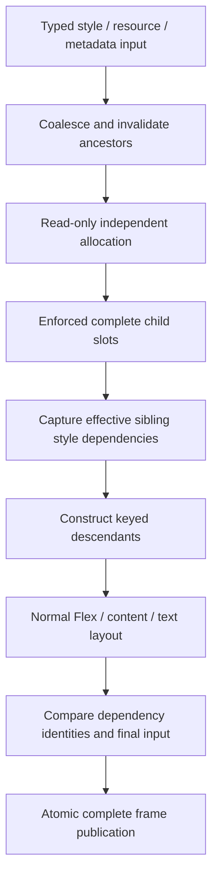

# Item styles in independent child allocation

Follow-up: [selected child assignments](RETAINED_CHILD_ASSIGNMENTS.md) preserves
known size/definiteness in returned/read child inputs, independently of hard
intervals and percentage bases. The dependency domain below remains unchanged.

Status: experimental framework protocol, 2026-11-17. Extends
[measured item styles](RETAINED_CHILD_STYLE.md). Complete RenderBox, ordinary
content-feedback construction and full RFC acceptance remain open.

## Public contract and decision

`ParentAllocationChildren::style(index) -> Result<ChildLayoutStyle, Error>` now
returns the same owned unresolved item inputs as the measured parent phase.
The allocation callback can combine incoming border-box constraints, known-size
definiteness, independent percentage bases, direct-child order/count, immutable
metadata and current effective child styles. A client policy can read flex
basis/grow/shrink, limits, margins or roles without copying every child's
configuration into its parent snapshot.

No child measurement, used host size, descendant geometry, application state or
construction API is exposed. An intrinsic keyword is inspectable data; it is
not a measured min/max-content answer. Arbitrary intrinsic allocation still
belongs in a measured policy. The width-only `ParentInlineLayout` remains
count-only and retains its separate proof domain. External allocation-child
implementations default to an unsupported error, preserving existing metadata
implementations until they opt into style access. Invalid indices fail.

The vendored Taffy read-only allocation view uses the same real-node getter as
measured style reads. Hidden/replaced classification, unresolved values and raw
unsupported-value errors therefore agree across phases. The ordinary child
box model and enforced complete inputs remain authoritative for measurements
and final placements. This is a generic extension point, not a new built-in
weighted Flex algorithm; example client algorithms cover finite cases only.

## Dependency proof and atomic publication

The existing structural proof still requires independent allocation edges to
reach the external root or an explicit full size/layout isolation cut. Reading
child styles does not authorize uncontained ordinary Flex feedback or make a
measured parent independent.

Every allocator ancestor of an observed `allocation_builder` captures **all its
direct children's effective styles and parent-data handles** in layout order.
The existing records also retain ancestor styles, algorithm handles and child
identity/order. Final validation compares these inputs before publication,
even if a changed style happens to produce numerically identical allocation.
It covers sibling dependencies, nested allocators and fields an application
algorithm may currently ignore. No user-supplied declaration of read fields is
trusted. A restored final style coalesces and is permitted.

The effective style comes from the same `measure::effective_style` lowering as
the live kernel. Image installation/replacement can add replaced classification
or an intrinsic aspect ratio without changing authored LayoutStyle; observing
only the authored style would miss that dependency. Builders therefore capture
these effective inputs too. Changes to unobserved host descendants remain
permitted because they cannot change that host's independent incoming slot.

Actual style changes use existing conservative child/ancestor ordinary/exact
cache invalidation. Responsive target discovery already follows style, measure,
parent-data, image and text sinks through computed sources. The query scheduler
already treats layout-target changes under sibling allocation as dependencies;
new finite tests exercise this with a computed child basis driving an outer
sibling's used width. No query ancestry proof is broadened: full allocation
ancestors still do not automatically qualify inline container-query hosts.

Failure before/following a builder preserves the prior sources, logical tree,
layout and frame in atomic frame edits. Ordinary transactions already committed
before a later frame error remain committed. Panics/external side effects/shared
memo warming remain outside rollback. Hidden/reorder/reparent/removal use the
same node lifetime, not copied positional style tables. Old FramePackets own no
allocator callbacks or style observations.

## ADR and costs

**Decision:** allow read-only unresolved item styles in the independent full
phase and expand structural observations conservatively across every allocator's
direct-child style domain. Preserve strict separation from content measurement.

**Alternatives:** restricting all policies to metadata forces duplicated layout
configuration and indirect normal style updates. Exposing measured contributions
would create construction/content feedback and require a different scheduling
contract. Tracking only numeric slots fails to detect changed dependencies;
tracking only the builder host misses siblings; tracking only authored styles
misses image-derived aspect/classification. Dynamic per-field subscriptions add
complexity and are not required to make this protocol correct.

**Costs:** copy/convert an owned style value per allocator read; structural
observations clone one effective Style per direct child of each allocator
ancestor, plus existing metadata handles/order/algorithm records. The final
capture repeats that work. This increases temporary memory and scans, especially
for many builders under wide ancestors. Existing private tree copies, previews,
exact caches and repeated layout remain. There is no persistent per-node style
mirror, GPU record, FramePacket field or new cache format. No wall-time, memory
reduction, p99 or sustained-frame improvement is claimed.

## Evidence and open scope

See [reproduction record](performance/2026-11-17-allocation-styles/README.md).
Finite independent allocation + keyed builders compare normal nested wrapped
Flex and complete CPU pixels with ordinary full Flex. Final unchanged slot
changes, image-derived inputs, nested ancestor/sibling dependencies, restored
writes, typed sources/computed queries, hidden/order/reparent and true shaped
glyphs exercise normal update routes. These are same-kernel controls, not new
independent browser conformance or proof that arbitrary client policies match CSS.

Remaining: complete RenderBox/dry/intrinsic and arbitrary content-driven policy
contracts, uncontained ordinary Flex feedback builders, generalized inline/query
ancestry proofs and automatic cross-builder/query scheduling; incremental
candidate/proof/rollback and global budgets; broad Flex/percentage/cycles/Grid/
Block/writing-mode/device precision; primitive/resource/effect/native lifecycle.
Modern desktop GPU heavy effects, continuous complete CPU frames, sustained
60/120Hz and display-visible input tails retain their separate unmet gates.
