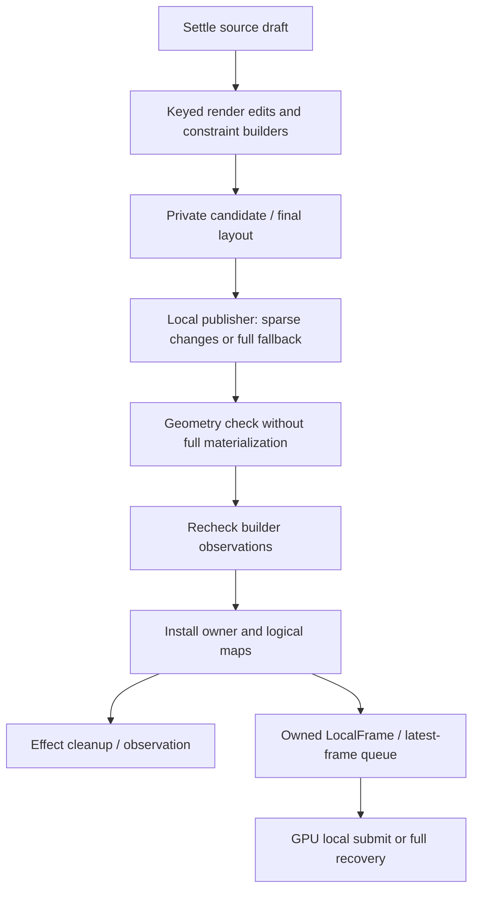

# Atomic keyed edits with LocalFrame output

Implemented subset, 2026-11-16. The full RFC goal remains active.

## Public contract

`LogicalUi::edit_local_frame(constraints, viewport, sources, render)` returns
`(ReactiveEditCommit<R>, LocalFrame)`. It shares the source settlement, final
topology, keyed scope/state/effect/binding lifecycle, provisional generation
handling and final publication boundary of `edit_frame`.

Both full `constraint_builder` and `inline_constraint_builder` work inside the
render closure. They retain their existing containment/dependency requirements;
the final candidate rechecks observed inputs/proofs after layout. Pure custom
ParentLayout algorithms use the same actual child layout path. A failed
algorithm, changed builder input, invalid final geometry or invalid environment
leaves owner sources, logical maps, effects, layout and old local snapshot
installed. Effects/cleanup run only after successful complete publication.
Arbitrary user side effects, panic and shared resource-cache warming remain
outside rollback guarantees.

The return value uses the existing local publisher directly:

- A stable property/material edit creates sparse local placement/material
  changes, retaining topology and exact previous snapshot identity.
- An equal final edit reuses the exact immutable local snapshot.
- The later [layout revalidation follow-up](performance/2026-11-18-local-revalidation/README.md)
  also preserves it after checked layout when revision, pixel policy and the
  selective publisher's exact paint/property identities remain unchanged. This
  avoids a second local topology construction and duplicate GPU submit. It does
  not skip layout, callbacks or final validation, or equate empty old-baseline
  deltas with the latest sparse local output.
- Layout, structure, visibility or paint viewport changes use the existing
  complete publisher and establish a new local baseline. Viewport-only edits
  with identical layout constraints still perform zero layout.
- The producer does not call `LocalFrame::resolve` to validate sparse output.
  It does not fill the optional compatibility cache or build resolved item
  arrays/property maps. An explicit `resolve`, `published_frame` or an unsupported
  GPU consumer path may materialize that representation later.

`UiTree`, `ReactiveUi` and `LogicalUi` also expose `published_local_frame()`.
This returns the last local snapshot without resolving world geometry. It may
be older than the resolved output when subscribers alternate, so callers must
inspect its own revision. It does not promise that every committed ordinary
transaction has already produced a local frame. `published_frame()` retains its
existing latest-published-output compatibility behavior.

## Geometry validation and failure

The local validator walks immutable preorder with one context per open ancestor.
It uses the same ordered f32 additions as local/full extraction for layout
origins, translations, border/padding content origins, clips and child scroll
origins. It reads local overrides by reference; it does not clone PaintItems or
look up effect maps. Shared geometry checks reject nonfinite/negative bounds,
content bounds and clip rectangles including endpoints, invalid spatial values,
and nonfinite post-scroll child origins.

Importantly, an inherited viewport clip cannot hide a nonfinite translated own
clip. The resolved `edit_frame` now uses the same check, closing this validation
gap on both atomic paths. Backend-specific scale, resource, shader and supported
primitive validation remains the consumer's responsibility.

## ADR: one atomic lifecycle boundary, selectable local output

**Decision:** reuse `edit_validated` with a local-output final validator, rather
than adding another lifecycle transaction engine. The existing FramePacket
method keeps its return type; local callers opt into `edit_local_frame`.

**Alternatives:** returning a LocalFrame only after a successful ordinary edit
would expose committed sources/lifetimes if final layout failed. Calling
`edit_frame` and wrapping the resolved result would discard sparse predecessor
provenance and force descendant extraction for every property update. Requiring
all backends to consume LocalFrame would remove the tested full reference path.

**Costs:** this atomic API still clones the entire private retained/layout
candidate for each call, including no-op calls. Builders still make their own
previews. Final geometry validation visits all visible paint items, O(N), with
O(depth) temporary stack storage. Sparse local publication avoids complete
world-item/property-map materialization but does not make the whole owner
transaction sublinear. No timing or allocation-reduction measurement is claimed.
The existing FramePacket layout counters do not include builder previews.
LocalFrameStats counts local changes/full-publication, not all transaction work.

## Consumer evidence and open scope

The [validation record](performance/2026-11-16-atomic-local-edits/README.md)
checks exact snapshot reuse, untouched resolved caches, mailbox coalescing,
source/effect rollback, provisional ID safety, full/inline builders, real custom
parents, scroll/clip/group opacity/images, resize/hide/show and old frames.
Actual glyph rasterization and complete CPU pixels match independently authored
ordinary forced-full trees. An explicitly run WGPU test exercises consecutive
local updates, a skipped predecessor and full recovery, with independent
full-reference pixel equality.

The subsequent [structural responsive stage](RETAINED_STRUCTURAL_RESPONSIVE.md)
combines existing ContainerQuery rules and explicit structural builders in this
atomic edit. [Scope-owned declarations](RETAINED_SCOPED_RESPONSIVE_RULES.md)
also add draft rule registration/retirement. Still open: automatic
dependency scheduling, full-axis content-sized structural builders, incremental
planner/rollback, general RenderBox and wider Flex conformance. This stage does
not change GPU queue or resource lease semantics, qualify modern GPU effects,
prove sustained 60/120Hz or visible input-to-display tails, or establish CPU
smooth-delivery acceptance.
