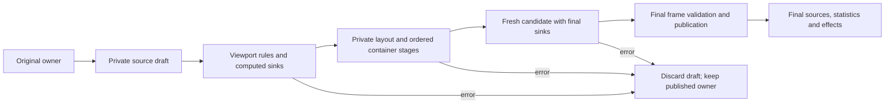

# Atomic responsive evaluation and public local output

Date: 2026-11-16. This extends the framework-owned
`LayoutResponsiveBindings`; legacy `ResponsiveBindings` keeps its earlier
two-pass contract. The full RFC implementation goal remains active.

## Public contract

| Method | Output | Layout and paint inputs |
| --- | --- | --- |
| `frame(ui, environment)` | `ResponsiveFrame` wrapping `FramePacket` | Finite layout/paint viewport from environment |
| `frame_in_viewport(ui, environment, constraints, viewport)` | `ResponsiveFrame` | Independent layout available space and finite paint viewport |
| `local_frame(ui, environment)` | `LocalResponsiveFrame` wrapping `LocalFrame` | Finite layout/paint viewport from environment |
| `local_frame_in_viewport(ui, environment, constraints, viewport)` | `LocalResponsiveFrame` | Independent layout available space and finite paint viewport |

`environment.layout_viewport` chooses viewport breakpoints and its direction
selects directional styles. `constraints` determines layout and actual container
content widths. `viewport` clips paint and hit testing. These inputs are
independent: environment width 500 does not force a query host to 500 when
actual layout width is 100. Normal Unbounded layout remains distinct from
MinContent/MaxContent.

```rust,ignore
let output = responsive.local_frame_in_viewport(
    &mut ui,
    &LayoutEnvironment::new([500.0, 400.0]),
    LayoutConstraints::new(
        LayoutAvailableSpace::Definite(100.0),
        LayoutAvailableSpace::Unbounded,
    ),
    [100.0, 80.0],
)?;
renderer.submit_local(&output.frame, [100, 80], 1.0)?;
```

Stable property-only updates retain local placement/material publication and
perform zero layout. A changed paint viewport refreshes clipping with zero
layout when available space is unchanged. Layout/topology changes still use
the existing complete fallback. A public `LocalFrame::resolve()` is a complete
compatibility snapshot with `base_revision = None`; the owner's final resolved
packet retains the original published predecessor, without private preview
revisions in its delta chain.

## Publication boundary

Viewport and nested container rules settle within one source transaction.
Container queries observe private layout previews of that draft. No preview
publishes a FramePacket, source value or effect. Once all rules and computed
sinks validate, final sinks are replayed once against a fresh private candidate
of the original tree. The final candidate lays out and builds output before
replacing the owner. Sources and statistics then publish and effects run once
against final values.



Returned errors, including later computed failures, unsafe host proofs, invalid
property values and final revision exhaustion, preserve live source values,
published frame/geometry, reactive statistics and effect observations. Values
that change A→B→A during planning do not publish a transient material or invoke
its effect. This is a responsive style/source transaction; it does not add
conditional structural builders or combine arbitrary earlier application edits
into the same rollback boundary.

The guarantee excludes arbitrary side effects inside user computations,
callback panics, allocation failure, transient scheduler stamps and resource
memoization. Computations must remain pure. Shared immutable text resources
can warm interior memo caches even when a draft is discarded. Dead rule
sources/targets are pruned as before; a surviving rule with a missing host
still errors. Ordinary UiTree publication methods have not independently gained
this transaction boundary.

One final frame does not imply revision increases by exactly one. A changed
property transaction advances revision once; changed layout/paint environment
can advance it once more. There is one final source transaction, frame intent
and effect pass for changed responsive sources. No source writes means no
additional reactive transaction. Private planning can conservatively exhaust
revision capacity before final publication near `u64::MAX`.

## Query dependencies and writer ownership

Rules must own their exact registered layout binding. Unbinding or replacing
that writer produces `InvalidBinding` on later resolution. Read-only computed
signals cannot be rule producers and fail with `ReadonlySignal` during bind.

The dependency graph follows every rule source through its explicit computed
DAG to all layout-affecting sinks: style, owned measure, image and text when
enabled. Additional direct sinks count too. A computed sibling allocation
change therefore precedes consumers whose host width depends on that sibling,
even if the extra binding was installed after the responsive rule. Derived
self-feedback is rejected as `UnsafeContainerQuery`.

Existing fixed-width, full-size and proven inline-contained Column host proofs
remain required. Actual private styles and authored alternatives are checked
again after the viewport stage and every container stage. If a computed branch
invalidates a host or changes the dependency stage grouping, resolution fails
without publication. No convergence loop or speculative stage reorder is used.
This checks actual branches of the explicit source DAG; it is not a static
proof of arbitrary user callbacks or general Row/wrap/aspect query graphs.

## Decision: private drafts before incremental rollback

The chosen boundary makes failure behavior independent of the renderer and
provides a basis for future constraint/structural APIs. Publishing each
stage was rejected because an effect or consumer could observe a state that a
later stage invalidates. A complete incremental undo journal would also need
to cover Taffy caches, geometry journals, chunks and publication ownership; that
is deferred until profiling justifies its complexity.

Clones are private identity-preserving drafts. UiTree deliberately does not
implement public Clone, which would allow two writers with the same identity
and generation namespace. Preview storage is dropped before the final candidate
is cloned, so the algorithm holds at most one additional full private tree at
a time. Immutable paint/property/resource storage is shared where existing
types allow it; owned tree/Taffy state still has O(tree) copy and memory costs.
Each changed query stage may need private layout; final publication can repeat
layout against the original baseline. One sibling-allocation regression now
counts three entries instead of the previous two. This is a correctness and
capability change, with an explicit cost rather than a speedup claim.

Idle and eligible property-only local paths avoid the full-tree candidate.
The common local reuse guard also checks that the local snapshot still belongs
to the current resolved owner baseline. Query proofs and graph construction
are still rebuilt per call; reachable computed DAG/sink traversal adds work.
There is no indexed dispatch, O(1) responsive update or timing improvement claim.

## Counters and verification

Both responsive wrappers aggregate `layout_runs` and `layout_stats` across
private previews and final publication. The wrapped FramePacket describes
only its final publication. `rules_examined` counts live registered rules,
excluding graph comparisons, DAG visits and layout-node visits. `changed_styles`
counts registered rule sources whose final values differ from their originals;
unrelated computed changes are not additional changed rules.

The [frozen evidence](performance/2026-11-16-atomic-responsive/README.md) records
commands, final counts and limitations. Ten new normal regressions cover error
isolation, final-only effects, nested dependency ordering, derived feedback,
writer replacement, revision exhaustion, transient restoration, public local
output and full/local CPU pixel/geometry/hit/old-snapshot comparisons. One
explicitly run WGPU test compares local output against a fresh full render,
asserts a red pixel after the breakpoint and verifies idle submit suppression.

Still open: general min/max parent BoxConstraints, ConstraintBuilder and
structural adaptation; broader Flex/percentage/baseline and query proofs;
cached/indexed dispatch and reducing planning copies; sustained 60/120Hz,
full-chain tail latency, modern desktop GPU effects and CPU smoothness
qualification. See the [implementation table](RETAINED_IMPLEMENTATION_PROGRESS.md)
for the rest of the full RFC acceptance.
