# Captured layout environment and automatic responsive settlement

Date: 2026-11-17. Implemented public subset; the complete RFC remains active.

Scope-owned responsive rules can now participate in ordinary UI updates without
an application calling `responsive_registered` after every source write or resize.
The UI captures host inputs only after a successful atomic frame publication.
The existing query DAG, dependency proofs and source savepoints remain the
authority; user builders execute once and stale observations reject the edit.

## Public input contract

`LogicalUi::frame_with_environment(environment, constraints, paint_viewport)`
and `local_frame_with_environment` capture all three inputs and enable automatic
evaluation. `LogicalEdit::layout_environment` stages the same environment inside
an atomic frame edit, including one which creates rules/sources/output. Once a
session is active, plain `edit` inherits its last constraints/paint viewport and
can also stage a new environment. `layout_environment()` on the UI returns the
last committed environment. `LogicalEdit::clear_layout_environment()` disables
automation after a successful edit; sources and last selected styles remain.

These are three independent inputs:

| Input | Meaning |
| --- | --- |
| Environment layout viewport | Viewport breakpoint selection; direction applied to selected styles |
| LayoutConstraints | Real available space, percentage bases and hard root bounds; container queries observe actual proven content widths |
| Finite paint viewport | Output clip and hit region; it cannot manufacture a definite layout/query size |

An active `frame(viewport)`, `local_frame(viewport)` or
`frame_with_constraints(definite_constraints)` updates the query viewport along
with its layout/paint dimensions and retains the other environment fields.
`frame_in_viewport` / `local_frame_in_viewport` and their atomic edit counterparts
change constraints/clip independently, retaining the captured query environment.
Use the environment-aware APIs when all three must change independently.

`device_scale`, `application_zoom`, `text_scale`, pointer/touch and reduced-motion
are captured/validated host metadata. The current breakpoint policy consumes
viewport inline width and direction. It does not automatically reshape text,
change PixelSnap or subscribe to native DPI, accessibility, font or OS events.
The host remains responsible for forwarding those events and policies.

## Normal update flow

In an active session, ordinary `transaction`, `edit`, `apply_updates` and resolved
or local frame extraction evaluate all surviving registered rules. Legacy
`bind`, append, key reconciliation, render-order synchronization, scope reorder
and reparent helpers use the same atomic logical edit boundary. A transaction or
plain edit produces validated complete LocalFrame output before delivering
effects, keeping the local placement representation without resolving all items
into a FramePacket. One transaction settles the final source/sink values and
runs each affected effect once. Equal final input keeps the visual revision and
requests no new frame, although rule/proof/draft work still occurs.

```mermaid
flowchart LR
    A[Owner transaction or inbox drain] --> B[Settle source draft]
    B --> C[Construct keyed draft and registered rules]
    C --> D[Settle query DAG before each builder]
    D --> E[Run builder once]
    E --> F[Retire and sort final structure]
    F --> G[Settle registered rules on final draft]
    G --> H[Validate complete frame and every observation]
    H --> I[Install sources scopes rules environment and frame]
    I --> J[Effects and cleanup]
```

`constraint_builder`, `inline_constraint_builder` and `allocation_builder`
automatically select registered rules before observing their real layout input.
They still require prerequisite declarations and valid structure. Later changes
to a width, source, exact writer, algorithm or dependency proof reject the whole
edit if they invalidate earlier observations. No callback replay or fixed-point
iteration is introduced. Plain `read` returns the current settled draft value;
it does not perform layout as a hidden read side effect. Call
`responsive_registered` explicitly for an intentional selection/read checkpoint.
An explicit conflicting environment can therefore invalidate final automation.

The same query resolver handles both viewport and nested container stages;
declaration ordering is not evaluation ordering. Scope retirement detaches rules
before final selection, including rules using sources from surviving scopes.
Retired source inbox generations are consumed as retired, never rebound.

## Atomicity

Session metadata is installed after source/tree/logical preflight and before
effects. Invalid environment, constraints, viewport, sink, query dependency,
writer, stale builder observation or composed geometry preserves the previous
sources, rules, scopes, environment, statistics and published frame. Failed
inbox batches retain the queue's existing consumed-and-rejected semantics;
there is no automatic retry loop. Earlier owned frames survive owner teardown.
Caught selection errors retain the existing source savepoint contract. Panics,
external callback side effects and shared memo-cache warming remain outside
rollback, as in the preceding atomic stages.

Caller-owned `LayoutResponsiveBindings` remain explicit and are not silently
adopted into the scoped registry. Enabling a session is opt-in; legacy UIs with
no captured environment retain their prior transaction/frame behavior. Do not
mix direct crate-internal ReactiveUi mutation with an active logical session.
Public measure-only queries remain isolated and do not recapture host inputs.

## ADR: explicit capture, automatic registered-rule checkpoints

**Status:** implemented.

**Context:** automatic source propagation cannot safely use a guessed viewport
or run layout builders again. A background inbox previously bypassed the logical
rule registry by publishing directly to ReactiveUi.

**Decision:** store one optional owned session on LogicalUi, stage changes in
LogicalEdit and reuse the existing atomic edit/query observation machinery.
Factor inbox drain from publication so both runtimes retain ownership, lifetime,
coalescing and rejection semantics while choosing their own commit boundary.
Run automatic rule checkpoints before builder input and final publication.

**Alternatives:** always enabling a default environment would change legacy
explicit query semantics and confuse paint viewport with layout. A setter that
commits metadata before frame validation exposes mismatched output on failure.
Replaying arbitrary builders to convergence is outside their FnOnce/lifecycle
contract and cannot prove absence of feedback. A per-rule incremental scheduler
is desirable follow-up work, but requires precise source/proof dependency
indices and invalidation contracts before it can replace full validation.

**Costs:** active ordinary transactions now produce a private atomic tree
candidate and complete local validation rather than the old direct sink commit.
Every checkpoint clones a flat registry view and uses existing whole-tree
previews, rule/proof scans and per-stage layouts/source savepoints. Repeated
builders/final settlement can repeat this work. A session adds one optional
environment/constraints/viewport value, not per-node renderer fields; it changes
no GPU record or FramePacket format. Captured field changes can update metadata
without a visual revision. No speed, allocation reduction or tail-latency gain
is claimed. No timing thresholds, workload special cases or unsafe code added.

## Validation and remaining scope

See the [reproducible validation record](performance/2026-11-17-automatic-responsive/README.md).
Tests compare ordinary source/inbox updates against a fresh ordinary forced-full
tree with manually selected styles, rather than using the responsive resolver
as its own oracle. Coverage includes CPU pixels/hits/effects/no-op/old snapshots,
independent environment/layout/paint inputs, new keyed branches and nested
queries before builders, stale-observation/geometry rollback, legacy reorder/
reparent/retirement, real Noto wrapping and explicit GPU output.

Still open: automatic cross-builder dependency scheduling/replay contracts,
native host environment/font subscriptions, dynamic general dependencies,
complete RenderBox and mixed ordinary-Flex full-axis builder proofs, child-style
custom allocators, incremental candidate/proof/rollback and indexed dirty-rule
dispatch, global budgets and broader Flex/intrinsic/percentage/cyclic/baseline/
writing-mode/precision conformance. General primitives/resource/effect/native
lifecycle, modern desktop GPU effects, smooth CPU complete-frame delivery,
sustained60/120Hz and display-visible input tails remain unqualified.
