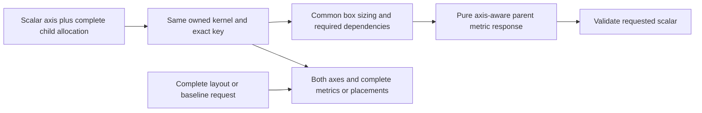

# Axis-specific parent and intrinsic measurement

Follow-up: [axis-aware content leaves](RETAINED_CONTENT_AXIS_MEASUREMENT.md)
extends demand to ContentMeasure and internal leaf intrinsic-limit probes.
Normal final layout/baselines still require complete natural metrics.

Status: implemented experimental framework contract, 2026-11-17. Extends
[pure parent measurement](RETAINED_DRY_PARENT_MEASURE.md) and
[complete baseline queries](RETAINED_DRY_BASELINE_QUERY.md). The complete RFC
goal remains active. This stage exposes general query demand and removes
unnecessary custom-parent work in finite verified cases; it does not establish
a wall-time, memory-saving or sustained-frame improvement.

## Public contract

`LayoutAxis::{Horizontal, Vertical}` is a physical-axis enum owned by the
framework. It is separate from Flex main/cross direction. The new scalar APIs
return only the authoritative requested **border-box extent**, avoiding a
two-dimensional result whose unused axis could be mistaken for a full size:

```rust,ignore
let min_width = ui.dry_measure_node_axis(
    node,
    ChildLayoutInput::new(LayoutConstraints::new(
        LayoutAvailableSpace::MinContent,
        LayoutAvailableSpace::Unbounded,
    )),
    LayoutAxis::Horizontal,
)?;

let width = children.measure_axis(child, input, LayoutAxis::Horizontal)?;
let height = children.measure_axis(child, input, LayoutAxis::Vertical)?;
```

UiTree, ReactiveUi and LogicalUi expose `dry_measure_node_axis`; pure parent
policies use `ParentLayoutChildren::measure_axis`. Existing complete-size and
baseline methods keep their contracts. Scalar result validation rejects a
nonfinite or negative extent. The default external child-trait implementation
uses its existing complete `measure`, validates and selects the requested axis;
framework adapters use the kernel's actual requested-axis path.

Requesting an axis is not an intrinsic mode, sizing mode, known assignment,
hard interval or percentage basis. MinContent/MaxContent/normal Unbounded and
Inherent/Content remain explicit in ChildLayoutInput. In particular, a height
query may require a selected width for paragraph wrapping. A horizontal query
may still depend on the other axis through ratio, bounds or the client policy;
it must calculate that dependency before returning its authoritative width.

`ParentLayoutInput.requested_axis: Option<LayoutAxis>` tells ParentMeasure what
is required. None means both. A scalar response may put a finite nonnegative
placeholder in an **unknown unrelated** axis, but must preserve every known
dimension and calculate any dependency of the requested extent. This extends
the existing ParentMeasureOutput rather than introducing a competing content or
box model. Complete ParentLayout callbacks always receive None, even when used
as the compatibility fallback for a scalar probe. Final metric agreement still
compares complete metrics at the same final input.

The fork's CustomLayoutInput carries the matching RequestedAxis. Complete input
struct literals/exhaustive patterns must add the new field. Callback algorithms
that ignore it continue computing both axes. ChildLayoutInput, independent
ParentAllocationInput/ParentInlineInput and structural builder inputs do not
gain query-demand fields: an allocation is not a scalar measurement request.
No public source/layout style, persistent node/cache format, GPU record or
FramePacket field changes. The existing exact cache already keys requested axis.

## Shared kernel execution and ownership

A width-only ComputeSize on an owned custom parent resolves its normal common
box model and returns after width selection. It omits the subsequent selected-
width dependent-height pass and final metrics/placement stage. A height-only
probe with no incoming known width first obtains complete natural metrics to
select inline size, then requests height at that selected width. When width is
already known it can request height immediately. Both honor common sizing,
containment, hard bounds, percentage provenance and independent allocations.
No fixed-point iteration or second Flex implementation is added.

Complete final layout normalizes demand to Both. The complete-plan fallback
also normalizes its input and all final child placements to Both. Full baseline
queries always normalize to Both. Scalar custom outputs discard baseline
metadata rather than presenting placeholders as complete metrics.

Independent full slots continue overriding all allocation fields for both
measurements and placement. Kernel child measurement saves the caller's
requested axis across that override. The width-only framework allocator first
enforces its existing tight inline slot, then applies the scalar demand. This
keeps allocation authority and measurement intent independent. Final placements
cannot retain a partial-demand child input.



Public queries reuse the existing private-tree clone and do not publish live
geometry, dirty flags, cache entries, sources, effects or paint output. Internal
parent probes use the existing exact bounded cache. Axis-specific placeholders
cannot satisfy a Both query because its key is distinct. Final layout still
performs normal complete publication, old frame lifetime and error handling.
Panic, user effects and shared memo warming remain outside rollback guarantees.

## ADR and costs

**Decision:** expose the existing kernel demand through a framework-owned scalar
API and ParentMeasure input. Preserve complete allocation inputs, exact cache
separation and full-plan/baseline authority.

**Alternatives:** adding an axis field to every ChildLayoutInput/placement would
let a partial query leak into final geometry and make allocation override query
intent. Returning an ordinary ChildLayoutResult would expose an unrelated
placeholder as real geometry. Four separate min/max width/height callbacks
would duplicate hard/selected/percentage/mode inputs and leave normal scalar
queries unresolved. Automatically returning zero for an unrequested dependency
would break ratio and text sizing. These alternatives were not adopted.

**Cost:** ParentLayoutInput and kernel CustomLayoutInput gain a small enum/
optional-enum payload with target-dependent padding. Scalar validation and
dispatch add branches. Callback/plan counts drop for the measured finite client,
but public queries still clone the owned tree and ancestor/ordinary algorithms
may perform substantial work. Height can require complete initial measurement;
legacy full-plan fallback still allocates plans. No new persistent allocation,
callback snapshot, iterative solver or cache format is introduced. Wall-time,
peak memory and long-tail behavior have not been profiled.

## Verification and open scope

See [evidence and commands](performance/2026-11-17-axis-measurement/README.md).
Coverage includes actual ordinary Flex/paragraphs, exact-cache separation,
independent full/inline allocations, normal source updates, P0 restoration,
complete CPU/WGPU numeric controls, error/query isolation and old frames.
These are finite same-kernel protocol controls, not new browser conformance.

This does not implement Flutter's entire intrinsic/RenderBox contract, arbitrary
content-feedback construction or cross-builder/query scheduling. Broad
Flex/Grid/Block intrinsic/ratio/cyclic
conformance, query budgets/incremental private candidates, primitive/effect/native
lifecycles and modern desktop heavy-effect GPU/CPU continuous-frame/60/120Hz/
visible-tail acceptance remain open.
