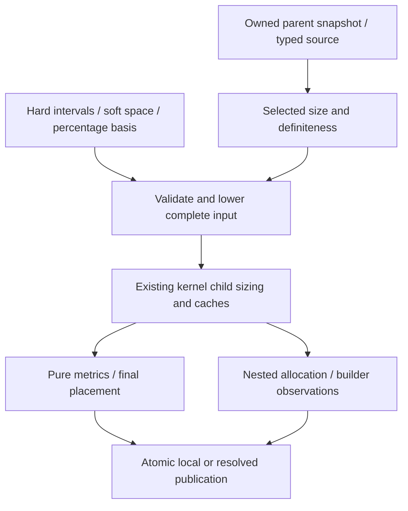

# Selected child sizes and independent percentage definiteness

Follow-up: [measured parent provenance](RETAINED_PARENT_DEFINITENESS.md) carries
the same domain through content-box callbacks and inline allocation, and fixes
final custom-parent/ConstraintBox bases that previously promoted every used
width to definite. This extends the original incoming child-assignment stage.

Follow-up: [explicit content sizing](RETAINED_CONTENT_SIZING.md) adds sizing_mode
to ChildLayoutInput and parent/builder callback inputs, distinguishing own-style
participation from selected size and Min/MaxContent space. Defaults stay Inherent.

Status: experimental public layout protocol, 2026-11-17. Extends
[independent allocation styles](RETAINED_ALLOCATION_STYLES.md) and
[dry parent queries](RETAINED_DRY_PARENT_MEASURE.md). Complete RenderBox,
arbitrary content feedback and full RFC acceptance remain open.

## The missing input domain

An already selected border-box size, a hard interval, a wrapping opportunity
and a percentage basis answer different questions. A Flex item can have a used
60px block size derived from its content and remain indefinite for the purpose
of resolving its own percentage descendants. Turning that size into a tight
60px interval makes it definite and can change a 50% child's natural 10px height
to30px. A finite soft available space alone is neither assignment nor a hard max.

The kernel already represents known dimensions and their definiteness. The old
ChildLayoutInput conversion discarded both, reconstructing known size only
from tight hard intervals and setting both definiteness flags true. A regression
first reproduced Some(70px,40px) becoming None/None after a public round trip.
The public protocol now preserves this previously unrepresentable domain.

## Public contract and migration

```rust,ignore
pub struct ChildLayoutInput {
    pub known_size: LayoutSize<Option<f32>>,
    pub known_size_is_definite: LayoutSize<bool>,
    pub constraints: LayoutConstraints,
    pub percentage_basis: LayoutSize<Option<f32>>,
}

let input = ChildLayoutInput::new(LayoutConstraints::new(
    LayoutAvailableSpace::Definite(180.0),
    LayoutAvailableSpace::Unbounded,
)).with_known_size(
    LayoutSize::new(Some(80.0), Some(60.0)),
    LayoutSize::new(true, false),
);
```

The selected dimensions describe this child's border box. The corresponding
definiteness flags govern whether those known dimensions establish definite
sizes for the child's content; they do not change the child's incoming
percentage_basis. That independent basis resolves the child's own percentage
styles/insets. Known size does not overwrite authored styles or turn them into
pixel constants; the existing common box model and layout algorithm still
apply style, inset, containment and content rules. This change adds no new
alternative layout algorithm or blanket CSS conformance guarantee.

None selects no size on that axis. Its definiteness flag has no effect and
lowers to true, allowing ordinary numeric styles to establish definite sizes.
`new` preserves previous behavior: no selected size and true flags, caller's
constraints and no percentage bases. `Default` is normal Unbounded/Unbounded
with the same empty assignment; it is not intrinsic MaxContent.

Selected sizes must be finite, nonnegative and inside the hard interval. A
contradictory selected size is rejected as InvalidParentLayout instead of
silently clamping the public assignment. A tight hard interval supplies a known
dimension and true definiteness even when no known size was authored. For a
selected value on that axis it must agree with that interval. Hard bounds retain
their existing stronger authority over authored child style limits. The
width-only allocator explicitly replaces the selected width and its definiteness
when it imposes its tight inline interval; block assignment is preserved.

Public struct literals/exhaustive patterns must add the two fields. Existing
callers can use `..ChildLayoutInput::default()` or `..ChildLayoutInput::new(...)`
to retain the earlier semantics. All repository Rust call sites are migrated.
This is an intentional source API expansion in the experimental framework, not
a stable ABI promise or a separate compatibility protocol.

## Normal update, query and lifecycle

The same input lowers through ParentMeasure/ParentLayout child measurements,
baseline queries and final ParentPlacement. ParentAllocationLayout returns
complete assignments with these fields; ParentLayoutChildren::allocation now
round-trips them, and enforced allocation wins over conflicting measured or
placement requests. Nested ParentAllocationInput and allocation_builder retain
the actual incoming selected size, definiteness, loose bounds, soft space and
percentage bases independently.



Actual source replacement invalidates the existing ancestor caches. Existing
kernel ordinary keys already distinguish known-size definiteness; exact caches
and final complete-input guards retain these fields. No kernel cache format
change is required. Restoring the original snapshot handle in one transaction
coalesces to no layout. Allocation builder observations compare the complete
final input and preserve their existing structural/containment proof domain.
Invalid selected inputs fail before publication; atomic frame edits preserve
the prior sources, layout, stats and frame. Ordinary already-committed
transactions, panic/external side effects and shared memo warming retain their
previous independent limits. Old packets do not retain these callback inputs.

UiTree/ReactiveUi/LogicalUi explicit dry queries accept the same selected inputs
without changing live geometry or cache state. Complete baseline queries expose
the effect of percentage definiteness through final ordinary placement
arithmetic. They remain explicit potentially expensive queries, not automatic
intrinsic contributions or construction scheduling.

## ADR and costs

**Decision:** extend the one ChildLayoutInput domain with selected size and
percentage definiteness, share validation/lowering across allocation, measured
placement and query routes, and reject inconsistent hard intervals.

**Alternatives:** encoding known size as tight bounds loses indefinite content
semantics. Encoding it only as available space loses selected size. Replacing
child styles duplicates truth and changes normal updates. A new parallel child
input type would leave old query/measurement paths unable to preserve inputs
and multiply adapters. Silently clamping an explicit contradictory assignment
would hide an application error.

**Costs:** two Option<f32> values and two bools are added to each public child
input value; placement vectors and temporary allocation lists therefore carry
more payload. Validation adds constant work per lowering; the existing kernel
input and cache formats do not grow. No persistent NodeData, GPU record or
FramePacket field is added. Actual compiler padding and whole-frame memory
impact are not benchmarked. Existing clones, repeated measurements and proof
scans remain. No wall-time, memory reduction, p99 or sustained-frame improvement
is claimed.

## Evidence and open scope

See [verification record](performance/2026-11-17-child-assignments/README.md).
Finite source-driven and direct measured-parent cases distinguish indefinite
and definite selected height while the assigned host size stays80×60. Complete
host/leaf results and all CPU pixels compare with ordinary forced-full Flex
using independently specified expected leaf sizes10/30. These reference sizes
are explicit controls, not a claim that a fixed-height Flex has indefinite
percentages. Nested allocators, exact enforced reads, restored P0 writes, keyed
builders, invalid-source rollback, baseline dry queries, real shaped glyphs and
old-owner lifetime exercise the normal routes.

Still open: complete RenderBox/dry/intrinsic and content-driven policy contracts,
uncontained ordinary Flex construction feedback, automatic cross-builder/query
scheduling and generalized query-host proofs; incremental candidate/proof/
rollback and global budgets; broad percentage/cycle/Flex/Grid/Block/writing-mode/
precision conformance, primitives/resources/effects/native lifecycle. Modern
desktop GPU heavy effects, CPU continuous complete frames, sustained60/120Hz
and display-visible input tails retain their separate unmet gates.
