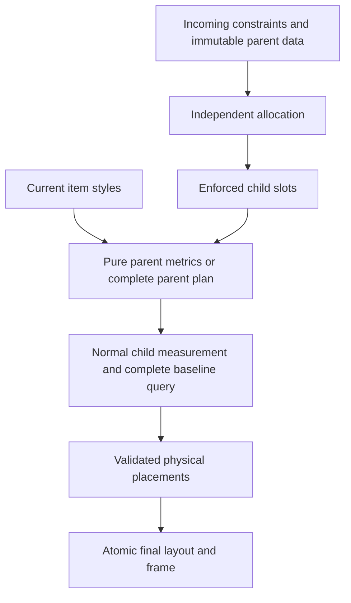

# Item styles in measured parent policies

Status: experimental framework contract, 2026-11-17. Extends pure parent
measurement and generic content leaves. Full RenderBox and full RFC acceptance
remain open.

## Input contract

`ParentLayoutChildren::style(index) -> Result<ChildLayoutStyle, Error>` returns
an owned copy of the direct child's current item-facing inputs, in actual layout
order. Both `ParentMeasure` and `ParentLayout` can read it. The API contains only
framework-owned types, with no Taffy, Window, renderer or UI-owner borrow.
External child adapters default to an explicit unsupported error; they do not
invent default styles. Invalid indices fail.

The value preserves unresolved preferred/min/max dimensions, intrinsic keywords,
flex basis/grow/shrink, self alignment and overflow policy, margin/inset,
padding/border, direction, position, box sizing, aspect ratio, scrollbar width,
overflow, size/layout/paint containment and replaced-element classification.
Percentages remain fractions, Auto remains Auto, and no final used geometry is
implied. Image-measured leaves expose their effective replaced classification.
Hidden children remain addressable and report their authored inputs plus hidden.

This is an item input domain, not a second copy of LayoutStyle. It does not expose
the child's internal container algorithm/gap/descendant alignment, NodeId,
resources, arbitrary descendants or inherited UI state. Child order is represented
by the index, not another order field. Measurement through the existing child API
remains authoritative for subtree content. Legacy raw Sticky/Fixed or calc values
outside the public style model reject when read rather than silently changing
policy; direct out-of-flow children were already unsupported by custom parents.

Reading style does not implement CSS placement. The parent policy still chooses
child inputs and physical origins; normal child layout retains its own box model.
In particular, custom ParentPlacement continues publishing zero child margin
metadata and does not apply relative insets automatically. A client can use
authored margins in its arithmetic, but that does not make the entire result
equivalent to ordinary Flex. No new built-in wrap/Flex algorithm is introduced.

## Measured versus independent phases

Independent `ParentAllocationChildren` and the width-only allocator do not gain
style or content access. Their existing proof domain and enforcement remain
unchanged: a measured policy sees authored style but cannot override an installed
assignment. Adding style access to an independent phase would require tracking
all direct-child style dependencies in structural observations and responsive
proofs, and could introduce content/percentage feedback. That is still open.

Style reads do not authorize allocation builders beneath arbitrary measured
parents. Existing unsafe feedback chains reject before running the builder.
This addition does not generalize inline/query proofs, add a fixed-point loop or
weaken final-input validation.

## Invalidation, failure and lifecycle

Styles already participate in normal typed transactions, source/computed sinks,
same-value suppression and final-value coalescing. Changed child style dirties
the child and ancestors, clearing ordinary/exact parent caches. All of the
measured policy's child-style reads are conservatively covered; there is no new
dynamic read subscription or per-property invalidation index.

The project-owned Taffy view copies item inputs directly from its real node
style. No sparse storage, per-NodeData field or measurement cache format is added.
Reorder/hidden/reparent/removal follow the existing node/style lifetime. The
owned style copy can outlive a callback, but cannot re-enter the tree. Published
FramePackets carry resolved drawing/resources, not these callbacks or inputs.

Errors propagate as InvalidParentLayout through the existing fallible candidate.
Atomic frame edits preserve old sources, tree, layout and published frame.
Previously committed ordinary transactions remain committed if a later frame
fails. Panics, user effects and shared memo/diagnostic mutation retain the
existing exclusions. Raw low-level callers still need private candidates for
isolation; the framework already uses them for custom parents and dry queries.

## ADR: read item style only where content dependency is already permitted

**Decision:** give measured parent policies an owned item-style view, use the
real kernel styles and existing conservative invalidation, and keep independent
phases restricted to their proved inputs.

**Alternatives:** copying all child policies into parent snapshots makes normal
child style updates indirect and duplicates their truth. Exposing engine Style
would bind the public protocol to Taffy and expose irrelevant container internals.
Adding style to every independent allocator silently broadens structural proof
dependencies. Automatically implementing margin/relative positioning in the
kernel would change all existing parent plans and risk double application.

**Costs:** value copying/conversion on each style read, plus application policy
work and existing repeated probes/exact caching/private tree copies. There is no
new GPU record, FramePacket field, persistent style mirror or read-tracking map.
No wall-time, memory reduction, p99 or sustained-frame improvement is claimed.

## Validation and remaining work

See [reproduction record](performance/2026-11-17-child-style/README.md). The finite
wrapping client tests are an application example, not full Flex conformance.
Geometry compares with a 0.0001 logical-unit tolerance because RTL arithmetic
can differ by a few f32 ULPs. Custom child margin metadata is separately asserted
zero and excluded from cross-protocol equality; CPU and explicit WGPU pixels
remain exact. The actual glyph case has no child margins and compares the
complete host/leaf/footer LayoutResult exactly.

Still open: independent child-style allocation with complete dependency proofs,
arbitrary RenderBox/dry/intrinsic contracts, uncontained content-feedback builders,
automatic cross-builder/query scheduling, incremental candidates/proofs/rollback
and memory budgets; broad Flex/percentage/cycles/Grid/Block/writing-mode/precision
conformance; primitive/resource/effect/native lifecycle. Modern desktop GPU heavy
effects, CPU continuous complete frames, sustained60/120Hz and display-visible
input tails retain their separate unmet gates.
