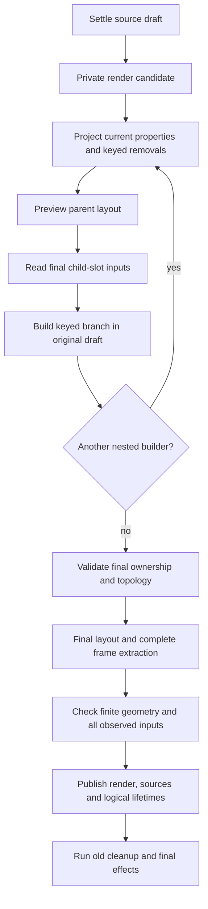

# Parent-input construction and atomic keyed frames

Updated 2026-11-16 on `codex/rendering-performance-research`. The full RFC goal
remains active. This stage implements a size-contained ConstraintBuilder
subset and conditional keyed construction. The subsequent
[inline builder stage](RETAINED_INLINE_CONSTRAINT_BUILDERS.md) permits
content-derived block height with an inline-only public input and shared
dependency proof. General full-axis content-sized builders and RenderBox remain open.

The later [incoming allocation builder](RETAINED_PARENT_ALLOCATION_BUILDERS.md)
permits two-axis content-derived size along independently allocated parent chains.
It reads the host's incoming border-box slot, unlike this API's outgoing child
slot. General ordinary-Flex/full-axis dependency proofs and RenderBox stay open.

The [mixed allocation follow-up](RETAINED_MIXED_ALLOCATION_BUILDERS.md) admits
ordinary Flex ancestry across explicit full Size+Layout containment cuts and
adds `known_size` / `known_size_is_definite` to ConstraintBuilderInput. These
preserve real known dimensions separately from intervals and percentage bases;
full constraint_builder returns the same extra fields for its outgoing slot.
Uncontained feedback edges and complete RenderBox remain open.

## Public contract

`LogicalUi::edit_frame(constraints, viewport, sources, render)` combines source
settlement, logical scope/state/effect lifetime, render structure/properties,
final layout and complete FramePacket extraction into one publication boundary.
It returns `(ReactiveEditCommit<R>, FramePacket)`. All fallible validation runs
before replacing the owner, retiring old sources, running cleanup, or observing
new effects. Final effects see installed logical maps and the complete frame.
`edit` retains its existing cheaper source/render-only publication contract.
The later `edit_local_frame` API offers the same atomic boundary with direct
LocalFrame output and non-resolving geometry validation; see
[its contract and remaining costs](RETAINED_ATOMIC_LOCAL_EDITS.md).

Within `edit_frame` or `edit_local_frame`, use `LogicalEdit::constraint_builder(host, build)` before
choosing the host child's structure. It passes `ConstraintBuilderInput`:

- `constraints`: actual hard child-slot bounds and soft available-space modes.
- `known_size` and `known_size_is_definite`: parent-selected dimensions and
  their percentage definiteness, distinct from the actual measured child size.
- `percentage_basis`: independently defined percentage bases, including None
  for an indefinite axis. A loose maximum is not a definite height basis.

The host must use `LayoutDisplay::ConstraintBox` **and**
`LayoutContainerType::Size`. Its zero/one in-flow child protocol, padding,
border/gutter deflation, RTL placement and direct-edge semantics remain those
of [constraint boxes](RETAINED_NESTED_CONSTRAINT_BOX.md). It may participate in
outer Flex grow/shrink allocation and contain ordinary nested Flex content.
Size/layout containment excludes descendant intrinsic contribution and
baseline/OOF feedback from the host's allocation. It does not imply paint clip.
Author a size or provide a parent allocation: an empty auto-sized contained
host may legitimately have zero size.

The input is assigned by that parent protocol **to its child slot**. It is not
the host's incoming CSS AvailableSpace, an intrinsic measurement probe, the
child's preferred/used size, or the paint viewport. A loose width max of 100
can produce a 20-wide child. `ContainerQuery` continues to read actual used
content size and remains a different API.

Use `reconcile_keys`, keyed `state`/`computed`/`effect`, `renders`,
`append_layout`, bindings and property edits inside the callback. A stable key
retains state, effect registrations and explicitly reused NodeIds. A changed
key retires the old scope subtree/output/dependencies and runs cleanup only on
successful publication. Scope keys and render nodes are independent; the
builder does not retain handles automatically on behalf of its caller.

```rust,ignore
// host: ConstraintBox + ContainerType::Size, under a real Flex allocation.
let (commit, frame) = ui.edit_frame(
    LayoutConstraints::viewport(window_width, window_height),
    [window_width, window_height],
    |tx| { tx.set(model, next_model)?; Ok(()) },
    |(), edit| edit.constraint_builder(host, |input, edit| {
        let wide = input.constraints.bounds.max.width >= 600.0;
        let branch = edit.reconcile_keys(component, &[u64::from(wide)])?[0];
        let selection = edit.state(branch, 0, || 0u32)?;
        let output = edit.renders(branch)?;
        let row = if let Some(row) = output.first() { *row } else {
            let row = edit.append_layout(branch, host, LayoutStyle::row(), 0)?;
            // Construct narrow/wide branch output and bind state here.
            row
        };
        Ok((selection, row))
    }),
)?;
// Submit the returned complete frame through the existing GPU or CPU consumer.
```

Nested builders observe previously staged structure and settled source sinks,
including a host allocated beside a fixed-size Flex sibling. Retire an old
branch before querying a replacement nested host. Host input reads are checked
again against the final candidate: a later sibling/ancestor edit or logical
reorder that changes any observed bounds/mode/percentage basis returns
`UnsafeConstraintBuilder`. No retry-to-convergence or transient frame is used.
An out-of-order plan must be reordered by its author. Hidden/non-box/non-size-
contained hosts and calls outside `edit_frame`/`edit_local_frame` reject before invoking `build`.
Removing a queried host later also rejects the plan.

## Implementation and lifecycle



The owned Taffy fork records final `PerformLayout` child-slot inputs on
constraint boxes, including empty boxes. `ComputeSize`/intrinsic probes do not
record them. The sparse records survive ancestor cache hits; hidden layout,
style protocol removal, node removal and clear retire them. Low-level readers
must run layout before reading a dirty tree. The framework only reads after
preview/final layout. A selected finite inline size is already a child width
assignment; the other indefinite axis still preserves Unbounded/MinContent/
MaxContent and its independent percentage definiteness.

Preview applies newly created and settled existing sinks with final topology
as one draft. In particular a two-child Flex can retire a branch and change to
a single-child box in the same edit, without validating an invalid intermediate
protocol. No arbitrary construction callback runs inside Taffy's layout stack.

Final-frame checks reject nonfinite resolved bounds/content bounds/clips and
overflowed rect endpoints. Finite local translations can overflow when composed;
that error must preserve the old complete frame and old branch lifecycle.
Failed node/scope/source/binding/effect reservations consume generation/serial
numbers so escaped provisional handles cannot alias a later edit.

The atomic guarantee covers returned errors and published owner state. User
source computations, initializers and builders must be pure apart from draft
edits. External callback side effects, panic/unwind, allocator failure and
resource memo-cache warming are not rolled back. Effect callbacks remain
synchronous and run after publication under the existing effect contract.

## ADR: retain the CSS kernel and add a staged parent-input protocol

**Status:** implemented for size-contained boxes; broader protocol deferred.

**Context:** a CSS Flex engine probes children repeatedly and may select parent
size from child content. Executing an arbitrary structural callback on each
probe can change state lifetimes, cache keys and the measurement itself. A
ContainerQuery or window-width substitute does not supply parent constraints.

**Decision:** record the actual final child-slot assignment, build outside the
algorithm in a private frame plan, and require size/layout containment. Recheck
all recorded inputs at the final publication boundary. The framework owns the
public API; vendored Taffy remains the persistent Flex algorithm implementation.

**Alternatives:** invoking builders from recursive measurement risks transient
scope creation and content-size feedback; accepting arbitrary content-sized
hosts with repeated layout until stable has no deterministic contract; replacing
Taffy now would discard the tested CSS algorithms without resolving construction
lifecycle. None is adopted in this stage.

**Costs:** `edit_frame` clones the retained tree and layout caches once. Each
explicit builder adds a temporary full preview copy, source-sink scan, draft
validation and layout traversal before the final layout/extraction. There may
be two additional complete tree owners resident (candidate + current preview).
It is O(tree) allocation/copying and O(bindings) preview dispatch, plus normal
layout costs per builder. Final geometry validation scans complete paint items.
The sparse input record stores one LayoutInput per laid-out constraint box,
plus map overhead; no per-node Style/Display size increase in this stage.
no_std uses the existing SecondaryMap fallback, which may allocate by slot span.
`LayoutPartialTree` gains a default no-op hook; existing custom trees still
compile. The new framework Error variant affects exhaustive matches.

This is not an incremental planner, a performance optimization, or an idle
scheduling mechanism. Builders are explicitly invoked once per requested plan;
there is no automatic environment subscription or callback equality cache.
`FramePacket.layout_runs/stats` describe final extraction; they **exclude**
construction previews. No end-to-end timing claim should be derived from them.

## Evidence and remaining work

[Commands and results](performance/2026-11-16-constraint-builders/README.md)
cover actual narrow/wide structural changes, identity retention, nested Flex
allocation and padding, source settlement, atomic protocol switching, changed
input rejection, invalid branch structure, finite-composition overflow,
provisional handles, old frame pixels, cleanup order and live old bindings
after failed replacement. A fresh forced-full tree supplies an independent
CPU pixel reference. Bundled Noto paragraphs wrap at 50/90/140/50 content widths
after branch selection. Vendor tests cover cached/empty/hidden/retired inputs.

Inline-only construction with content-derived block height is implemented in
the [subsequent stage](RETAINED_INLINE_CONSTRAINT_BUILDERS.md). Subsequent stages
also add [pure custom parent measurement/placement](RETAINED_CUSTOM_PARENT_LAYOUT.md)
and [atomic LocalFrame edit output](RETAINED_ATOMIC_LOCAL_EDITS.md).
[Explicit responsive stages](RETAINED_STRUCTURAL_RESPONSIVE.md) now compose
existing multi-stage ContainerQuery bindings with construction in one edit.
Still open:
general full-axis content-sized builders, complete RenderBox,
automatic builder dependency scheduling and indexed/incremental
planning and broader Flex/percentage/cyclic
sizing and device rounding. Modern desktop GPU/effects, CPU smooth delivery,
sustained 60/120Hz and input-to-visible tail latency remain unqualified by this
stage. No new GPU readback, browser comparison, or timing benchmark was run.

[Scope-owned responsive declarations](RETAINED_SCOPED_RESPONSIVE_RULES.md) now
add rule registration/update/removal and keyed retirement in the same edit.
