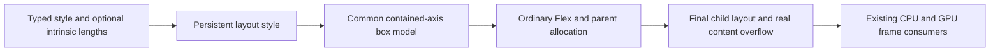

# Explicit intrinsic inner sizes for contained layout

Status: experimental framework contract, 2026-11-17. Extends
[size containment](RETAINED_SIZE_CONTAINMENT.md) and
[Content/Inherent queries](RETAINED_CONTENT_SIZING.md). The complete RFC goal
remains active. This is a layout capability stage, without new frame-time or
sustained presentation claims.

## Public contract

`LayoutStyle.contain_intrinsic_size: LayoutSize<Option<f32>>` and
`.contain_intrinsic_size(width, height)` describe intrinsic **content-box**
lengths on physical axes. Each value must be finite and nonnegative. `None`
retains the empty-content contribution; `Some(0.0)` explicitly supplies zero.
Both size to zero inner content today, while preserving different authored
values for style observation/equality. Percentages are not accepted.

```rust
let placeholder = LayoutStyle::column()
    .container_type(LayoutContainerType::Size)
    .contain_intrinsic_size(Some(320.0), Some(180.0))
    .padding(LayoutEdges::all(LayoutLength::Px(8.0)));
```

An unconstrained auto box in this example contributes 336x196 border-box units.
Outside Flex grow/shrink/stretch, preferred sizes, min/max and parent-selected
dimensions/hard intervals can still change its used size. The fallback is not a
preferred width/height, fixed child, or new proof of percentage definiteness.
The existing final used-size rules determine descendant percentages.

`InlineSize` uses only the width fallback; uncontained block size still follows
content measured at the final inner width. `Normal` ignores both fallbacks for
sizing. Values remain validated and observable even while inactive. Toggling
containment or display uses normal style invalidation and final-value coalescing.
No value automatically remembers a previously measured size.

Padding, border and reserved Scroll gutters are added by the shared box model,
independent of BorderBox/ContentBox's treatment of preferred/min/max lengths.
Intrinsic keyword limits use the fallback on contained axes. Content-mode dry
queries continue ignoring the queried node's preferred/min/max (and the
leaf/owned-box aspect suggestion), retaining containment, this intrinsic
fallback, insets and hard inputs. This does not broaden the previous stage's
limited cross-algorithm aspect-contribution guarantee.
Children keep their own authored sizing and final layout. Actual content still
contributes local overflow and paints normally; fallback content is never drawn
and never inserted as fictitious scrollable overflow. Baseline suppression
continues following the existing layout-containment contract.

Image inputs/decoded images suppress their natural ratio under size containment;
an explicitly authored ratio remains effective. For fallback60x25, a natural80x40
image sizes60x25, or60x30 with an authored ratio2, in the finite tested root case.
The same ordinary-box behavior is recorded independently in Chromium.

## Architecture decision

**Decision:** extend the common style domain and leaf box model. The vendored
`CoreStyle` accessor defaults to `Size::NONE` for external adapters and forwards
through references. `Style`, owned `CustomChildStyle` and public `ChildLayoutStyle`
carry the same unresolved values. Measured and independent allocation policies
can read them without resolving content. ConstraintBox and custom parent hosts
preserve them when constructing their temporary common box styles. Flex, Grid
and Block reuse the existing contained-size helper, with no second layout path.

**Alternatives:** assigning preferred dimensions changes their strength during
Flex/Grid allocation. A dummy child incorrectly participates in tracks, gaps,
alignment, overflow and order. Remembering every prior output would require a
separate skipping/observation lifecycle and would add hidden historical input.
These alternatives do not implement explicit intrinsic inner size semantics.



Normal typed sources use existing P4 layout routing; equal final values remain
P0. Atomic property preparation rejects invalid lengths before applying earlier
patches. Responsive query rules still require their existing dependency proofs:
an explicit fallback cannot make an arbitrary inline Row/wrap chain safe.
Independent allocation builders already observe complete effective sibling
styles, so a fallback edit invalidates a captured dependency even when inactive
or when the allocator happens to return the same numeric slot. Cache/style
invalidation and old immutable packets use their existing lifecycle.

**API migration:** complete public LayoutStyle/ChildLayoutStyle and engine
Style/CustomChildStyle literals need the new field. Defaults and builders retain
old behavior. The default CoreStyle method preserves external implementations.
Serde uses the style's existing default behavior for missing fields; there is no
new CSS property-string parser or logical writing-mode API.

**Costs:** two `Option<f32>` values occupy16 bytes. Existing x64 vendor size
guards now assert Style<String>576 bytes (previous560) and Style<Arc<str>>544
(previous528), in both supported balance configurations. Every stored/cloned
style and owned child-style view pays this payload; candidate/proof snapshots
also copy it. There is no new persistent GPU record, FramePacket field, callback,
resource lease or iterative convergence loop. Scalar fallback addition replaces
zero contributions. Overall peak memory and wall-time have not been measured;
no memory-saving or performance-improvement claim follows from these counts.

## Validation and remaining scope

See [reproduction and evidence](performance/2026-11-17-containment-fallback/README.md).
Independent Chromium145 geometry covers four Flex directions, three containment
modes, five per-axis fallback combinations, two box models, preferred/numeric and
intrinsic limits, constrained shrink and grow. Normal source updates compare
complete CPU/WGPU pixels with separately authored fixed-geometry full references.
Real Noto glyphs, decoded images, pure content measurement, custom/box parents,
dry queries, query thresholds, hidden restoration and old packet ownership have
finite focused coverage, rather than complete conformance.

Not implemented: `auto` last-remembered sizes, content-visibility/skipping and
its observation/forget/reconnect lifecycle; vertical writing/logical properties;
automatic non-overlay scrollbar prediction; public Grid/calc and broad
percentage/cycle/aspect/intrinsic behavior across all algorithms. Overflow::Auto
continues its pre-existing sizing policy; this stage does not implement the
CSS Sizing4 hypothetical-scrollbar iteration. Modern desktop GPU heavy effects,
CPU continuous full-frame smoothness, sustained60/120Hz and input-to-visible
tail latency remain separate acceptance work. General feedback builders,
incremental private candidates/proofs/global budgets, complete RenderBox,
primitive/effect/native lifecycles and other open RFC items remain open.

Normative basis: [CSS Sizing4 explicit intrinsic inner size](https://www.w3.org/TR/css-sizing-4/#intrinsic-size-override).
