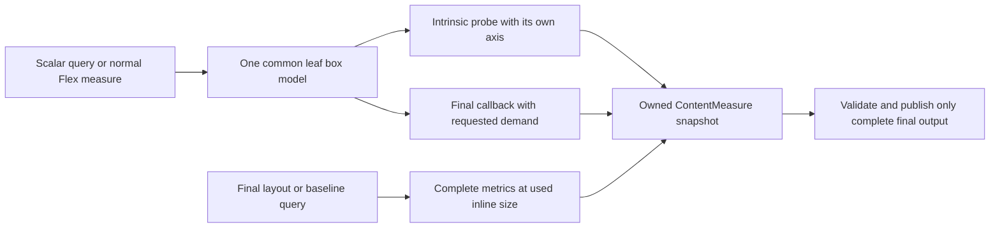

# Axis-aware content leaves and intrinsic box probes

Status: implemented experimental framework contract, 2026-11-17. Extends
[owned content measurement](RETAINED_CONTENT_MEASURE.md) and
[parent axis queries](RETAINED_AXIS_MEASUREMENT.md). The complete RFC goal stays
active. This stage reduces finite client work and preserves layout dependencies;
no wall-time, memory-saving, tail-latency or sustained-frame improvement is claimed.

## Public content contract

`ContentMeasureInput.requested_axis: Option<LayoutAxis>` now identifies the
physical content extent needed by a probe. None requires complete natural size
and available first/last baseline metrics. Some(Horizontal/Vertical) permits a
finite nonnegative placeholder only in an unrelated extent; a content algorithm
must still calculate any dependency needed for the requested extent. Scalar
callbacks may omit baselines. All returned size components and supplied
baselines remain validated, even when unrequested.

```rust,ignore
fn measure(&self, input: ContentMeasureInput) -> Result<ContentMeasureOutput, Error> {
    match input.requested_axis {
        Some(LayoutAxis::Horizontal) => self.natural_width(input.available),
        Some(LayoutAxis::Vertical) => self.height_at_inline_space(input.available),
        None => self.complete_metrics(input.available),
    }
}
```

Available space remains the deflated **soft content opportunity**. It is not a
known allocation, hard bound or percentage basis. Intrinsic MinContent/
MaxContent, normal Unbounded and finite opportunities retain their meanings.
The callback still cannot read UI state, styles, children, ancestors, GPU
resources or the host box model. Its owned immutable snapshot and identity/
replacement/purity contract is unchanged. This is content measurement, not a
second RenderBox sizing algorithm.

Complete ContentMeasureInput struct literals/exhaustive patterns need the new
field. Existing implementations that ignore it keep returning complete metrics
correctly. ContentMeasureOutput and all persistent styles/nodes/cache/GPU/frame
formats are unchanged. This does not establish a stable Rust/cross-language ABI.

## Preserve the actual probe's demand

The project-owned Taffy kernel adds `compute_leaf_layout_with_measure_axis`.
Its common leaf arithmetic is the same implementation used by the legacy
two-argument callback API; the old entry point is a wrapper ignoring demand.
Internal intrinsic min/max probes pass their own physical axis rather than
blindly inheriting the outer layout's request. The final callback is Both for
PerformLayout. This avoids resolving a height limit from a placeholder produced
for an outer width query. No duplicate padding/min/max/ratio implementation is
introduced, and existing adapters keep their callback signatures.

The framework content adapter keeps the pure leaf arithmetic's known-size
shortcut disabled so complete layout can still obtain natural overflow and
baselines. It applies outer scalar demand only to the final callback, leaving
internal intrinsic probes authoritative. A horizontal ComputeSize returns after
its first pass instead of selecting width for an unrelated height pass. A
vertical request with no selected width first obtains complete natural metrics,
selects the used width, then requests only dependent height at that width.
Final layout and complete baseline queries always request complete content
metrics. Scalar query outputs discard baseline metadata; their unused size or
overflow components are not published as final geometry.

Padding/border/gutters, intrinsic/numeric min/max, ratio, hard bounds, containment
and fallback sizes stay in the common leaf box model. Callbacks may return
natural content larger than the used box. Final natural extent and first/last
baselines still supply the existing overflow and publication routes. Exact
measurement caches already distinguish requested axis and final/size modes.



## ADR, costs and failure boundary

**Decision:** expose demand to content callbacks through a single shared leaf
algorithm, and preserve each intrinsic probe's independent demand. Keep scalar
query intent separate from complete final metrics and from allocation fields.

**Alternatives:** only forwarding the outer axis mislabels internal other-axis
limits. Always requesting complete content keeps callbacks from skipping costly
work. A second content-only box model would duplicate Flex/ratio/insets and
invalidate full-reference comparisons. Skipping dependent inline selection for
height would change paragraph wrapping. None was adopted.

**Costs:** one optional enum in temporary ContentMeasureInput, per-callback
branching and dispatch. The finite width client now receives one call instead
of an unnecessary second pass, but internal intrinsic probes remain and height
can still need initial complete metrics. The legacy wrapper is generic without
a new persistent allocation. Public queries continue cloning private layout
trees; exact caches/private candidates retain existing costs. Payload padding,
whole-frame allocations, timing and p99 were not profiled.

Errors remain sticky InvalidMeasure and private layout/frame edits preserve live
state. A successful scalar query does not certify a complete response: a client
that answers width but rejects Both fails complete baseline/final layout. Atomic
source/frame edits roll back that failure. Ordinary prior commits, panic,
external effects and shared memo warming keep their established boundaries.
P0 final-value coalescing, resource ownership and old frame consumption retain
the same normal paths.

## Verification and open scope

See [evidence and commands](performance/2026-11-17-content-axis/README.md).
Finite tests include scalar callback counts, intrinsic limit demand, ratio,
containment/gutters, complete CPU controls, normal source/no-op/error lifetimes,
real shaped paragraph metrics and actual WGPU submissions. Browser conformance
is not inferred from same-kernel comparisons.

Full RenderBox, general dependency-driven content construction and builder/query
scheduling, incremental private candidates/proofs/global budgets, broad
Flex/Grid/Block cyclic/ratio/intrinsic/writing-mode consistency, primitive/effect/
native lifecycle and modern desktop heavy-effect GPU/CPU smooth complete-frame/
sustained60/120Hz/visible-tail acceptance remain open.
