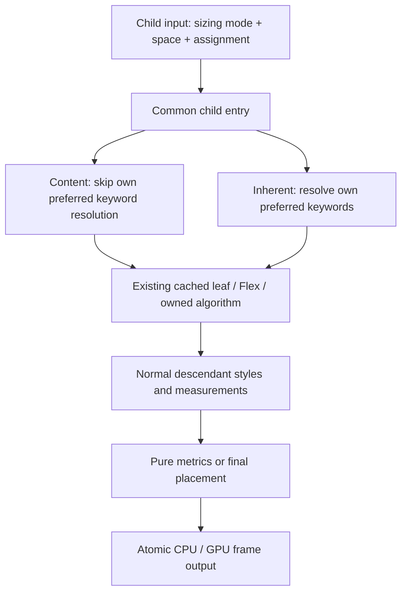

# Explicit content contributions in the public layout protocol

Follow-up: [Flex automatic minima](RETAINED_FLEX_AUTOMATIC_MINIMUM.md) distinguishes
authored preferred sizes from ratio-transferred suggestions in ordinary Flex;
the sizing mode remains a separate input and no broader CSS conformance follows.

Status: experimental framework protocol, 2026-11-17. Extends
[selected child assignments](RETAINED_CHILD_ASSIGNMENTS.md). Complete RenderBox,
all intrinsic algorithms and full RFC acceptance remain open.

## Public contract

`LayoutSizingMode::{Inherent, Content}` is a framework-owned value. Inherent
keeps the existing child-size behavior. Content asks for a contribution without
the queried node's own preferred/min/max size styles. It does not erase styles
inside the subtree. Parent hard constraints and selected dimensions still apply,
as do padding/border/gutter, containment and the node's layout algorithm.
Leaf/owned box model aspect suggestions are ignored in Content mode, matching
the existing leaf ContentSize semantics; broad cross-algorithm aspect and CSS
contribution conformance remains a separate gate.

```rust,ignore
let input = ChildLayoutInput::new(LayoutConstraints::new(
    LayoutAvailableSpace::MaxContent,
    LayoutAvailableSpace::Unbounded,
)).with_sizing_mode(LayoutSizingMode::Content);

let child = children.measure_baselines(index, input)?;
let metrics = ui.dry_measure_node(node, input)?;
```

Sizing mode is distinct from the available-space query mode. Inherent+MaxContent
can still honor a200px preferred width; Content+MaxContent can return natural
100px plus insets; Content+MinContent can return20px plus insets. Content+Definite
width provides a wrapping opportunity, and an explicit known width can select
the actual border box. None of these choices is an automatic general CSS Flex
contribution formula, measurement of arbitrary ancestors or unbounded feedback.

ChildLayoutInput adds sizing_mode; new/default select Inherent. Existing struct
literals using defaults remain valid, complete literals/patterns add the field.
ParentLayoutInput, ParentAllocationInput, ParentInlineInput and full
ConstraintBuilderInput also expose the actual invocation mode. Low-level
CustomLayoutInput carries the corresponding kernel mode. Application policies
decide how to use it; the framework does not silently propagate Content into
every descendant. ParentMeasure and full ParentLayout receive the same mode on
the same final input, and normal metric agreement checks still apply.

The same typed input is used by direct child measurement, complete baseline
measurement, final ParentPlacement, independent allocation/readback and explicit
UiTree/ReactiveUi/LogicalUi dry queries. Full allocation overrides conflicting
measured or placement requests including sizing mode. Width-only allocation
continues to override only its inline assignment. Old frames own the output,
not callbacks or measurement inputs.

## Kernel correction and normal updates

The common child entry previously resolved preferred sizing keywords even for
ContentSize queries. A regression reproduced a node authored min-content width
returning20 during a MaxContent content query whose natural contribution was100.
The entry now forwards ContentSize directly to the real cached algorithm without
resolving the queried node's own preferred/min/max keywords. Descendant calls
retain their ordinary policy. Owned custom parents/ConstraintBox also suppress
their own aspect suggestion in ContentSize, matching the common leaf model.

No second intrinsic or Flex implementation is added. Existing ordinary cache
modes distinguish Inherent/Content; exact caches and final complete input guards
include sizing_mode. Callback inputs now expose that distinction instead of
silently hiding it. Query isolation and sticky fallible-layout errors remain.
Normal source/snapshot updates invalidate existing ancestors; restoring the same
snapshot handle coalesces to P0. Keyed builders observe the real complete slot
and retain their conservative structural proof/containment domain.



## ADR, failure behavior and costs

**Decision:** represent content versus inherent sizing explicitly in the one
public child-input domain, transport the mode to owned callback inputs and
preserve the existing kernel's cache distinction. Fix the common child entry
instead of changing authored styles or adding another contribution algorithm.

**Alternatives:** MinContent/MaxContent alone controls available space, not
whether own styles participate. Temporarily clearing styles mutates normal
truth/cache dependencies and complicates failure rollback. A separate intrinsic
API alone would still leave normal measured placement/allocation unable to
express the same contract. Assuming all user policies forward the host's mode to
children would incorrectly erase descendant styles.

Pure owned policies can fail; existing private candidate/atomic source-tree-frame
publication preserves the prior owner state. Ordinary transactions committed
before a later frame error remain committed. Panic, external side effects and
shared memo warming retain their prior limits. The mode does not authorize
content feedback construction or relax independent-allocation purity.

**Costs:** one enum in public child/parent/builder inputs and low-level
CustomLayoutInput can increase temporary input/placement payload depending on
padding. The kernel LayoutInput/cache already had the mode, so those formats do
not grow. No persistent per-node style copy, GPU record or FramePacket field is
added. Explicit baseline queries, private tree copies, repeated probes and
structural proof scans remain. No time/memory reduction, p99 or sustained-frame
improvement is claimed.

## Evidence and remaining scope

See [verification record](performance/2026-11-17-content-sizing/README.md).
Finite controls distinguish Content+Min/MaxContent, selected/hard inputs and
descendant styles across leaf/Flex/ConstraintBox/owned hosts. Normal typed
source-driven mode switches compare complete child geometry and CPU pixels with
ordinary full Flex controls whose queried styles are independently cleared.
Callback mode transport, full/inline planners, keyed builder inputs and real
shaped glyph wrapping exercise the normal routes. This is not new independent
browser conformance or proof of arbitrary client algorithm equivalence.

Complete RenderBox/dry/intrinsic and general CSS contribution/aspect/cyclic
semantics, uncontained ordinary Flex feedback construction, automatic scheduling,
general query-host proofs, incremental candidate/proof/rollback/global budgets,
wide Flex/Grid/Block/writing-mode/device precision and primitive/resource/effect/
native lifecycle remain open. Modern desktop GPU heavy effects, CPU continuous
complete frames, sustained60/120Hz and display-visible input tails retain their
separate unmet gates.
