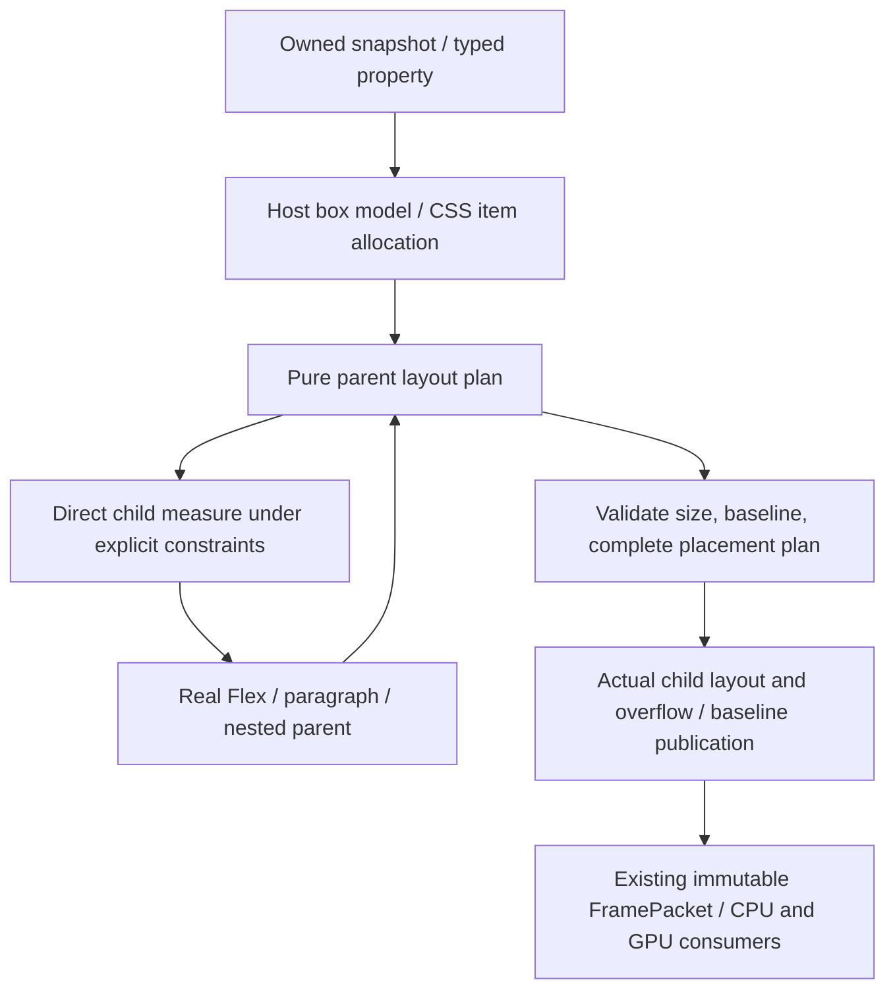

# Owned custom parent layout

Status: implemented subset, 2026-11-16. The complete RFC goal stays active.
This stage follows [inline constraint builders](RETAINED_INLINE_CONSTRAINT_BUILDERS.md).

## Contract

`ParentLayoutSnapshot::new(impl ParentLayout)` owns a pure `Debug + Send + Sync`
algorithm. Install it with `Transaction::parent_layout` or bind
`Property::<Option<ParentLayoutSnapshot>>::parent_layout`. The ordinary public
LayoutStyle host remains responsible for its outer CSS item behavior and box
model; the snapshot replaces its internal Flex child algorithm. The current
host accepts Flex/None display, not ConstraintBox, measured/text/image hosts,
or direct absolute/fixed children. Removing the snapshot restores ordinary
Flex. Snapshot identity uses Arc pointer equality: clone an existing handle
for equality, create a new one when any owned input changes.

The API does not expose Taffy, App, Window, render resources or mutable UI state:

```rust
trait ParentLayout {
    fn layout(
        &self,
        input: ParentLayoutInput,
        children: &mut dyn ParentLayoutChildren,
    ) -> Result<ParentLayoutOutput, Error>;
}
```

- `ParentLayoutInput` contains assigned content dimensions, soft available
  space (including normal Unbounded and explicit intrinsic modes), and separate
  established percentage bases. A known content dimension must be preserved
  exactly. A finite soft maximum does not establish a percentage basis.
- `ParentLayoutChildren::measure(index, ChildLayoutInput)` addresses only direct
  children, in layout order. It runs the real cached child algorithm, including
  nested Flex, custom parents, images and owned paragraph measurement. Each
  child input explicitly supplies hard border-box bounds, available space and
  percentage bases. Measurement cannot construct or retire logical children.
- `ParentLayoutOutput` returns a content size, optional first baseline and one
  `ParentPlacement` for every child, including hidden children. Placements carry
  each child's final input and physical content-box origin. Hidden subtrees
  remain zero. Placement order cannot reorder paint/hit output.
- The parent owns direct placement: direct child margin, relative inset and
  Flex grow/alignment do not place the child. These work normally inside child
  Flex containers. Origins are physical, without automatic RTL mirroring;
  common host padding/border/RTL scrollbar insets still apply.
- Host preferred/min/max/intrinsic sizing, aspect ratio, hard outer bounds,
  containment and insets use the common kernel. Unknown width is selected before
  dependent height with one remeasurement, never an iterative fixed point.
  Baselines, scroll overflow and descendant OOF candidates flow through normal
  publication. Direct OOF children reject before layout; deeper CSS OOF nodes
  retain the existing containing-block path.

A client algorithm in `parent_layout/tests.rs` demonstrates a stack that measures
real children at the allocated width and places subsequent children below their
content. It is a test client, not another built-in special-case layout strategy.



## Failure and publication

Reject nonfinite/negative sizes, invalid percentage bases or intervals, failure
to preserve known dimensions, missing/duplicate/out-of-range child indices,
nonfinite origins/endpoints and baselines outside the content height. Arbitrary
delegate errors map to `InvalidParentLayout`. No error result is stored as a
successful final cache entry. A nested error is sticky for the layout invocation.

UiTree computes dirty layouts on a private Taffy clone whenever custom parents
exist. On error, live layout/cache and observer writes remain intact; the last
published frame/geometry remains usable. A preceding ordinary property/source
transaction is still a committed transaction. Use `LogicalUi::edit_frame` to
roll back sources, lifecycle, layout and frame together. Panic, external side
effects and warming a shared paragraph cache are not rollback guarantees.
Delegates must be pure even though Rust cannot enforce that with `&self` alone.

ContainerQuery rejects a host with a custom allocator anywhere in its ancestor
chain. Inline dependency proofs stop at custom parents. The existing CSS
fixed-size/Column/containment proofs cannot authorize arbitrary sibling and
cross-axis dependencies. ParentLayout sinks join responsive computed-sink
dependency checking. Automatic query/delegate dependency declarations are open.

## ADR: keep Taffy as an owned algorithm kernel, extend its parent protocol

**Decision:** retain the vendored Taffy Flex/Grid/Block/leaf algorithms and add
an owned sparse delegate table plus high-level dispatch. Framework types and
the snapshot lifetime remain public; backend and Taffy structures stay internal.

**Alternatives:** a leaf callback cannot allocate/place real child nodes. Changing
paint positions after Flex produces conflicting measurement, overflow and hit
truths. A complete replacement Flex engine duplicates a large semantic surface
without current evidence of benefit. Fixed container presets would not provide
the requested extensibility.

**Cache consequence:** ordinary Taffy ComputeSize entries retain only size and
omit vertical percentage basis in matching. Arbitrary policies can observe
both that basis and baseline metadata. Invocations with any custom allocator
therefore bypass both reads and writes of lossy ComputeSize caches throughout
the invocation, including ordinary ancestors. Exact PerformLayout entries are
still reused. This avoids incorrect child baselines and stale dimensions without
enlarging every ordinary node's ten cache entries. A future exact measurement
cache should be separately designed/profiled, including requested-axis and
size-definiteness semantics. There is no measured speedup claim here.

**Costs:** sparse Arc delegate entry per custom host, one Option handle per
retained node and pending patch, a custom-host index, map lookup per cache miss,
allocation of a placement plan and validation bitmap per callback, O(tree) Taffy
clone for dirty custom layout, repeated pure callbacks for intrinsic/selected
width/final allocation, and more ComputeSize work. No new Style/Display/GPU
format or per-Taffy-node cache payload. Snapshot replacement may allocate an
adapter Arc; unchanged handles do not. Ordinary trees retain the in-place layout
and observer journal path. Indexed delegate preflight is O(custom hosts × depth).

## Evidence and remaining scope

See [validation commands and observations](performance/2026-11-16-custom-parent-layout/README.md).
CPU compares custom parents with independently authored forced-full ordinary
Flex trees. Real Noto glyphs and an explicit WGPU readback test cover actual
consumers, rather than only checking callback return values.

This is the general pure parent measurement/placement primitive, not complete
Flutter RenderBox. Atomic LocalFrame edit output is implemented in the
[subsequent stage](RETAINED_ATOMIC_LOCAL_EDITS.md). General full-axis
content-sized structural builders, automatic dependency scheduling, query +
structural plans, intrinsic/percentage/cyclic/baseline conformance, device rounding,
incremental rollback and exact measurement caching remain open. No new modern
GPU effects, sustained 60/120Hz, visible presentation, input-to-visible tail or
CPU smooth-delivery qualification is claimed.
