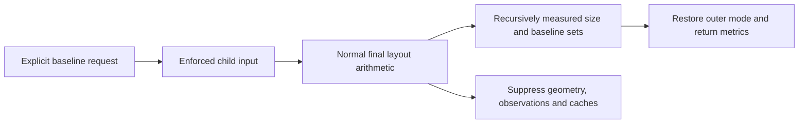

# Explicit complete baseline queries

Status: experimental framework protocol, 2026-11-17. Extends
[pure parent metrics](RETAINED_DRY_PARENT_MEASURE.md). Full RFC acceptance and
complete RenderBox/intrinsic semantics remain open.

## Contract and API

```rust,ignore
let metrics = ui.dry_measure_node_baselines(node, child_input)?;
let child = children.measure_baselines(child_index, child_input)?;
```

UiTree, ReactiveUi and LogicalUi expose the first query; ParentLayoutChildren
exposes the second, available in both pure ParentMeasure and full ParentLayout.
Inputs remain the existing direct-child border-box hard bounds, soft space and
independent percentage bases. Independent inline/full assignments override child
requests exactly as for ordinary measure; parent metadata and known-dimension
definiteness retain their existing semantics. There is no platform/backend borrow.

This query returns the baseline sets exported by the kernel's actual final
container algorithm for **the same input**, with logical unrounded border-box
offsets. It does not run the existing parent's allocation, include the queried
root's margins/OOF positioning, or return a frame/overflow/location. A missing
baseline means the supported final algorithm exports none, not that every CSS
baseline type has been implemented. Layout containment/hidden suppress them.
Raw Grid still exports only its supported first baseline; this change does not
add last-baseline sharing or writing modes to Grid or the public Flex API.

`dry_measure_node` / `children.measure` remain size-oriented. Ordinary Flex can
skip placement when dimensions are known, and size caches may omit metadata.
Callers needing complete baseline sets must opt into the new query. No global
replacement of size measurement, LayoutInput field or RunMode variant is added.

## Kernel isolation

The owned Taffy adapter executes normal final placement **arithmetic** in a scoped
scratch mode. It reuses existing direction/wrap, line distribution, alignment,
first/last group export, padding and containment rules; no separate baseline
layout algorithm duplicates them. It recursively runs required descendant work.
Custom parents may execute complete plans, including final metric agreement.

During scratch execution the adapter:

- Bypasses all layout/size cache reads and writes. A size hit can lack baselines;
  a final-layout hit implies geometry was committed, which scratch queries must
  neither rely on nor falsely authorize.
- Suppresses unrounded geometry writes and observer callbacks, hidden cache
  clears, detailed Grid writes and final constraint/custom/contained input
  observations. Existing builder proofs continue to refer to actual allocation.
- Skips OOF placement and hoisted-list mutation: OOF descendants contribute no
  in-flow size/baseline. Returned scratch OOF/overflow data is discarded.
- Restores the surrounding execution mode for nested queries and keeps nested
  errors sticky. An error cannot be cached as successful; atomic framework
  edits retain old sources, geometry and packets.

Public UI queries still use the existing private full-tree clone for owned
context isolation. Raw kernel callbacks receive mutable NodeContext and can
mutate it; this facility does not make arbitrary user code pure. Shared paragraph
memo warming, callback counters and external effects are outside rollback.
Callbacks must remain immutable/repeatable under the existing parent contract.

The low-level LayoutPartialTree hook defaults to None (unsupported). The shipped
TaffyTree explicitly implements it with suppression above. External
CustomLayoutChildren/ParentLayoutChildren default to an unsupported error rather
than claiming complete metrics from a size query or silently running real layout.



## Decision and costs

**Decision:** offer explicit complete metrics rather than silently make every
intrinsic size query perform final placement. Reuse the kernel's final algorithm
under write suppression. Keep the existing fast size path and its weaker metadata
contract, and retain independent final plan validation.

**Alternatives:** using None from a size-only hit changes parent alignment;
forcing full real layout during a probe corrupts geometry/final observations;
size caches cannot authorize complete output; a second baseline-only algorithm
would duplicate Flex's direction, wrapping and line placement semantics. A new
global run mode or per-node baseline cache would expand migration/invalidation
scope before this contract is validated.

**Costs:** a bool in the transient tree view and branches on writes/cache access.
No new per-NodeData, GPU, packet or persistent cache fields. Explicit queries
perform descendant layout calculations and allocate ordinary Flex item/line and
custom placement vectors; cache bypass means repeated queries repeat this work.
Nested custom parents may amplify it considerably. Public explicit queries still
clone the tree. No wall-time, memory reduction, p99 or sustained-rate benefit is
claimed. A bounded independently keyed metrics cache and true metrics-only
ordinary algorithms remain possible follow-up work, with separate validation.

## Evidence and limits

See [reproduction record](performance/2026-11-17-dry-baselines/README.md).
Controls compare the same-input normal full kernel and independent ordinary
Flex CPU/GPU output; they do not establish new independent CSS conformance.
Tests cover known fixed dimensions and nested actual first/last metrics, warm
size/final caches, hidden/containment, 72 direction/wrap/alignment combinations,
owned parent slot enforcement, final observation preservation and nested error
rollback. Real Noto text wraps through an ordinary nested Flex and a custom
parent; old glyph packets remain valid after owners drop.
Outer first/last alignment also matches ordinary full location/size/baselines
and CPU pixels; custom-host overflow accumulation remains a different existing
contract (right78 versus52 in that fixture), not a full RenderBox equivalence.
The subsequent [actual container overflow fix](RETAINED_OWNED_CONTAINER_OVERFLOW.md)
removes that phantom measured-size extent; the fixture now verifies full
LayoutResult equality. This does not imply arbitrary custom/Flex equivalence.

Full RenderBox/dry/intrinsic semantics, general child-style allocation and
uncontained ordinary Flex feedback builders, scheduler/incremental candidates/
global budgets, broad conformance and device precision remain open. Modern GPU
heavy effects, smooth CPU continuous complete frames, sustained60/120Hz and
display-visible input tails retain their unfulfilled acceptance gates.
