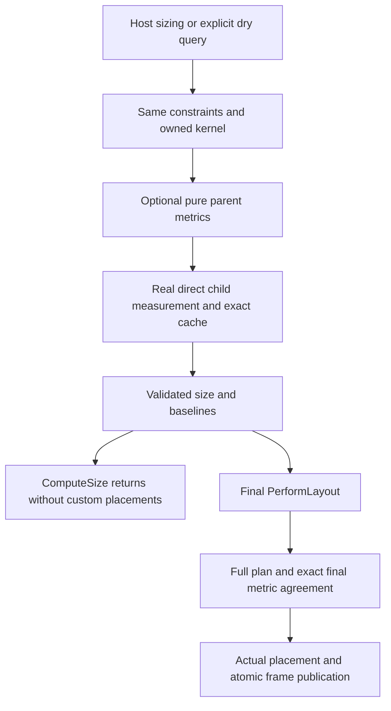

# Pure parent metrics and explicit dry node queries

Status: experimental framework protocol, 2026-11-17. Extends
[owned custom parents](RETAINED_CUSTOM_PARENT_LAYOUT.md) and
[authored parent data](RETAINED_PARENT_DATA.md). Full RenderBox and full RFC
acceptance remain open.

## Public API and input contract

```rust,ignore
trait ParentMeasure: Debug + Send + Sync + 'static {
    fn measure(
        &self,
        input: ParentLayoutInput,
        children: &mut dyn ParentLayoutChildren,
    ) -> Result<ParentMeasureOutput, Error>;
}
struct ParentMeasureOutput {
    size: [f32; 2],
    baseline: Option<f32>,
    last_baseline: Option<f32>,
}
let snapshot = ParentLayoutSnapshot::new(full_parent).with_measure(pure_metrics);
let result: ChildLayoutResult = ui.dry_measure_node(node, child_input)?;
```

ParentMeasure returns content-box metrics without a placement list. It is an
optional owned immutable phase attached to the same ParentLayoutSnapshot.
`has_measure()` reports its presence; clone retains phase identity and replacing
only the metric algorithm changes snapshot equality. Existing ParentLayout
implementors and output literals remain valid; without a metric phase the same
complete plan is used as before. New snapshots allocate one optional metric Arc;
the kernel adapter returns None immediately when absent, without running the
inline allocation phase a second time.

ParentLayoutInput retains known content dimensions, soft available space and
independent percentage bases. Every known dimension must be preserved exactly.
Output dimensions must be finite/nonnegative and each optional baseline a finite
signed content-box offset. Overflowing or negatively placed descendants can put
it outside the host height; the original in-height restriction was corrected in
the [owned overflow stage](RETAINED_OWNED_CONTAINER_OVERFLOW.md). Leaf intrinsic
metrics retain their own validation. The callback can read
immutable child metadata and measure actual direct children. Inline/full
independent assignments are enforced identically in dry and full callbacks;
requested child inputs cannot override them. No builder, source mutation,
ancestor access, backend or platform borrow is available. Interior mutation,
invocation-dependent output and external mutable state violate purity.

The optional metric phase is used inside actual custom-parent host sizing,
intrinsic and selected-width queries. ComputeSize no longer constructs the
custom host's placement vector or placement-validation bitmap when the metric
phase answers. The host box model still applies preferred/intrinsic/min/max,
aspect, hard bounds, padding/border/gutter and containment. Width selection
before height and percentage definiteness retain the existing rules; this is
not a second sizing algorithm or a change to ordinary Flex allocation.

Final PerformLayout always obtains and validates a complete plan. At the same
**final content input**, metrics from ParentMeasure must exactly equal its
dimensions and first/last baselines, before containment suppression. A mismatch
fails InvalidParentLayout rather than falling back to a different geometry.
No claim is made that arbitrary callbacks are proven equivalent for every
possible earlier intrinsic input; this remains the owned algorithm's contract.

## Explicit dry queries versus private full-layout queries

UiTree, ReactiveUi and LogicalUi expose `dry_measure_node(&self, node,
ChildLayoutInput) -> ChildLayoutResult`. Its input is a direct child's border-box
constraint interval/soft space plus **separate percentage bases**. It forces
ComputeSize through the same owned custom-child kernel, including preferred
sizing keywords and exact cache mode. Known dimensions come from tight bounds.
It does not treat a finite soft maximum as used size or percentage basis.

The query omits root margin/OOF positioning and rounding and returns size plus
available border-box baseline metadata, not location, overflow or a frame. It
does not make a node participate in its existing parent's allocation. A caller
requesting intrinsic MinContent/MaxContent must provide these modes explicitly;
ordinary Unbounded remains distinct. Parent-owned phases may intentionally
replace those requests with their enforced slots, as in real layout.

The framework clones the owned Taffy tree before querying and never publishes
its cache/layout changes, revision, dirty state, source/effect or paint output.
It can be called before the first frame or after publication. The existing
`measure_node_with_constraints` / `measure_with_constraints` continue to run a
private complete root layout, returning LayoutResult under their original root
semantics. They are not silently switched to this different input contract.

The low-level TaffyTree `measure_node_with_input` validates the node/subtree and
input, forces ComputeSize/noncollapsing margins, returns sticky nested errors
and may warm the tree's exact caches. Ordinary Flex baseline probes or hidden
algorithms can still write internal scratch layout, so raw callers must clone
for isolation. The framework already does. Hidden custom nodes invoke neither
metric nor full parent callbacks. This API does not promise all ordinary
container algorithms return full final-layout baselines during ComputeSize.
An [explicit complete baseline query](RETAINED_DRY_BASELINE_QUERY.md) now exposes
the supported final algorithm's metrics separately; full general intrinsic/
baseline conformance remains open.



## Failure, lifecycle and ADR

**Status:** implemented.

**Context:** a complete ParentLayoutOutput vector and its validation are
unnecessary when a caller needs only metrics. The former public measure query
also ran complete root layout on a clone; its isolation did not make it a pure
measurement protocol. Conflating these inputs would change margins, percentage
bases and result semantics.

**Decision:** add a separate optional pure metric phase to the owned parent
snapshot, use it in real kernel size probes, verify final metric agreement and
provide an explicit direct-child-style query on a private layout candidate.
Reuse existing measure children, enforcement and exact caches. Keep existing
full-root queries and old complete-plan fallback intact.

**Alternatives:** deriving metrics from a complete plan retains the vector cost;
an unchecked independent metric answer risks divergent final baselines; replacing
the full query would silently change its contract. Running arbitrary builder
closures during repeated intrinsic probes would break lifecycle/side effects.
Removing all private clones requires a larger layout/cache mutation journal.

**Costs:** optional Arc per snapshot, adapter dispatch for attempted dry queries,
metric computation and exact final agreement checks. Final layouts do an extra
metric query before their full plan; this can increase work. Inline phases still
allocate their slot vectors, full phases their enforced assignments. Existing
complete-input caches retain final metrics without additional cache format,
per-NodeData, GPU instance or FramePacket fields. Public queries still clone the
layout tree/maps and discard warmed private caches. No wall-time, memory or
tail-latency improvement is claimed by callback-count evidence alone.

Malformed metrics/errors, nested failures or final-plan disagreement fail through
InvalidParentLayout and are not cached as successful. Framework atomic frame
edits preserve old sources, geometry and frames; previously committed ordinary
transactions remain committed. Purity/panic/external-side-effect limitations are
unchanged. Snapshot replacement/removal/hidden/cache lifetime use the same
existing delegate ownership; old render packets own no metric callbacks.

## Validation and remaining scope

See [reproduction and evidence](performance/2026-11-17-dry-parent-measure/README.md).
Callback counts compare optional dry and original full-plan paths; independent
ordinary Flex full pixels remain the output reference. Tests include intrinsic
modes/limits, containment, aspect and hard bounds; nested custom hosts; enforced
inline/full assignment and metadata; baseline validity and deliberate final
disagreement; cache identity and query isolation; actual Noto wrapping and
offscreen GPU pixels. The finite controls do not expand independent browser
conformance or prove general metric/full callback equivalence.

Still open: complete RenderBox/dry/intrinsic contracts for arbitrary algorithms,
full baseline conformance beyond the explicit supported-kernel query, arbitrary
child-style allocation, uncontained ordinary Flex feedback builders, general
scheduler, incremental candidates/proofs/
rollback and global budgets. Broad Flex/intrinsic/percentage/cyclic/writing-mode/
precision coverage, primitive/resource/effect/native lifecycle, modern GPU effects,
smooth continuous CPU frames, sustained60/120Hz and display-visible input tails
retain their separate unmet acceptance gates.
