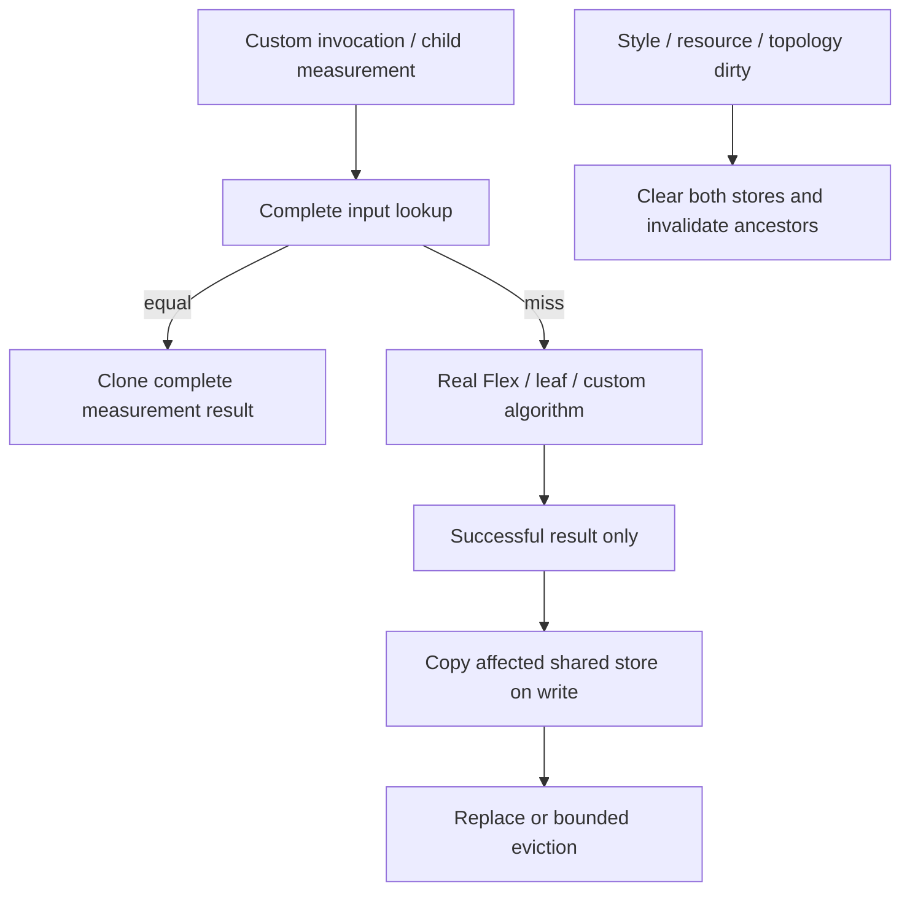

# Exact measurements for owned parent algorithms

Implemented 2026-11-16 on `codex/rendering-performance-research`. The complete
RFC remains active. This follows [the owned parent protocol](RETAINED_CUSTOM_PARENT_LAYOUT.md).

## Contract and decision

The ordinary Taffy ComputeSize cache stores size only. It can ignore the vertical
percentage basis and match a query on fewer axes; a hit reconstructs an output
without baselines or other metadata. Those assumptions cannot serve an arbitrary
parent algorithm that observes complete child measurements. The initial custom
parent stage therefore bypassed that cache throughout any invocation with custom
delegates, including ordinary ancestors.

The owned kernel now has a separate bounded exact measurement store. It compares
the complete `LayoutInput`, including both percentage bases, known dimensions
and definiteness, both available-space modes, requested axis, sizing mode,
collapsible-margin flags and hard bounds. Equality is ordinary structural f32
equality: NaN cannot produce a hit. The store retains the complete `LayoutOutput`
instead of reconstructing one from size. Baselines, overflow, margin metadata and
any other output fields survive a hit. ComputeSize remains distinct from final
layout and cannot substitute for the writes performed by PerformLayout.

No public Taffy/framework input, ParentLayout API, GPU format or ordinary
per-node cache payload changes. `ParentLayoutChildren::measure` still runs a
pure measurement; repeated equal inputs may skip the child algorithm. Custom
snapshots must remain deterministic and all owned input changes must replace
the snapshot or mark the measured resource/style/topology dirty.

### ADR: sparse complete records, without lossy cross-key reuse

**Decision:** use a lazily populated side table keyed by generation-checked
Taffy NodeId. Each measured node retains at most nine complete input/output
records; equal stores replace, full stores use bounded round-robin eviction.
Exact lookups scan at most nine records. The existing nine-slot size cache and
final-layout cache remain available for ordinary invocations.

**Alternatives:** enlarging every ordinary cache entry would charge all nodes
for a capability they may never use. Caching only custom hosts would still lose
metadata or percentage dependencies in their ordinary Flex descendants and
ancestors. An unconditional bypass is correct but repeats actual child work.
Hashing adds a key representation and allocation policy without reducing a
small bounded lookup. No general cross-axis or interval-based inference is
used for these arbitrary algorithms.

Custom invocations conservatively select exact measurement for the whole
invocation whenever any custom delegate exists in the TaffyTree. This also
protects an ordinary ancestor that measures a custom descendant. Restricting
this selection to a dependency-indexed subtree is still open. Final layout
continues to use its exact existing cache and observer journal.

## Invalidation and private previews

Style, context/resource, delegate and child/topology changes clear the node's
ordinary and exact caches and propagate to ancestors. A node with only exact
measurements must propagate invalidation even when its ordinary cache is empty;
the dirty shortcut now stops only when both stores were empty. `dirty()` counts
either store, preserving that invariant. CacheTree clearing, hidden layout,
remove and clear also retire entries. Generation reuse cannot address old data.

Removing the last delegate does not globally discard remaining exact records.
Those records still prove that a later measured-child change must invalidate a
cached ancestor. They age out when nodes change or are removed; ordinary
invocations do not read them. Dependency-indexed retirement is future work.

Each side-table value is an `Arc<ExactMeasureCache>`. Private retained/layout
previews clone map references, sharing unchanged per-node stores; inserting or
replacing a record uses copy-on-write for that node only. Cache hits do not
mutate recency, avoiding a copy on every preview read. The map itself and the
ordinary retained/layout tree are still cloned. This does not remove O(tree)
atomic candidate costs.

Errors use the existing sticky layout error: no result is stored after a child
or delegate failure. Framework dirty custom layout still runs on a private
candidate; failed caches/geometry do not replace the owner. Panic and arbitrary
external side effects are outside that guarantee. Low-level Taffy callers still
need a private candidate if they require whole-layout rollback.

## Evidence, costs and open work

[Validation evidence](performance/2026-11-16-exact-parent-measure-cache/README.md)
covers all input categories, complete metadata, bounded eviction, sparse
allocation, clone isolation, exact-only ancestor invalidation, hidden/removal
and delegate retirement. Two distinct vertical percentage bases reach a real
leaf exactly twice despite repeated requests and repeated parent passes.
Framework wrap Flex with one versus twelve identical measurements reaches the
same number of actual leaf algorithms; final geometry and complete CPU pixels
match. Direct leaf baseline replacement and real Noto paragraph glyph output
are checked separately.

The store adds one side-table/map lookup per exact query, one Arc allocation
plus bounded record storage per visited measured node, reference counts on
private clones and per-node copying on cache writes while shared. Complete
records are larger than the ordinary size-only entries. It has a per-node
entry bound, not a global byte budget or a guarantee of lower total memory.
On the tested Windows x64 default build LayoutInput is 72 bytes, LayoutOutput
88 bytes and a complete record 160 bytes. Nine reserved records are 1,440 bytes
per populated store, plus a 32-byte header, Arc control block and table overhead.
These sizes vary with enabled features and ABI; old in-flight private previews
can retain additional copy-on-write stores.
No scene-specific key or primitive-specific shortcut is introduced.

This removes the blanket ComputeSize bypass for custom invocations and proves
work reuse, not a measured frame-time or tail-latency gain. No sustained
60/120Hz, modern GPU/effect qualification or CPU smooth-delivery claim follows.
General dependency declarations, automatic structural/query scheduling,
incremental planning/rollback, broader Flex conformance and complete RenderBox
remain open.
