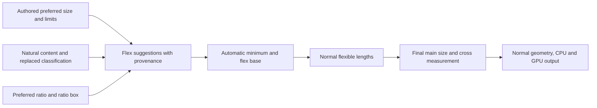

# Flex automatic minima and preferred ratio provenance

Status: experimental framework contract, 2026-11-17. Extends the public Flex
and content-contribution protocols. Complete RFC acceptance stays open.

## Contract and defect

A numeric preferred size, an automatic content contribution and a size transferred
through a preferred aspect ratio are distinct inputs. Previously FlexItem.size
eagerly filled an Auto axis from the ratio. Automatic-minimum calculation then
mistook that inferred value for an authored specified-size cap. It also did not
distinguish replaced images from ordinary content. An ordinary100px-wide child
inside a ratio2 host with explicit height20 incorrectly shrank to40 instead of
retaining its100px content minimum. Height80 incorrectly stopped at100 instead
of respecting the160px transferred suggestion.

The project-owned Flex kernel now keeps resolved preferred sizes without eager
ratio filling. Flex base size and automatic minima consume the appropriate
suggestions explicitly. Replaced elements take the smaller content/transferred
suggestion; ordinary content takes the larger. A real specified main size caps
the result, as does its definite main maximum. A preferred ratio also transfers
definite cross limits to the content suggestion. Explicit minima and scrollable
overflow retain their separate behavior. Hidden/Scroll zero the automatic Flex
minimum, while Clip/Visible retain it.

Definite authored cross sizes use their own limits, without an unrelated main
maximum overriding that axis through ratio transfer. Automatic cross sizes derive
from the final used main size and preferred ratio; ordinary automatic block sizes
retain their content minimum unless their minimum or scrollability opts out.
An automatic content minimum wins over a transferred maximum; an explicit
maximum on that axis still applies.

All transfers operate on the box selected by box-sizing. ContentBox subtracts
padding/border before ratio multiplication/division, then adds the target-axis
insets. BorderBox transfers the border extent directly. A replaced item's
automatic Column block contribution derives from its natural inline extent and
the authored ratio box, rather than blindly using bitmap height with a different
ratio box. Descendant measurement and final geometry still use the ordinary
kernel; there is no image-specific retained renderer path.

## API and architecture decision

**Decision:** correct the common Flex algorithm and preserve the provenance of
its sizing inputs, using the existing effective replaced flag. No public style,
source, primitive, GPU record or FramePacket field is added. Image snapshots and
decoded images already establish effective replaced classification; ordinary
ContentMeasure/Paragraph/custom parents remain non-replaced unless explicitly
provided through a lower-level engine style.

**Alternatives:** forcing min-width:0 hides a normal content constraint and changes
semantics. Fixing image measurement alone leaves ordinary content, captions and
nested Flex wrong. Clearing aspect_ratio before layout erases legitimate transferred
suggestions. Another parent/layout algorithm would duplicate Flex's dependencies.

Failure, private-candidate publication, style/source validation, cache invalidation
and old-packet lifetime use existing boundaries. No new callbacks or iterative
convergence loop are introduced. Layout-only changes still route through P4;
paint-only and restored identical source values retain their normal P0 behavior.

**Costs:** FlexItem gains transient replaced classification and two ratio-box
inset values; the actual struct padding/peak-byte delta has not been profiled.
Transfers add scalar arithmetic. Replaced Column contributions can query inline
metrics instead of block metrics; callbacks and cache warming can differ.
Ordinary measurement caches, exact-query guards and source-tree-frame ownership
continue unchanged. No timing, memory-saving or sustained-frame claim is made.

## Independent reference and scope

The [browser fixture and verification record](performance/2026-11-17-flex-auto-min/README.md)
use actual SVG image decode and ordinary nested Flex content, not Taffy as its own
oracle. The finite matrix spans four directions, replaced/non-replaced content,
three preferred cross sizes, size/limit/overflow variants and plain/BorderBox/
ContentBox with padding/border. It does not prove all CSS aspect, intrinsic,
percentage/cyclic or containment interactions.

Current CSS Flexbox4.5 caps content suggestions by definite cross maxima converted
through the ratio. Chromium145 retains the unbounded content width in twelve
explicit-cross non-replaced Row cases. These are separately asserted normative
deviations, not counted as browser matches. Keep both the captured actual values
and the expected spec values visible.

Normative sources: [CSS Flexbox automatic minimum](https://www.w3.org/TR/css-flexbox-1/#min-size-auto),
[CSS Sizing preferred ratio](https://www.w3.org/TR/css-sizing-4/#aspect-ratio-automatic),
[automatic content-based minimum](https://www.w3.org/TR/css-sizing-4/#aspect-ratio-minimum).
No complete RenderBox, broad Flex/CSS conformance, CPU/GPU continuous60/120Hz,
heavy-effects or display-visible input latency acceptance follows from this stage.
