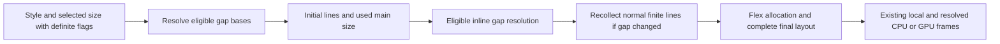

# Flex percentage gaps and selected-size definiteness

Status: implemented experimental subset, 2026-11-17. Extends the public
[selected child-size contract](RETAINED_CHILD_ASSIGNMENTS.md). The complete RFC
goal remains active. This stage fixes layout behavior; it does not establish a
frame-time, memory-saving or sustained-presentation improvement.

## Contract and examples

`LayoutStyle::gap(row, column)` uses physical vertical/horizontal gaps.
`main_cross_gap` lowers through the final Flex direction into the same inputs.
Percentages use the corresponding inner content extent when it establishes a
definite percentage basis. Padding, border and reserved gutters are excluded;
BorderBox/ContentBox retain their normal treatment of authored dimensions.

A selected numerical extent alone is insufficient. A custom parent can assign
an 84x64 border box with padding2 and mark only width definite. Ten-percent gaps
are then8 horizontally and0 vertically; marking height definite makes the
vertical gap6. Changing flags while retaining identical selected dimensions
must invalidate layout. Tight hard bounds establish their existing definite
assignment independently. Finite soft available space does not itself supply a
gap percentage basis. Numeric lengths remain active on indefinite axes.

An automatic or intrinsic content-derived Column height remains indefinite.
Three30x20 children with10% row gap produce60px height and y=0/20/40, rather
than using their own output height to create a6px gap. A definite80px content
height resolves8px gaps and positions y=0/28/56. Source updates back to auto
restore zero gaps through the ordinary style/cache path.

Normal fit-content inline layout differs: it selects a used width, then resolves
horizontal percentage gaps and performs normal wrapping at that width. Three
30px items can select90px width with a zero cyclic intrinsic contribution, then
wrap into two lines when the selected width establishes a9px gap. They retain
90px width; the algorithm does not enlarge the width to satisfy the gaps or
iterate to a fixed point. In a70px opportunity they retain70px and use7px gaps.
This stage preserves the project's existing used-inline-size rules. Intrinsic
MinContent/MaxContent queries retain their own line-collection rules.

This is a finite tested contract, not a universal CSS cyclic-percentage claim.
The CSS Gaps rule says cyclic Flex percentages resolve to zero. Whether a
selected inline extent establishes a definite basis must also follow the
applicable sizing context; not every future layout mode or arbitrary callback
assignment is covered by browser comparison here.

## Architecture decision

**Decision:** use existing `known_dimensions_are_definite` in the common
vendored Flex algorithm, without another renderer or framework-only algorithm.
Initial gap resolution masks indefinite axes. Post-content main-size gap
resolution applies to eligible inline sizing, not content-derived block sizes.
When normal finite inline layout changes a main-axis gap, drop preliminary line
views and recollect lines using the selected inner width before flexible-length,
cross-size, baseline and final-placement work. The feature-gated balanced-line
path uses its corresponding collector. No second container-size selection is
performed.

**Alternatives:** treating every known float as definite produces cyclic block
gaps and ignores explicit parent flags. Suppressing every percentage when no
authored size exists breaks normal selected-width behavior. Repeatedly resizing
the container to fit a percentage equation adds convergence and changes the
sizing contract. Assigning pixel gaps in the UI would duplicate lowering and
lose ordinary style dependencies. These alternatives were not adopted.

**API impact:** no public field/type, style payload, node, GPU record or
FramePacket field is added. The existing per-axis definite flags now affect gaps
as well as their other layout consumers. Public `.gap` documentation records
this behavior. Framework selected inputs, ParentMeasure/ParentLayout and complete
independent allocation continue sharing the same normal kernel route.

**Costs:** initial resolution adds per-axis scalar checks. Eligible automatic
inline layout with wrapping and a changed percentage gap performs one additional
item scan and replaces preliminary line descriptors. Ordinary unchanged gaps,
known-size layout, nowrap and intrinsic queries do not take that extra collector.
Balanced-line cost follows its existing algorithm. There is no new persistent
allocation, measurement callback or iterative convergence loop. Changed line
membership can necessarily change later measurement and draw work. Allocation
peaks, wall time and dense-layout tail latency were not measured in this stage.

## Validation and remaining work

[Evidence and reproduction](performance/2026-11-17-flex-percentage-gaps/README.md)
record independent Chromium145 geometry, raw browser/spec differences, normal
typed source updates with P0 restoration, pure dry baselines/hard bounds, owned
parent inputs, actual Noto glyphs and complete CPU/WGPU full-reference pixels.
The tests use independent numeric-gap controls rather than comparing two
percentage-gap executions of the same implementation. Old packets remain usable
after their UI owners are dropped.

The browser matrix includes72 wrapped Column MinContent main-size cases where
Chromium145 uses an unwrapped height. Flexbox9.9.1.3 instead requires the largest
item contribution. Tests preserve/assert the browser result before asserting
the normative three-column geometry separately; these are excluded from browser
match counts. The common intrinsic algorithm is not changed to copy that browser
difference.

Open: broad percentage/cycle/aspect/intrinsic conformance across Flex/Grid/Block,
`calc`, logical/vertical writing and automatic scrollbar prediction; complete
RenderBox and content-feedback builders, combined builder/query scheduling,
incremental private candidates/proofs/budgets; primitive/effect/native lifecycles.
Modern desktop heavy-effect GPU presentation, CPU continuous complete-frame
smoothness, sustained60/120Hz and input-to-visible tails still require separate
acceptance. Offscreen correctness does not complete those requirements.

References: [CSS Gaps percentage resolution](https://www.w3.org/TR/css-gaps-1/#percentages),
[Flex intrinsic main sizes](https://www.w3.org/TR/css-flexbox-1/#intrinsic-main-sizes),
[Flex definite sizes](https://www.w3.org/TR/css-flexbox-1/#definite-sizes).
