# Retained frames and GPU instance lifecycle

The retained runtime now consumes the same owned FramePacket values used by the
normal UI gallery in a persistent WGPU quad renderer. The feature is
`gpui-box/retained-wgpu`. Validation ran on GTX 1650 Ti with Vulkan on Windows.

## Submission flow

```mermaid
flowchart LR
    Event[GPUI click] --> Tx[Property transaction]
    Tx --> Tree[Persistent UI and Taffy]
    Tree --> Packet[FramePacket with base revision]
    Packet --> Adapter[WgpuFrameRenderer]
    Adapter --> Arena[InstanceArena slots and generations]
    Arena --> Upload[Adjacent dirty upload ranges]
    Upload --> GPU[Persistent GPUI quad buffer and bindings]
    GPU --> Completion[Queue completion serial]
    Completion --> Retirement[Release leases and retired slots]
```



FramePacket contains the complete immutable snapshot and a delta relative to its
base revision. The consumer applies deltas in sequence. If a base frame was
skipped, or a new tree/scale/device epoch appears, it synchronizes from the full
snapshot. It rejects revisions older than the current revision of the same tree.
Repeated submission of the same frame and surface produces no GPU work.

`InstanceArena<T>` allocates stable generation-checked slots, validates updates,
merges adjacent dirty slots and retains unacknowledged writes. Deleting a node
retires its handles at the last submitted GPU serial. The free list receives
those slots after completion. Reusing a slot cannot revive its old handle.

The backend uses storage buffers with geometric capacity growth, a CPU mirror
for restoring a grown allocation, and a stable binding per allocation. It draws
contiguous slot ranges in scene order. Transparent overlap and reordering retain
their order even when that requires multiple draw calls. Existing in-flight
frames retain explicit leases on old buffers and bindings during growth.

Up to three frames can be in flight in the gallery. At the configured limit the
renderer polls the oldest submission before accepting another. UI FramePacket
leases and retired CPU slots follow the same completion serial. All writes and
draws use the same WGPU queue. Errors require renderer recreation, which starts
with a complete frame snapshot.

## Validation

The first hardware stage passed 16 whole-image comparisons against the original
full GPUI renderer. Cases cover initial synchronization, color updates, adjacent
batch updates, parent translation, child reorder, removal/replacement, 32 queued
updates with slot reuse, a dropped base frame, renderer reset, target resize and
1.5× scaling, buffer growth, switching trees, transparent overlap/reordering,
alpha changes, and 10,000-object batch translation.

- One rectangle color update wrote 160 bytes in one range.
- Three adjacent colors wrote 480 bytes in one range.
- The 10,000-object translation committed once, performed zero Taffy runs and
  zero command recordings, then wrote 1,600,000 bytes in two ranges in this run.
  A live unchanged root split the reused slots into two adjacent groups.
- The queued update sequence used no image readback between its 32 submissions.
  The backend enforced its three-frame bound and the final image matched.
- The ignored hardware GPUI click test was explicitly run and passed. It opens
  the test window, clicks the normal gallery button, consumes the resulting
  frame on the GPU, reads pixels and compares them with the full reference at
  the window's actual device scale.

Core tests separately check deferred slot reuse, stale/foreign handles, dirty
range merging and rejection of inconsistent frame identity/revision metadata.
They avoid depending on whether a fast GPU has already completed a submission.
The retained-wgpu core configuration passed 11 tests. Both normal-click tests
passed, including the explicitly enabled hardware case. Core, shared-example
and hardware-runner Clippy checks passed with `-D warnings`. The desktop
executable built with the retained-wgpu feature. The WGPU dependency also compiled
with the new retained feature disabled through the existing gpu-backend check.

The complete validation artifact includes screenshots, adapter information,
source hashes and structured results in the [evidence directory](performance/2026-11-11-retained/README.md).

## Reproduction

```powershell
./tooling/rendering-perf/run-retained-gpu.ps1 -Output target/retained-runtime-gpu
mise exec -- cargo test --locked -p gpui-box --features retained-wgpu
mise exec -- cargo test --locked -p gpui-box-example-hello --features retained-wgpu normal_click_reaches -- --ignored --nocapture
mise exec -- cargo run --locked -p gpui-box-example-desktop --features retained-wgpu -- --retained
```

The gallery paints its visible output through the existing GPUI window path and
also submits each published frame to the persistent offscreen WGPU consumer.
Native-window surface presentation remains an integration task. This provides
normal event-to-GPU coverage with pixel readback while the platform backends
continue to be integrated.

## Remaining scope

Current retained GPU records cover rectangle geometry, solid background color,
inherited translation, rectangular clipping and resolved scroll. They accept
alpha with the existing ordered blending semantics. The subsequent
[property/damage stage](RETAINED_PROPERTIES_DAMAGE.md) extends the original
16-case evidence with 10 pixel scenarios and completed-work timing comparisons.
The [group-compositing stage](RETAINED_GROUP_COMPOSITING.md) adds isolated group
opacity, effect chains and layer-content reuse. Full affine transforms,
transform/clip indirection on the GPU, text/image resources and the remaining
primitive types are still in the active goal.

Frame generation and validation currently scan the full snapshot. The consumer
uploads only changed instances after sequential updates, but a complete CPU
scene update still has this traversal. Highly fragmented draw order can create
many draw calls. Segmented order storage and selective geometry updates remain
performance work. The original validation measures correctness and upload payloads;
the property/damage stage adds a bounded-queue throughput comparison.
Continuous animation latency, cache budgets and other native platform
backends require their own measurements.

Renderer reset exercises allocation-epoch reconstruction with the available
device. Forced device loss, platform surface loss and font/image resource epochs
still need dedicated fault injection and recovery tests.
