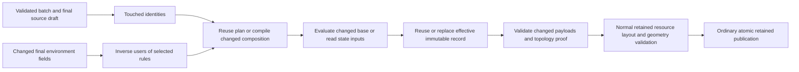

# Incremental pure-style planning over immutable UI records

Status: experimental Rust implementation,2026-11-18. The complete RFC remains
active. Extends [typed composition](RETAINED_TYPED_STYLE_COMPOSITION.md) and
[owned UI input](RETAINED_OWNED_UI_INPUT.md), without a new layout solver or
application-selected fast mode.

Follow-up: [adopted-frame input routing](RETAINED_UI_INPUT_ROUTING.md) advances
the source model to schema3 and adds interaction metadata plus publication input
scenes. This stage's schema2/timing evidence below remains historical; no timing
claim here automatically transfers to the larger input-enabled source model.

## Contract and dependency model

`StylePlan::new(&[StyleRef])` compiles the ordered composition once. It owns the
StyleRef handles and stores the selected style/declaration index per atom;
condition values remain in immutable definitions. The plan selects complete
rules before evaluating conditions, preserving caller overrides, Initial,
shorthands and winner diagnostic positions. `StylePlan::resolve` returns the
same public resolution/winners as standalone resolve. Standalone resolve builds
a temporary plan; callers can retain a plan for repeated state/environment input.

`StyleDependencies` exposes the pure inputs read by selected rules: hovered,
pressed, focus_visible, disabled, selected, viewport width, direction,
reduced_motion, touch and pointer. Dependencies from overwritten declarations
are absent. All cases of each winning rule contribute, even cases not currently
matched; changing an earlier conjunction input can make another case relevant.
These are expression dependencies, not event subscriptions, geometry proofs or
permission to evaluate on a compositor thread. Current conditions do not read
environment height/device scale/application zoom/text scale. Those values still
validate and are stored; changing them alone does not reevaluate Style IR.

UiDocument caches one immutable plan per styled node and maintains five inverse
environment-user sets. Each accepted batch records touched node identities;
only those plus users of final changed environment fields are considered for
style work. Final environment/state values are used once; transient valid
changes restored in the same batch do not trigger extra evaluation.

- Changed definition list rebuilds that node's plan and membership before final
  resolution, including a newly introduced dependency in the same batch.
- Changed authored layout/properties reevaluate the selected rules over the new
  base, even when overlays hide the changed base field.
- State changes reevaluate only when a selected rule reads a changed flag.
- Content/child lists/unread state copy source metadata into the effective
  record while reusing prior effective layout/properties. They still enter
  normal resource/topology/layout invalidation and final validation.
- Equal reconstructed definitions keep the old plan by value equality. A final
  equal source record reuses the effective record unless a read environment
  input changed. Equal newly computed effective output also reuses its record.
- Node removal retires the plan and inverse membership; slot+generation keys
  prevent replacement from inheriting stale subscribers. Snapshot recovery
  rebuilds plans and membership from complete authored state.

Authored/effective node maps hold `Arc<UiNode>` records. Candidate map cloning
shares unchanged records, child vectors and StyleRef lists. Mutation copies a
touched authored record with Arc::make_mut; unchanged effective records share
their old ownership. Unstyled records can share between both maps. Snapshot
export remains owned UiNode values, and node()/resolved_node() retain their
read-only public signatures. This does not turn UiDocument into a multi-writer
owner or make the Taffy tree transferable.

## Publication diagnostics and atomicity

UiPublication gains `planning: UiPlanningStats`: topology_validations, nodes_considered,
style_plans_built, styles_evaluated and effective_records_reused. These count
source/style work in this call; topology_validations counts complete source graph
proofs (one for snapshot/recovery/structural batches, zero for attribute-only
batches). Other counters exclude payload validation, map
cloning, layout candidates, layout, extraction/raster/GPU and presentation.
An exact batch replay returns zero planning counts because it performs no
planning. Initial snapshot/recovery counts full plan construction and evaluation.
This output-only diagnostics addition does not change UI_SCHEMA_VERSION2 or
the source message fields. It remains an experimental Rust API, without frozen
wire/foreign ABI.

Immutable StyleRef also caches validated declaration/case/maximum value-work
counts at construction. Receiver limits consult these owned counts, including
unselected values, without rescanning definitions. Pointer identity proves
equality for a shared immutable definition/record; distinct instances retain
value equality. Normal staging skips property comparison for shared unchanged
effective records. Dense effective-record changes use a sorted merge when
estimated logarithmic searches exceed one complete map scan; sparse changes
use normal map replacement. This choice depends on map density, not UI shape.

Create/Children/RemoveSubtree batches validate the complete source graph. A batch
that has none of those operations cannot change identity/edges, so it reuses the
already accepted rooted-graph proof and validates touched final payloads plus
the content-leaf invariant. Selected style resolution validates its full output
but cannot change identity/children/content. There is no second identical graph
walk over effective records. This follows from the closed typed operation set;
future operations that mutate topology must join this classification. Normal
TreeEdit candidate/resource/layout and complete geometry validation remain.

The adapter evaluates a private cache draft along with its source/effective
drafts. Plans, membership, records, environment and source sequence are installed
only after normal stage/layout/geometry validation succeeds. Invalid combined
rules, resource/topology/host failures cannot retire live dependencies or install
new ones. Numeric/declaration/limits checks still apply even if a later operation
overwrites the value; skipping pure evaluation does not bypass input validation.

## ADR and costs

Decision: compile immutable ordered rules once and derive invalidation from
their actual typed input reads. Share immutable node records across ordinary
private input candidates. Preserve final-state validation and the existing
retained layout/render path. No new caller dirty hint or trust flag is required.

Alternatives: scanning all rules for every hover wastes repeated selection work.
Caching only the currently matching branch misses future conjunction changes.
Indexing overwritten rules is correct but causes unnecessary work. Using source
revision as the sole cache key invalidates all styles every batch. Reusing a
failed candidate's membership would break later updates. Removing full topology/
geometry validation requires separate proofs, outside this step. Source topology
can reuse its already accepted proof for the typed nonstructural operation set.

Costs remain explicit: authored BTreeMap directories still clone O(N) entries
with Arc increments; effective maps clone for sparse edits or rebuild by a
complete ordered merge for dense edits. The plan map clones handles. Generation/mapping/hit maps,
source topology validation on structural batches, resource scans, complete tree candidates,
layout and complete geometry validation retain prior costs. First mutation of a
shared environment membership set copies that set. Definition replacement scans
its declarations and allocates plan storage; each selected atom retains indices,
each styled node retains handles/plan metadata and membership can appear in up
to five sets. Dense changes still reevaluate all affected rules and allocate
changed records. All selected cases contribute conservative field dependencies;
there is no threshold interval index or property-by-property result cache.

Internal value-only evaluation omits winner-map entries, while explicit public
resolve keeps diagnostic winners. This is not silent omission of validation:
the selected complete layout/properties are validated in both modes. Arc
allocation/indirection/refcounts and plan/index memory require measured budgets;
no total-memory reduction follows from sharing alone.

The validated work-count cache adds four usize values per immutable definition,
not per use. Dense merge temporarily retains ordered changed records/entries;
its density heuristic compares an estimated map search height against a full
scan, not an online frame-time predictor. A shared StyleRef pointer shortcut is
valid because construction validated all branches and the storage has no public
mutation. Distinct newly constructed definitions still compare their full values.

## Verification and remaining scope

See [evidence and reproduction](performance/2026-11-18-ui-style-planning/README.md).
Finite CPU/GPU outputs and real text continue to use direct ordinary full-tree
controls; new differential checks reconstruct complete snapshots to verify
invalidation, authored/effective equality and complete layout/pixels.

This is incremental **pure-style** planning. Automatic structural builder/query
scheduling, arbitrary content feedback, full RenderBox, tokens/theme/inheritance,
handlers/focus/semantics, Store/Command/macros, portable ABI, global budgets and
independent native presentation remain open. It does not prove sustained60/120Hz,
CPU complete-frame smoothness, modern desktop heavy effects or full input tails.
